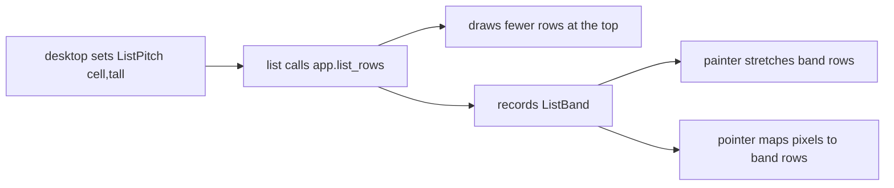

# Channels UI polish batch

Six fixes to the channels app in aura-ui-terminal and aura-desktop: TASKS and to-do clicks open the assigned agent, Finished to-dos lists its items, INFO, QUEUE and HISTORY are restyled through shared widgets, and single-line list rows get 30% more height on the desktop. Shipped as one PR from aura/channels-ui-polish-batch-rus206.

## Todos

- [ ] Read replies from RUS207, RUS204, FEN6 and RUS198; adjust file plans
- [ ] Item/Todo rows and drawer items open the assigned agent; tests for click and Enter
- [ ] Fix Finished to-dos: start offset in fit, history_scroll, wheel; tests
- [ ] INFO top as CHANNEL section with indented lines; test
- [ ] Shared StatusDot, detail_row, Info::marked_section and Info::link in aura-ui-widgets
- [ ] QUEUE restyle, web field in MergeQueueView and aura-app, branch click and hover; tests
- [ ] HISTORY restyle like MEMBERS via shared rows; tests
- [ ] ListPitch/ListBand in aura-ui-terminal, Body::list and split_pinned use it; tests
- [ ] Desktop paints bands at 1.3 rows and maps the pointer through them; tests
- [ ] STYLEGUIDE.md sections and changelog.d fragment
- [ ] fmt, clippy -D warnings, tests for touched crates, file-size check
- [ ] Merge main, push, open PR, gh pr merge --match-head-commit, report to COO2

<!-- end of generated header: edit below -->

## What is wrong today, and why

**Finished to-dos looks empty.** The to-do drawer (`renderer/todo_drawer/rows.rs`) fits its entries with `fit`, which always starts the window at the item in progress and caps it at `MAX_TODO_ROWS` (10). Open items take two rows each, so four of them plus the "Finished to-dos" row fill all ten rows. The opened history's closed items land after the window, and the `+N more` row counts them (29 here). No closed item ever gets room while open items fill the drawer, and the drawer cannot scroll.

**Clicking a task row opens nothing useful.** In TASKS, an `Item` row (an item of the coordinator's to-do list, shown as `→ RUS3`) opens the agent of the request the item is on. In a channel that is the coordinator, already on screen, so the click only says "co is already open". The drawer's items show their assignee but take no clicks at all.

**INFO, QUEUE and HISTORY** each lay out their tops differently from the rest of the side panel. Each panel also has its own bold or colored text.

## How the fixes work

### 1. Task rows open the assigned agent (`app/tasks/actions.rs`, `app/todo_drawer.rs`)

- Split `open_selected_task_agent` into `open_assigned_agent(&mut self, agent_id: &str)`. A member of the open channel opens as a member's chat (`open_channel_member`), any other agent goes through `request_agent_switch`, and the agent already on screen keeps the "already open" note.
- `Item` rows open the item's assignee, matched with `find_assignee` (made `pub(in crate::app)`) among the channel's members and then all agents. If there is none, they open the agent of the linked task (`link`). If that is missing too, they do nothing: they no longer fall back to the request's agent.
- `Todo` rows open the agent of the task doing the todo (`todo.task`), else the matched assignee. A todo with neither still opens its plan, as now. `Task` rows are unchanged: an empty `agent_id` does nothing.
- Click and Enter both go through `open_selected_task_row`, so they agree.
- The drawer records a hit rect per item row as it draws (`TodoDrawer::item_hits`). A left press on one opens its assignee through `open_assigned_agent`. An item with no agent does nothing. The drawer has no keyboard highlight, so Enter applies to TASKS only. That is the safe default; the docs say so.

### 2. Finished to-dos lists and scrolls (`renderer/todo_drawer/*`, `app/todo_drawer.rs`)

- `TodoDrawer` gains `history_scroll: usize`, the first entry shown while the history is open. Opening the history sets it to the "Finished to-dos" row's index (the count of open items), so the closed items show at once. Folding the history resets it.
- `rows::fit` takes that start. With the history open, the window starts there, clamped so the last page is full. `+N more` counts only the entries below the window. With the history folded, behavior is unchanged.
- The wheel over the drawer's rows moves `history_scroll` in `todo_drawer_mouse`, and the drawer uses up that event. Elsewhere on the chat the wheel still scrolls the chat. The drawer has no highlight, so this is a plain offset like INFO and QUEUE, not `WheelViews`. FEN6 has been told.
- `rows.rs` is at 453 lines. Its tests move to `rows/tests.rs` to stay under 500.

### 3. INFO top (`renderer/channel_side.rs`)

`info_lines` opens with `info.section("CHANNEL", None)`, then indented lines: `info.item("#slug")`, the title as an item (no longer bold), and the description as `info.text(.., Value::Quiet)`, wrapped. The sections after it are unchanged.

### 4. QUEUE restyle (`renderer/channel_queue.rs`, `app/apps/channels/side.rs`, shared widgets)

```text
TARGET
  main  ~/code/zode

● MERGED  a1b2c3d
  aura/feat-parser
  Agent     RE36
  Queued    11-27 20:31
  cargo test failed: parser::escapes
```

- **Status dot:** a new shared `StatusDot` in `aura-ui-widgets/src/components/status_dot.rs`. It holds the glyph `●` and a color per state (ok `success`, running `warning`, waiting `muted`, failed `error`). I've asked RUS204 for the Integrations panel's dot. If one exists on main when I build, use it instead and map merge states onto it.
- **New `Info` methods** in `components/info/mod.rs`. `marked_section(dot, title, note)` is a section title led by the dot; the title is in `secondary` like every section title, never bold. `link(text) -> usize` is an indented `foreground`, underlined line that returns its line index for hit testing.
- **The entry:** each entry's header is `marked_section` with its state and short sha, then the branch on its own line via `link`, then the facts. Facts use only `Value::Plain` and `Value::Quiet`: Overlaps is no longer `Flag` and a failure's detail is no longer `Error`. No bold and no `Modifier` anywhere.
- **The link target:** `MergeQueueView` (`aura-ui/src/events/views/merge_queue.rs`) gets `#[serde(default)] pub web: Option<String>`. `factory/pages.rs::views` fills it once from the queue repo's GitHub remote, using `repo::github_repo` (made `pub(crate)`), and passes it to `queue_view`. The branch URL is `{web}/tree/{branch}`, with each path segment percent-encoded. Without `web` the branch is plain text and not clickable. I've asked RUS207 about this. If they object, keep the field and leave the aura-app side to them.
- **Clicks:** the renderer records `(line index, url)` pairs and the rows area with `set_channel_queue_links`. `processes/mod.rs` routes a QUEUE click to `click_channel_queue`, which calls the existing `open_link` (made `pub(in crate::app)`; tests read `opened_links`). Hover uses a new `HoverTarget::QueueBranch(line)`.

### 5. HISTORY restyle like MEMBERS (`renderer/channel_history.rs`)

- Drop the bold `Your messages · N` heading; MEMBERS has none.
- Each item keeps its two rows. The first is a `list_row` with a kind mark in the icon column (`#` a post to members, `→` typed to the coordinator, `P` a `/plan` request) and the message in `foreground`.
- The second row is muted, under the text: `20:31 · to members`, `to the coordinator`, or `plan · RUS3`, with the planner's code read from the channel's members. It is drawn by a shared `detail_row`, MEMBERS' `status_row` moved into `aura-ui-widgets` (`components/detail_row.rs`). `channel_side.rs` then calls the shared one. I told RUS198.
- The fill for highlight and hover is `cell_style` on both rows, as MEMBERS does. Scroll, wheel and click code in `history/mod.rs` does not change.

### 6. 30% taller single-line list rows (shared, exact on the desktop)

**The terminal choice.** Rows are whole cells, so 1.3 rounds to 1. The whole-cell options are +0%, +100% (a blank row per item, which halves what a 200-agent channel shows) or a spacer every third row (uneven rhythm, and the highlight jumps). The terminal keeps one cell per row, and the report will explain this.

**The desktop draws 1.3 rows exactly**, rounded to whole pixels: `tall = round(cell.height * 1.3)`.



**On the terminal side (`app/list_bands.rs`, new):**
- `ListPitch { cell, tall }` defaults to 1/1, and `App::set_list_pitch` sets it.
- `App::list_rows(panel, rows) -> Rect` returns `rows` with its height cut to `floor(h * cell / tall)` (at least 1). It records a `ListBand { columns: panel.x..panel.right(), area: rows, rows: shrunk }`; the borders are included, so `│` and the scrollbar stretch with the rows.
- The shared choke points call it: `Body::list(app, panel, inner, focused)` in `renderer/chrome.rs`, used by SANDBOX, REPO, PROCESSES, TRACE, TASKS, KERNEL, MEMBERS and INBOX instead of `Body::new`, and `split_pinned` in `renderer/agents/mod.rs` for CHANNELS, PROJECTS, AGENTS, ARCHIVE and BENCH.
- Two-row items (channel MEMBERS, HISTORY, the drawer) are not single-line and are left out.
- Scroll, highlight and hit testing are unchanged, because the list really has fewer rows.
- Bands are cleared at the start of `render`. Right after the content panels draw, `capture_list_bands(buffer)` copies each band's cells. In `drop_covered`, `cover_list_bands(buffer)` marks the per-row column spans that menus or modals drew over.

**On the desktop side:**
- `shell::refresh::render_front` sets the pitch each frame (a no-op when unchanged) and keeps `tui.list_bands()` beside `prose`. That goes in a new `shell/bands.rs`, because `shell/mod.rs` is at 500 lines.
- `paint` cuts rows at band edges. It paints band row `k` from the band's own cells with a second `RowCache` and a brush whose cell is `tall` high, at `band_top + k * tall`, so text is centered and box lines join.
- The pixels left at the bottom of the band are filled from the first remainder row, clipped. The other grid rows under the band are skipped. Covered spans are painted from the grid at normal positions into the `top` layers, so menus stay on top.
- `Shell::cell_at` maps a pixel inside a band to `area.y + k`, or to the first remainder row below the stretched rows.
- `LIST_ROW_EM = 1.3` lives in `theme.rs`.

## Docs, coordination and shipping

- **STYLEGUIDE.md:** Status Indicators gets the status dot. Panel Bodies gets QUEUE and the new HISTORY layout, plus INFO's CHANNEL section and the `marked_section`/`link` rows. The Chat Column gets the drawer's scrolling history and its clicks. Weight and Slant: no bold in QUEUE or HISTORY. The Desktop Window gets list rows at 1.3 rows, with the terminal choice explained.
- **Changelog:** a new fragment, `changelog.d/channels-ui-polish-batch-rus206.md`.
- **Replies:** check them before touching shared files: RUS207 for `factory/*`, RUS204 for the dot, FEN6 for the drawer wheel and list renderers, RUS198 for `channel_side.rs`. With no reply, go ahead as described and name the files in the report.
- **Build split:** the work can go to three subagents with disjoint files. One takes spacing (terminal bands and desktop), one items 1 and 2, one items 3 to 5. I do the docs, the checks and the ship.
- **Checks:** `cargo fmt --all`; `cargo clippy -p aura-ui-terminal -p aura-ui-widgets -p aura-desktop -p aura-app -p aura-ui --all-targets -- -D warnings`; `cargo test` for each of those crates; `bash scripts/check_file_size.sh`.
- **Ship:** merge the latest `origin/main` and push without force. Then `gh pr create` and `gh pr merge --merge --match-head-commit <sha>`. Report the PR link, the merge commit, why the finished to-dos were empty, and the spacing choice.

## Tests that prove it

| Area | Test |
|---|---|
| Click/Enter | In `app/tests/channel_tasks.rs`, a click and Enter on an Item row assigned to a member open that member's chat; a Task with an empty agent and an unassigned Item do nothing. A drawer item click opens its assignee; one with no assignee does nothing. |
| Finished to-dos | With 4 open items and 29 closed, opening the history shows `✓` rows with `RUS3 · done`. The wheel moves the window. `fit` table tests cover the start offset. |
| INFO | The screen reads `CHANNEL`, then `  #zode` and the indented title, with no bold span. |
| QUEUE | The entry has its header line with `●` in the state color, the branch on its own line, and no BOLD and no color on text spans. Clicking the branch records `https://github.com/o/r/tree/aura/x`. With no `web`, it records nothing. `queue_view` fills `web`. |
| HISTORY | Two rows per item: the mark and text, then the muted `time · kind`. No heading and no bold. A click still jumps. |
| Spacing | `list_rows` is the identity by default. With pitch (18, 23), 20 rows become 15, and CHANNELS keeps its highlight in view. A menu over a band marks covered spans. Desktop: band row `k` paints at `top + k * 23`, and a pointer at the second stretched row hits row `area.y + 1`. |
