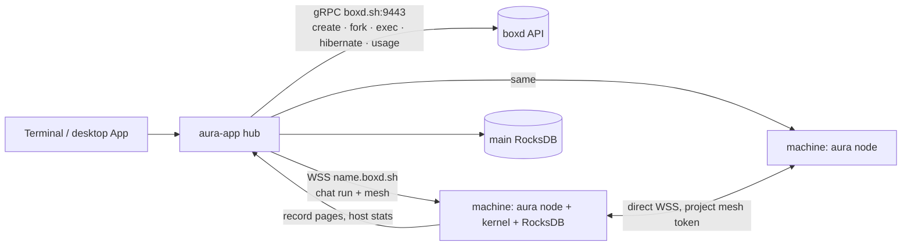

# Cloud agents on boxd machines

Let any agent run in its own boxd microVM instead of on this machine. Machines start from a per-project snapshot that already has the build done and the aura node running, or fork from a running parent in under 200 ms. They hibernate when idle, wake in about 100 ms and are destroyed when the agent is archived. Their records sync back to the main RocksDB, and cloud and local agents message each other through one mesh. A local/cloud switch sits under the chat input, and a HOST tab after PROCESSES shows the host's vital facts, local or cloud, with boxd's metered costs. The boxd API key is set in a `.env` file.

## Todos

- [ ] Add shared .env loader (cwd upward, then AURA_HOME/.env) used by all three entry points
- [ ] Add CloudConfig with BoxdApiKey/BOXD_TOKEN, MachineSize, reload, .env.example block and .gitignore
- [ ] Add aura cloud setup: detect boxd CLI, offer installer, auth login, mint key into ~/.aura/.env
- [ ] Add SystemKind::Vm/Placement, VmPayload, VmUsage, PriceRates and mesh/sync/host wire types
- [ ] Create aura-engine-cloud: vendored proto, tonic client, key-to-JWT TokenSource, VmProvider, fake
- [ ] Implement VmFleet: create/fork, claim, idle hibernate, wake, destroy, orphan sweep, limits, ledger
- [ ] Build base and project snapshots (memory + disk) with fingerprints, delta apply and builder TTL
- [ ] Add node claim/rebind and endpoints: mesh WS, sync import/seal/traces, /v1/host, workspace patch
- [ ] Add append_replica_batch and the ReplicaSink record/memory/trace mirror
- [ ] Implement the single-writer local/cloud/fork hand-off and the patch pull-back
- [ ] Drive cloud agents' turns through the remote chat session in the event loop
- [ ] Add RemoteRouter, hub directory and direct machine-to-machine mail with project mesh tokens
- [ ] Persist placement per agent and project; archive and remove-project destroy machines
- [ ] Add the footer local/cloud switch, /cloud and /local, and the setup notice
- [ ] Add CostModel: boxd metered usage rows, live estimate from samples, org usage and balance
- [ ] Add HostInfoView and the publisher: local sysinfo, cloud GetVm + /v1/host, project scope
- [ ] Add the HOST tab after PROCESSES with renderer, keys, buttons, /host and the agents-list marker
- [ ] Update invariants, check_invariants.sh, deny.toml, architecture/api/configuration docs
- [ ] Env, setup, secrecy, client, fleet, snapshot, cost, replica, hand-off, mesh, UI and live tests

<!-- end of generated header: edit below -->

## Approach

A cloud agent is an ordinary registered agent whose **kernel runs inside its own boxd machine**: a KVM microVM with its own kernel, a fixed 100 GiB copy-on-write disk and an HTTPS domain `<name>.boxd.sh`. The machine runs the stock `aura` node (`aura run --ui none`, the same entry point as `Dockerfile`).

The local app stays the **hub**. It owns the registry and the main RocksDB. It creates, forks, hibernates, wakes and destroys machines through boxd's gRPC API. It drives each cloud agent's turns over the existing wire API (`POST /v1/run` + `WS /stream/:run_id`), mirrors their records into the local store and keeps the mesh directory. Later the hub can become a web service without changing the machine side.



### What changes from the Daytona version

| Topic | Daytona plan | boxd plan |
|---|---|---|
| API | REST + bearer key | gRPC `boxd.api.v1.BoxdApi` at `boxd.sh:9443` (New York: `nyc.boxd.sh:9443`); the `bxd_…` key is exchanged for a 1-hour JWT |
| Fast boot | warm snapshot, then the delta | snapshot captures **memory and disk**: new machines resume with the build done and the node already listening (~6 ms create); `ForkVm` copies a running machine in under 200 ms |
| Sleep | pause plus a heartbeat hack, because preview traffic didn't count | hibernate (disk-only billing, ~85-156 ms wake) or standby (sub-ms wake); idle timers count real network traffic, so no heartbeat |
| Disk | 10 GiB quota problem | 100 GiB copy-on-write per machine; billed on what is written |
| Cost | estimated from list prices | **metered by boxd** (`GetVmUsage`, `GetOrgUsage`, `ListBillingActivity`), with a live estimate only for the last ~25 min not yet metered |
| VM to VM | everything relayed by the hub | machines talk directly over their HTTPS domains; the hub keeps the directory |

### Decisions I made (please confirm)

1. **Kernel in the machine, not just the tools.** Cloud agents use the node's chat-session path, so Gate routing, `/compare` and file checkpoints stay local-only in v1.
2. **The switch is per agent.** It flips the agent on screen. New agents inherit their project's last choice, and a busy agent refuses the flip.
3. **Spawning in the cloud forks.** A `spawn_agent` child of a cloud agent gets a **fork of its parent's machine**: same files, same warm `target/`, same running processes, in under 200 ms. `task` subagents stay inside the parent's machine. Set `AURA_CLOUD_FORK_ON_SPAWN=0` to keep every child in the parent's machine.
4. **Machines are created `isolated`.** boxd then leaves out the in-machine `boxd` CLI, which would otherwise be signed in as you. An agent running `yolo` can't touch your other machines, integrations or agent logins. The cost is that isolated machines can't use boxd's private network, so VM-to-VM traffic uses each machine's HTTPS domain with a per-project mesh token. `AURA_CLOUD_ISOLATED=0` switches to non-isolated machines on a per-project network (`<name>.boxd:8080`, lower latency).
5. **Code comes back as a patch.** You pull on demand from HOST or `/cloud pull`. Changes are also pulled when you flip an agent to local or archive it.
6. **The runtime talks gRPC; the `boxd` CLI is only for setup.** Your install command (`curl -fsSL https://boxd.sh/downloads/install.sh | sh`) gets you the CLI. `aura cloud setup` uses it to sign in and mint the key into `.env`. The hub never shells out to `boxd` at run time, so a key pasted into `.env` works without the CLI.

## Configuration and the API key

```dotenv
# -- Cloud agents (boxd) ------------------------------------------------------
# API key: `boxd auth keys create aura`, or the console at https://app.boxd.sh.
# Required for cloud mode. Keys are fenced to one organization.
BOXD_API_KEY=bxd_xxxxxxxxxxxxxxxxxxxxxxxxxxxxxxxxxxxxxxxxxxx
# Optional: a token you already hold (wins over the key), the API endpoint,
# and the region for new machines (unset = Frankfurt; `nyc` = New York).
# BOXD_TOKEN=
# BOXD_BASE_URL=https://boxd.sh:9443
# BOXD_REGION=nyc
# Machine size: 1x4, 2x8, 4x16 (default) or 8x32 where the org quota allows.
# AURA_CLOUD_SIZE=4x16
# Sleep: hibernate after this many idle seconds; standby first if set.
# AURA_CLOUD_IDLE_HIBERNATE_SECS=300
# AURA_CLOUD_IDLE_STANDBY_SECS=0
# AURA_CLOUD_ISOLATED=1
# AURA_CLOUD_FORK_ON_SPAWN=1
# Rates for the live estimate between boxd's meter readings (org currency).
# AURA_CLOUD_PRICE_VCPU_HOUR=0.039
# AURA_CLOUD_PRICE_MEM_GIB_HOUR=0.012
# AURA_CLOUD_PRICE_DISK_GIB_HOUR=0.00008
```

`BOXD_API_KEY`, `BOXD_TOKEN`, `BOXD_BASE_URL` and `BOXD_REGION` are the names boxd's own SDKs read, in the same order (token, then key), so one `.env` serves both.

### Where `.env` is read

| Order | File | Why |
|---|---|---|
| 1 | variables already in the process environment | the shell or CI wins; nothing overrides them |
| 2 | `.env` found from the working directory upward | today's behaviour (`dotenvy::dotenv()` in `src/main.rs`, `aura-desktop/src/main.rs`, `aura-node/src/main.rs`) |
| 3 | `AURA_HOME/.env` (e.g. `~/.aura/.env`) | **new**: the desktop app launched from a dock or menu has no project folder, so the key still loads |

- One shared helper, `aura_config::env_file::load()`, replaces the three `dotenvy::dotenv()` calls. It records which files it loaded (paths only) for `aura doctor` and the HOST tab's "credentials from" line.
- `CloudConfig::from_env()` is the only reader of `BOXD_*` and `AURA_CLOUD_*`.
- Without a key, the notice says: `Cloud needs BOXD_API_KEY: run aura cloud setup, or add it to .env or ~/.aura/.env`.
- The key is read again when `/cloud` or the switch is used with none loaded, so editing `.env` works without a restart.

### `aura cloud setup` (and `/cloud setup`)

1. Finds `boxd` on `PATH` or in `~/.local/bin`. If it's missing, shows the installer (`curl -fsSL https://boxd.sh/downloads/install.sh | sh`, or `irm https://boxd.sh/downloads/install.ps1 | iex` on Windows). It offers to run it only after a y/N confirmation, without `--yes`, so only the binary is installed.
2. Runs `boxd auth login` (browser) if `boxd auth` says you're signed out.
3. Runs `boxd auth keys create aura-<hostname>` and reads the `bxd_…` value from stdout, so it never reaches your scrollback. Writes it to `~/.aura/.env` as `BOXD_API_KEY` (mode 0600 on Unix), keeping the rest of the file, then reloads `CloudConfig`.

### Keeping the key safe

- `BoxdApiKey` and the exchanged JWT are newtypes over `zeroize::Zeroizing<String>`. Their `Debug`/`Display` print `bxd_…xxxx`. The JWT stays in memory only and is refreshed 10 min before its 1-hour expiry. A single `TokenSource` is shared app-wide, because the exchange endpoint is rate-limited per IP.
- **The key never enters a machine:**
  - The delta upload always leaves out `.env`, `.env.*` and `AURA_HOME`, even when `.gitignore` would include them.
  - The machine's env is built from an explicit allowlist (`AURA_*` runtime settings, never `BOXD_*`).
  - Per-machine node tokens are installed by `Exec`, not through env or the public domain.
- `.gitignore`: add `.env.*` with a `!.env.example` exception. On Unix, warn once when a loaded `.env` holding the key is readable by other users.

## The boxd client

- New crate `aura-engine-cloud`. It vendors the published `api.proto` at `proto/boxd/api/v1/api.proto` and compiles it in `build.rs` with `tonic-build` + `protox` (pure Rust, so nobody needs `protoc`).
- `scripts/update_boxd_proto.sh` refreshes the proto. A contract test pins the RPCs we call.
- **RPCs used:**
  - Machines: `CreateVm` (with a `MachineSpec`), `CreateVmFromSnapshot`, `ForkVm`, `GetVm`, `ListVms`, `DestroyVm`
  - Sleep and wake: `HibernateVm`, `WakeVm`, `SuspendVm`, `ResumeVm`
  - Machine settings: `SetAutoHibernateTimeout`, `SetBotProtection` (off, or API calls get a `503`), `SetDeleteAfter` (builders only), `UpdateVmLabels`
  - Exec and files: `Exec`, `UploadFileStream`, `DownloadFileStream`
  - Snapshots: `CreateSnapshot`, `GetSnapshot`, `DeleteSnapshot`
  - Account and costs: `GetOrgMachineLimit`, `GetVmUsage`, `GetOrgUsage`, `ListBillingActivity`, `ListRegions`, `Whoami`
- A `VmProvider` trait sits over it, with `BoxdProvider` and a `FakeProvider` for tests.
- One channel per region: machine calls go to the machine's region endpoint, account and billing calls to `boxd.sh:9443`. Every call has a timeout (rules.md §6.2). Cancelling an `Exec` kills the remote command, which keeps timeouts clean.
- **New dependencies:** `tonic` 0.12 (built on hyper 1, which `Cargo.lock` already has) and `prost`; `tonic-build` and `protox` at build time only. I considered driving the `boxd` CLI with `--json` instead and rejected it for the runtime path: a process spawned per call, output that changes between CLI versions, and the CLI would have to be installed.

## Snapshots and fast boot

Your local `target/` can't be shipped (112 GB, built for this host). Instead the build is done once in the cloud, and boxd snapshots capture **memory and disk**. A machine created from one resumes with the build finished and the aura node already running.

| Layer | Snapshot name | Built when | How |
|---|---|---|---|
| Base | `aura-base` | bootstrap script, size or `aura` version changes | `CreateVm` with a `MachineSpec` (`size`, `isolated`, `packages`: apt build deps `clang mold cmake libssl-dev pkg-config`, rustup with `rust-toolchain.toml`, then `aura` built from source). Waits until `packages` are met, then `CreateSnapshot` |
| Project | `aura-proj-<project id>` | fingerprint changes: base, toolchain, `Cargo.lock`, JS lockfiles, build command, size | from `aura-base`; upload the project at a commit (the `.gitignore` file set minus the env denylist), `cargo fetch`, the build/test command (`cargo test --workspace --no-run`), start the node unclaimed, `CreateSnapshot` |
| Agent | machine | each spawn | `CreateVmFromSnapshot` (~6 ms), or `ForkVm` of the parent; then the **delta** (`git diff <snapshot commit>` plus untracked files) through `UploadFileStream` + `Exec` |

- **Versions:** boxd keeps only the latest version of a snapshot name, and new machines use the new version once it's `ready`. One name per project is enough, and garbage collection is just deleting projects' snapshots.
- **Fingerprint:** the fingerprint and commit are written to `/etc/aura/snapshot.json` before capture, so each machine reports its own origin, mirrored in `AURA_HOME/cloud/snapshots.json`.
- **Rebuilds** run in the background on a fingerprint change, or once the delta passes 300 files or 24 h.
- **Builders** get `SetDeleteAfter` of 2 h, so a crashed hub can't leave them running.
- **Claiming a machine:** a snapshot's node starts unclaimed. The hub installs a fresh per-machine node token and node id with `Exec` (`aura node claim --stdin`, over a local socket). Nothing secret is shared between clones, and nothing is claimable over the public domain. After a fork, `aura node rebind --stdin` also seals every agent on the copy except the new child, so the parent's record keeps a single writer.

### Default size: 4 vCPU / 16 GiB

- This workspace compiles RocksDB (C++) and about 50 crates. Four parallel rustc/link jobs at 2-4 GiB each fit in 16 GiB without swapping.
- boxd bills **active vCPU only, and memory in use**, so idle reserved cores cost nothing. A bigger machine costs about the same CPU per build and finishes sooner.
- `8x32` is the better pick where your org quota allows it (`AURA_CLOUD_SIZE=8x32`). The fleet reads the quota and falls back to `4x16` with a notice.
- The size is fixed in the snapshot (forks and restores keep their source's size), so changing it rebuilds the snapshots.
- In-machine env: `CARGO_BUILD_JOBS` = vCPUs, `mold` as the linker (through env, not the repo's config), incremental builds on.
- **Price:** at most €0.36/h running for 4x16 with every core busy, and €0.008/h hibernated (boxd's figures). Typical agent use is far lower, because compiles are bursty.

## Machine lifecycle

The `VmState` machine per agent: `Provisioning -> Claiming -> Ready <-> Busy -> Idle -> (Standby) -> Hibernated -> Waking -> Ready`, plus `Destroying` and `Error`. It maps boxd's `running`, `suspended`, `hibernated`, `stopped`.

- **Sleep:** with no turn, background job or queued mail for `AURA_CLOUD_IDLE_HIBERNATE_SECS` (default 300), the hub closes its sockets to the machine and calls `HibernateVm`. Optional standby first (`SuspendVm`) for sub-millisecond wakes, which bills memory meanwhile. `SetAutoHibernateTimeout` of 30 min is a backstop.
- **No heartbeat needed:** boxd's idle clock counts network traffic both ways, and the hub's open mesh socket (pinged every 15 s) and the agent's LLM calls keep a working machine awake.
- **Wake:** a prompt or mail for a sleeping agent calls `WakeVm` and waits for `/health`. Any new HTTPS connection also wakes a hibernated machine, so a peer's message wakes it by itself. The hub sees the state change on its 10 s `GetVm` poll and reconnects.
- **Destroy:** archiving an agent or removing its project does a final sync and patch pull, then `DestroyVm`. After that, a background task re-reads `GetVmUsage` until boxd marks it `complete` (metering lags up to ~25 min) and records the final cost. Restoring an archived agent brings it back as local.
- **Orphan sweep at startup:** machines carry the labels `aura.install`, `aura.agent` and `aura.project`. Any machine whose agent is archived or unknown is destroyed.
- **Machine limit:** the org cap is 50 machines, or 2 without a payment method, and hibernated machines count. The fleet checks `GetOrgMachineLimit` before creating, and HOST shows `machines 7/50`.
- **Names:** `aura-<code>-<4 hex>`, e.g. `aura-re36-3f9c`. That gives the domain `aura-re36-3f9c.boxd.sh`.

## Sys transactions (the machine ledger)

- New `SystemKind::Vm` with a `VmPayload`:
  - `event`: `created`, `forked`, `claimed`, `hibernated`, `standby`, `woke`, `resized`, `snapshot_saved`, `usage`, `destroyed`, `error`
  - machine id and name, region, size, isolated, source (`snapshot <name> v<n>` or `fork <parent>`), boot ms, reason
- **`usage` rows** every 15 min copy boxd's meter reading for the machine: vCPU-hours, RAM GiB-hours, disk GiB-hours, `cost_micro`, `currency`, `complete`. `destroyed` carries the final reading once complete. Tokens and keys are never stored.
- Rows go to a **ledger agent per cloud agent** (`0://cloud/vm/<agent zns>`) whose only writer is the hub's fleet. Snapshot builds go to `0://cloud/project/<id>`.
- New `SystemKind::Placement { from, to }` on the agent's own record, appended at the hand-off moment.

## Sync to the main RocksDB

- **`ReplicaSink` trait**, with `LocalRocksSink` now and an HTTP sink later.
  - The mirror pulls `GET /agents/:id/record` pages from the local head + 1. It is pushed a `record_committed` hint over the mesh.
  - It checks that seqs are contiguous and the hash chain holds, then appends the entries **verbatim** in one batch through a new `append_replica_batch` on the sealed `WriteStore`.
  - It also mirrors the memory snapshot and trace runs (`GET /v1/sync/traces?since=`).
- **Writer hand-off, so one agent never has two writers (§12):**
  - *Local to cloud:* claim the agent; append `Placement`; seed the machine through `POST /v1/sync/import`; mark the agent cloud; release.
  - *Cloud to local:* seal the agent on the machine; pull until the heads match; append `Placement` locally; pull the patch; hibernate the machine.
  - *Fork:* the copy's `rebind` seals everything but the new child before the child's first turn.
- **Live work:** the PROCESSES tab shows cloud processes from `ProcessSummary` frames sent over the mesh.

## Mesh (agents across nodes)

- **Wire types** in `aura-core-protocol`: `MeshFrame { Announce, Directory, Mail, MailAck, RecordCommitted, Processes, HostStats }`. Thread ids get a node prefix (`<node>:t17`).
- **Hub to machine:** WSS to `wss://<name>.boxd.sh/v1/mesh`, with the machine's node token.
- **Machine to machine:** the hub pushes a `Directory` (agent id to machine domain) to every machine of the project. Mail between two cloud agents goes **directly** to the peer's domain, authenticated with a per-project mesh token (random, sent by `Exec` at claim time and rotated when a machine is destroyed). A copy goes to the hub over the mesh for the Inbox tab and replication. With `AURA_CLOUD_ISOLATED=0` the address is `<name>.boxd:8080` on the private network instead.
- **Local and cloud:** local agents reach cloud agents through the hub, and the other way round.
- **Routing:** `AgentHost::set_remote_router(Arc<dyn RemoteRouter>)`. `deliver_message` to an id the host doesn't hold goes to the router, and `list_agents` merges the directory. Mail for a hibernated peer wakes it (any connection does), or queues at the hub while the peer is being created.
- **Model access in the machine:** the zOS JWT goes per run through `RuntimeRequest.auth_jwt`. Linked plan tokens don't leave this machine in v1.

## HOST tab

The tab goes **after PROCESSES**: `SANDBOX · PROCESSES · HOST · TRACE · TASKS` (short label `HST`). `/host` opens it. It works for every agent, local or cloud.

```text
☁ cloud · boxd · Frankfurt · 4 vCPU · 16 GiB · isolated     ● Ready
Status   running · up 1h12m · idle, hibernates in 3m · resumed in 92 ms
Address  https://aura-re36-3f9c.boxd.sh · 10.42.0.17 (private) · ssh aura-re36-3f9c.boxd
Mesh     hub 38 ms · 3 peers direct
CPU      4 vCPU · 63% · load 2.6
Memory   9.4 / 16.0 GiB  █████▉────
Disk     31.2 GiB written of 100 GiB (copy-on-write)
Sync     head 1 284 · 0 behind
Cost     €0.41 metered (to 12:00) + €0.03 est. since · now ~€0.12/h
         project today €2.18 · org balance €27.10 · machines 7/50
Snapshot aura-proj-harness v4 (commit a1b2c3d, 12 files ahead)
Events   12:01 woke · 11:44 hibernated (idle) · 10:49 created from snapshot
[Pull changes] [Hibernate] [Wake]
```

- **Local agent:** hostname, OS / kernel / arch, status, interface IPs, CPU cores, usage and load, memory, and the workspace disk. The Cost row is hidden. A `Cloud` line shows `configured (from ~/.aura/.env)`, or `not configured: run aura cloud setup`.
- **Project scope** (the panel's existing scope box): one row per host (local plus each machine) with its state, CPU, memory and €/h, and totals for now and today.
- **Sleeping or unreachable machine:** shows the last values with `as of 12:01`. The tab never wakes a machine.

### Where the data comes from

| Field | Local | Cloud |
|---|---|---|
| Status, uptime | event loop + process start | `VmFleet` state + `GetVm` + node `/health` |
| Address | `sysinfo` interfaces | `GetVm` (domain, region) + node `GET /v1/host` (private IP) |
| CPU, memory, disk | `sysinfo` | node `GET /v1/host`. The microVM has its own kernel, so the same `sysinfo` collector reports the machine's own limits; no cgroup parsing |
| Size, isolation, snapshot | n/a | `GetVm` + the ledger + `/etc/aura/snapshot.json` |
| Cost | n/a | `GetVmUsage` (metered) + live estimate; `GetOrgUsage` for project and today; `ListBillingActivity` for the balance |
| Events | n/a | the latest ledger rows |

- Host stats arrive as `MeshFrame::HostStats` every 5 s while the machine runs. `GetVm` is polled every 10 s and usage every 5 min.
- The event loop publishes `UiCommand::HostInfo(HostInfoView)` for the agent on screen, or the project, about every 2 s, only when it changed.

### Cost

- **Metered first.** `GetVmUsage` gives each machine's vCPU-hours, RAM and disk GiB-hours and `cost_micro`, in the org's currency (`eur` or `usd`). It works for deleted machines too. It lags up to ~25 min, and `complete` says when a figure is final.
- **Live estimate on top.** For the time since the last meter reading, `CostModel` prices the 5 s host samples: active CPU seconds from the machine's CPU time, memory in use, and disk written. Rates default to boxd's list prices (€0.039 per active vCPU-hour, €0.012 per GiB-hour of memory in use, €0.00008 per GiB-hour of disk written) and can be overridden from `.env`. That part is labelled `est.`.
- **Determinism:** totals are a function of the ledger's `usage` rows plus the samples. Once `complete`, the stored figure is what boxd charged.
- **Permissions:** the usage RPCs need an org owner or admin key. Otherwise HOST shows the estimate only, with `metered usage needs an org admin key`.
- Snapshot builders are charged to the project.

## Footer switch

- In `renderer/hud.rs::render_footer`, right of `● Ready`, a clickable `⌂ local` / `☁ cloud`. It shows the transitional state while there is one (`☁ creating`, `☁ waking`, `☁ asleep`, `☁ syncing 12`).
- New `areas.footer_placement` and `HoverTarget::Placement`, with the click handled next to `click_stop_button` in `app/mod.rs`.
- Sends `UiEvent::SetPlacement { agent_id, placement }`. The label changes on `UiCommand::SetPlacement(PlacementView)`. `/cloud` and `/local` do the same.
- Without a key, the switch stays `⌂ local` and shows the setup notice.
- The agents list gets a `☁` marker beside cloud agents, dimmed while asleep.

## Files to change

| Area | Files |
|---|---|
| Env loading | new `crates/config/aura-config/src/env_file.rs`; call it from `src/main.rs`, `crates/surface/aura-desktop/src/main.rs`, `crates/surface/aura-node/src/main.rs` |
| Config | new `crates/config/aura-config/src/cloud.rs` (`CloudConfig`, `BoxdApiKey`, `MachineSize`, `is_configured`, `reload`); `.env.example`; `.gitignore`; `docs/configuration.md` |
| Setup | `crates/surface/aura-cli/src/` `aura cloud setup`; `crates/surface/aura-app/src/cloud/setup.rs` (`boxd` detection, key minting, `.env` write) |
| Core types | `crates/core/aura-core-types/src/types/transaction.rs` (`SystemKind::Vm`, `Placement`), new `types/vm.rs` (`VmPayload`, `VmUsage`, `Placement`, `MachineSize`, `PriceRates`) |
| Wire | `crates/core/aura-core-protocol/src/` new `mesh.rs`, `sync.rs`, `host.rs` |
| New crate | `crates/engine/aura-engine-cloud/`: `proto/`, `build.rs`, `token.rs` (key exchange), `provider.rs`, `boxd.rs`, `fake.rs`, `fleet.rs`, `snapshots.rs`, `delta.rs` (env-file denylist), `machine_env.rs`, `claim.rs`, `mesh.rs`, `replica.rs`, `cost.rs` |
| Engine | `crates/engine/aura-engine/src/agents/host.rs`, `mail.rs` |
| Store | `crates/store/aura-store-db/src/`: `append_replica_batch` on the sealed `WriteStore` |
| Node (in machine) | `crates/surface/aura-node/src/`: `node claim` / `node rebind` (local socket), gateway `/v1/mesh`, `/v1/sync/import`, `/v1/sync/seal/:id`, `/v1/sync/traces`, `/v1/host`, `/v1/workspace/patch`; routes in `middleware.rs` |
| App (hub) | `crates/surface/aura-app/src/`: new `cloud/` (`hub.rs`, `remote_session.rs`, `handoff.rs`, `patch.rs`, `host_info.rs`, `setup.rs`); `event_loop/turns.rs`, `agents.rs`, `mod.rs`; `agent_registry.rs` |
| UI protocol | `crates/ui/aura-ui/src/events.rs`: `SetPlacement`, `PlacementView`, `HostInfo(HostInfoView)` |
| Terminal UI | `app/processes.rs` (`SidePanelTab::Host` after `Processes`), `renderer/sandbox.rs`, new `renderer/host.rs` and `app/host.rs`, `app/keys.rs`, `app/mod.rs`, `renderer/hud.rs`, `app/commands.rs` |
| Dependencies | `tonic`, `prost` (workspace), `tonic-build` + `protox` (build), `sysinfo`; `zeroize` is already a workspace dep; `deny.toml` licences checked |
| Invariants and docs | `docs/invariants.md` (replica writer, fleet ledger writer as declared exceptions), `scripts/check_invariants.sh`, `tests/layer_boundary.rs`, `docs/architecture.md`, `docs/api.md` |

## Testing

- **Env file** (`tempfile` dirs plus a guarded env, no real `$HOME`):
  - A key in a cwd `.env` loads, and so does a key only in `AURA_HOME/.env`.
  - A shell value beats both files, and the cwd file beats `AURA_HOME/.env`.
  - `BOXD_TOKEN` wins over `BOXD_API_KEY`.
  - With no key, `is_configured()` is false and the notice is shown.
  - `reload` picks up a key added after start.
- **Setup:** a fake `boxd` script on `PATH` mints a key. The key lands in `~/.aura/.env` with mode 0600, existing lines are kept, and the key never appears in output.
- **Secrecy:**
  - `Debug` and `tracing` output never contain the key or the JWT.
  - The delta tarball leaves out `.env` and `.env.local`, even without `.gitignore`.
  - The machine env has no `BOXD_*`, and node tokens travel only over `Exec`.
- **boxd client** against an in-process tonic server implementing the subset:
  - the bearer header, and JWT refresh before expiry
  - the region endpoint chosen per call
  - the size fallback when the quota refuses `8x32`
  - `Exec` cancellation on timeout
- **Fleet:** idle hibernate, wake on mail, wake caused by a peer and noticed by polling, archive destroys, final usage once `complete`, orphan sweep, machine-limit refusal.
- **Snapshots:** a fingerprint change triggers a rebuild, and the builder gets its delete-after. Claim gives each clone a distinct token. Fork rebind seals the parent's agents on the copy.
- **Cost:** a ledger of `usage` rows plus samples gives an exact total, an override applies, replaying gives the same figure, and without admin rights the tab shows the estimate only.
- **Host info:** local `sysinfo` info is non-empty, and a sleeping machine shows last-known values and is not woken.
- **Replica:** gaps, bad hash links and duplicates are rejected, re-imports change nothing, and a batch is all or nothing.
- **Hand-off:** while an agent is cloud, local never appends to it; flipping back seals the machine side first.
- **Mesh:** two in-process `aura-node`s plus a local host: local to cloud, cloud to cloud direct with a valid mesh token, a refused bad token, and mail for a sleeping peer.
- **UI:** the tab order, HOST for local and cloud agents, the switch click, and the setup notice.
- **Live boxd:** a smoke test behind `AURA_BOXD_LIVE_TEST=1`, reading `BOXD_API_KEY` from `.env`: create from snapshot, claim, one turn, hibernate, wake, fork, destroy. It uses at most 2 machines, which fits an org without a payment method. Ignored by default.

## Risks

- **Machine cap:** 50 per org (2 without a payment method), and hibernated machines count. Surface the count and destroy archived agents' machines promptly.
- **Idle clock is network-based:** a long build with no network looks idle. The hub's mesh pings keep a busy machine awake; a machine left without the hub (crash) falls back to boxd's 30 min backstop.
- **Snapshot restore changes hostname and IP:** the node must not cache them. Claim refreshes the node id and addresses.
- **Isolated machines have no private network:** VM-to-VM traffic goes through boxd's HTTPS proxy, adding latency. The non-isolated option exists but gives the machine your boxd access.
- **Metered cost lags ~25 min** and needs an org admin key. The live estimate covers the gap and is labelled.
- **API drift:** the proto is vendored and pinned by a contract test; `scripts/update_boxd_proto.sh` refreshes it.
- **Key in a plain-text file:** `.env` is git-ignored and never uploaded. Setup writes it with 0600, and a world-readable file triggers a warning.
- **Feature gap:** cloud agents miss Gate routing, `/compare` and checkpoints in v1.
