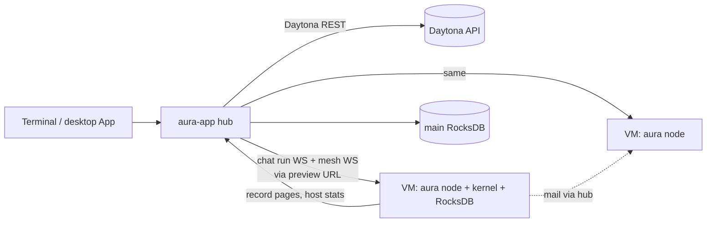

# Cloud agents on Daytona VMs

Let any agent run in a Daytona Linux VM instead of on this machine. The VM boots from a warm project snapshot with the build already done. It sleeps when idle and is destroyed when the agent is archived. Its records sync back to the main RocksDB, and cloud and local agents message each other through one mesh. A local/cloud switch sits under the chat input, and a HOST tab after PROCESSES shows the vital facts of the agent's host, local or cloud, with costs for cloud VMs. Daytona credentials are set in a `.env` file.

## Todos

- [ ] Add shared .env loader (cwd upward, then AURA_HOME/.env) used by all three entry points
- [ ] Add CloudConfig with redacting DaytonaApiKey, reload, .env.example block and .gitignore
- [ ] Add SystemKind::Vm/Placement, VmPayload, PriceRates and mesh/sync/host wire types
- [ ] Create aura-engine-cloud with the VmProvider trait, Daytona REST client and fake provider
- [ ] Implement VmFleet: provision, idle pause, heartbeat, wake, destroy, orphan sweep, ledger rows
- [ ] Build warm snapshots with fingerprints, delta apply (env-file denylist) and GC
- [ ] Add node endpoints: mesh WS, sync import/seal/traces, /v1/host cgroup stats, workspace patch
- [ ] Add append_replica_batch and the ReplicaSink record/memory/trace mirror
- [ ] Implement the single-writer local/cloud hand-off and the patch pull-back
- [ ] Drive cloud agents' turns through the remote chat session in the event loop
- [ ] Add the RemoteRouter to AgentHost and hub-routed mail with node-prefixed threads
- [ ] Persist placement per agent and project; archive and remove-project destroy VMs
- [ ] Add the footer local/cloud switch, /cloud and /local, and the no-key .env notice
- [ ] Add CostModel over ledger intervals, rate overrides and the Daytona org usage fetch
- [ ] Add HostInfoView and the publisher: local sysinfo, cloud DTO + HostStats, project scope
- [ ] Add the HOST tab after PROCESSES with renderer, keys, buttons, /host and the agents-list marker
- [ ] Update invariants, check_invariants.sh, architecture/api/configuration docs
- [ ] Env-file, secrecy, fleet, cost, host, replica, hand-off, mesh and UI tests, plus the gated live test

<!-- end of generated header: edit below -->

## Approach

A cloud agent is an ordinary registered agent whose **kernel runs inside its own Daytona VM**. The VM runs the stock `aura` node (`aura run --ui none`, the same entry point as `Dockerfile`). The local app stays the **hub**. It owns the registry and the main RocksDB, boots and sleeps VMs, drives each cloud agent's turns over the existing wire API (`POST /v1/run` + `WS /stream/:run_id`), mirrors their records into the local store, and passes mail between nodes. Later the hub can become a web service without changing the VM side.



### Decisions I made (please confirm)

1. **Kernel in the VM, not just the tools.** Cloud agents use the node's chat-session path, so Gate routing, `/compare` and file checkpoints stay local-only in v1.
2. **The switch is per agent.** It shows and flips the placement of the agent on screen. New agents inherit their project's last choice. A busy agent refuses the flip. Agents spawned *inside* a VM run in that VM; agents the terminal starts in cloud mode each get their own VM.
3. **Code comes back as a patch.** You pull changes on demand from HOST or `/cloud pull`, and they are pulled automatically when you flip an agent to local or archive it. If a patch won't apply, it is saved under `AURA_HOME/cloud/<agent>/`.
4. **Messages go hub-and-spoke.** The hub keeps an outbound mesh WebSocket to each VM and routes mail, including VM-to-VM mail.
5. **Costs are estimated from list prices, per second.** The estimate comes from the VM ledger's state intervals and is labelled `est.`. Daytona's org usage figure is shown beside it when the API returns one.
6. **Daytona credentials come from the environment, which a `.env` file can set.** A variable already set in the shell wins over the file.

## Configuration and the API key

The Daytona API key, and every other cloud setting, can sit in a `.env` file:

```dotenv
# -- Cloud agents (Daytona) ---------------------------------------------------
# API key from https://app.daytona.io/dashboard/keys. Required for cloud mode.
DAYTONA_API_KEY=dtn_xxxxxxxxxxxxxxxx
# Optional: only needed when the key can reach several organizations.
# DAYTONA_ORGANIZATION_ID=
# Optional: API base (self-hosted Daytona) and region (`us`, `eu`).
# DAYTONA_API_URL=https://app.daytona.io/api
# DAYTONA_TARGET=us
# VM size and sleep timing.
# AURA_CLOUD_CPU=4
# AURA_CLOUD_MEMORY_GIB=8
# AURA_CLOUD_DISK_GIB=40
# AURA_CLOUD_IDLE_PAUSE_SECS=300
# Price overrides for the HOST tab's estimates (USD per hour).
# AURA_CLOUD_PRICE_VCPU_HOUR=0.0504
# AURA_CLOUD_PRICE_MEM_GIB_HOUR=0.0162
# AURA_CLOUD_PRICE_DISK_GIB_HOUR=0.000108
# AURA_CLOUD_PAUSED_BILLS_COMPUTE=0
# AURA_CLOUD_EGRESS_IP_LOOKUP=0
```

The names use Daytona's own `DAYTONA_*` variables, the ones its SDKs and CLI read, so one `.env` serves both.

### Where `.env` is read

| Order | File | Why |
|---|---|---|
| 1 | variables already in the process environment | the shell or CI wins; nothing overrides them |
| 2 | `.env` found from the working directory upward | today's behaviour (`dotenvy::dotenv()` in `src/main.rs`, `aura-desktop/src/main.rs`, `aura-node/src/main.rs`) |
| 3 | `AURA_HOME/.env` (e.g. `~/.aura/.env`) | **new**: the desktop app launched from a dock or menu has no project working directory, so the key still loads |

- The lookup moves into one shared helper, `aura_config::env_file::load()`, called by all three entry points before anything reads config. It records which files it loaded (paths only) for `aura doctor` / the HOST tab's "credentials from" line.
- `CloudConfig::from_env()` in `aura-config` stays the single source of truth for these variables. Nothing else calls `std::env::var("DAYTONA_…")`.
- **Status:** `CloudConfig::is_configured()` decides whether the footer switch can flip to cloud. Without a key, the notice says: `Cloud needs DAYTONA_API_KEY: add it to .env or ~/.aura/.env`.
- **Re-read:** the key is read again when `/cloud` or the footer switch is used with none loaded. Editing `.env` then works without a restart. The new key is used for new requests only.

### Keeping the key safe

- `DaytonaApiKey` is a newtype over `zeroize::Zeroizing<String>`. Its `Debug` and `Display` print `dtn_…xxxx`, so the key can't reach `tracing` logs, panics or record payloads.
- **The key never goes into a VM:**
  - The delta upload always leaves out `.env`, `.env.*` and `AURA_HOME`, even when `.gitignore` would include them.
  - The VM's env is built from an explicit allowlist (`AURA_*` runtime settings and the per-VM node token), never copied from the host's environment.
- `.env.example` gets the commented block above. `.gitignore` already ignores `.env` and `.env.local`; add `.env.*` with a `!.env.example` exception.
- The keyring can be added later behind the same `CloudConfig` field, with the env/`.env` value winning when set.

## Snapshots and fast boot

Your local `target/` can't be shipped: it is 112 GB here and built for this host. Instead the build is done once in the cloud and frozen into a snapshot.

| Layer | Name | Built when | Contents |
|---|---|---|---|
| Base | `aura-base-<hash>` | bootstrap script or `aura` version changes | Linux VM class, apt build deps (`clang`, `mold`, `cmake`, `libssl-dev`, `pkg-config`, git, node, python), rustup + `rust-toolchain.toml` components, the `aura` binary |
| Project warm | `aura-proj-<project>-<fingerprint>` | fingerprint changes: base, toolchain, `Cargo.lock`, JS lockfiles, build command | project at a commit (the `.gitignore`-respecting file set minus the env denylist), `cargo fetch`, the project's build/test command (`cargo test --workspace --no-run`), packages installed. A hot snapshot (`includeMemory`) where allowed |
| Agent | sandbox | each spawn | created from the warm snapshot (or forked from a paused template), then sent the **delta** (`git diff <snapshot commit>` + untracked files) |

- Rebuilds run in the background when the fingerprint changes, or when the delta passes a threshold (default 300 files or 24 h). The two newest snapshots per project are kept.
- Optional: a Daytona warm pool for the project snapshot.

### Default resources

- **4 vCPU, 8 GiB RAM.** That is Daytona's default org ceiling, and it gives about 2 GiB per rustc/link job.
- **Disk: 40 GiB requested, clamped to the org quota with a warning.** The default quota of 10 GiB is too small for this workspace's `target`.
- In-VM env: `CARGO_BUILD_JOBS=4`, `mold` as the linker (through env, not the repo's config), incremental builds on.
- At list price the default VM costs about **$0.34/h running** and **$0.004/h paused** (disk only, assumed).

## VM lifecycle

The `VmState` machine per agent: `Provisioning -> Booting -> Ready <-> Busy -> Pausing -> Paused -> Resuming -> Ready`, plus `Destroying` and `Error`.

- **Sleep:** pause (memory kept) after `AURA_CLOUD_IDLE_PAUSE_SECS`, default 300, with no turn, no background job and no queued mail. Daytona `autopause` is set to 30 min as a backstop.
- **Heartbeat:** preview-URL traffic does **not** reset Daytona's inactivity timers. While a turn runs, the hub calls `POST /sandbox/{id}/last-activity` every 60 s.
- **Wake:** a prompt or mail for a paused agent calls `POST /sandbox/{id}/start` and waits for `/health`, then delivers. Mail queues in the hub until then.
- **Destroy:** archiving an agent or removing its project does a final sync and patch pull, then `DELETE /sandbox/{id}`. Restoring an archived agent brings it back as local.
- **Orphan sweep at startup:** sandboxes carry the labels `aura.install`, `aura.agent` and `aura.project`. Any sandbox whose agent is archived or unknown is deleted.

## Sys transactions (the VM ledger)

- New `SystemKind::Vm` with a `VmPayload`: event (`created`, `booted`, `paused`, `resumed`, `resized`, `snapshot_built`, `destroyed`, `error`), plus sandbox id, class, region, snapshot, resources, state, boot ms, reason, and the `PriceRates` in force. Tokens and keys are never stored.
- Rows go to a **ledger agent per cloud agent** (`0://cloud/vm/<agent zns>`) whose only writer is the hub's fleet.
- The state transitions carry timestamps, so the cost is a pure function of the ledger. `destroyed` carries the final total.
- New `SystemKind::Placement { from, to }` on the agent's own record, appended at the hand-off moment.

## Sync to the main RocksDB

- **`ReplicaSink` trait**, with `LocalRocksSink` now and an HTTP sink later.
  - The mirror pulls `GET /agents/:id/record` pages from the local head + 1. It is pushed a `record_committed` hint over the mesh.
  - It checks that seqs are contiguous and the hash chain holds, then appends the entries **verbatim** in one batch.
  - It also mirrors the memory snapshot and trace runs (`GET /v1/sync/traces?since=`).
- **Writer hand-off, so one agent never has two writers (§12):**
  - *Local to cloud:* claim the agent; append `Placement`; seed the VM through `POST /v1/sync/import`; mark the agent cloud; release.
  - *Cloud to local:* seal the agent on the VM; pull until the heads match; append `Placement` locally; pull the patch; pause the VM.
- **Live work:** the PROCESSES tab shows cloud processes from `ProcessSummary` frames sent over the mesh.

## Mesh (agents across nodes)

- **Wire types** in `aura-core-protocol`: `MeshFrame { Announce, Mail, MailAck, RecordCommitted, Processes, HostStats }`. Thread ids get a node prefix (`<node>:t17`).
- **Routing:** `AgentHost::set_remote_router(Arc<dyn RemoteRouter>)`. `deliver_message` to an id the host doesn't hold goes to the router. `list_agents` merges the remote directory.
- **Auth:** the Daytona preview token plus a random per-VM node bearer token, kept in memory or the keyring and never logged.
- **Model access in the VM:** the zOS JWT goes per run through `RuntimeRequest.auth_jwt`. Linked plan tokens don't leave the machine in v1.

## HOST tab

The tab goes **after PROCESSES**: `SANDBOX · PROCESSES · HOST · TRACE · TASKS` (short label `HST`). `/host` opens it. It works for every agent, local or cloud.

```text
☁ cloud · Daytona · us · Linux VM            ● Ready
Status   ready · up 1h12m · idle, pauses in 3m · warm boot 4.1s
Network  10.0.4.17 (private) · 34.120.7.9 (egress) · mesh 42 ms
CPU      4 vCPU · 63% · load 2.6
Memory   5.1 / 8.0 GiB  ██████▍───
Disk     27.4 / 40 GiB  ██████▊───
Sync     head 1 284 · 0 behind
Cost     $0.34/h · this VM $0.41 est. · project today $2.18 est.
         org usage (Daytona) $14.90 this period
Snapshot aura-proj-harness-3f9c (commit a1b2c3d, 12 files ahead)
Events   12:01 resumed · 11:44 paused (idle) · 10:49 booted
[Pull changes] [Pause] [Resume]
```

- **Local agent:** hostname, OS / kernel / arch, status, interface IPs, CPU cores, usage and load, memory, and the workspace disk. The Cost row is hidden. There is also a `Cloud` line: `configured (from ~/.aura/.env)` or `not configured: set DAYTONA_API_KEY`.
- **Project scope** (the panel's existing scope box): one row per host in the project, local plus each VM, with its state, CPU, memory and $/h, and a total $/h and today's total.
- **Paused or unreachable VM:** shows the last values with `as of 12:01`. The tab never wakes a VM.

### Where the data comes from

| Field | Local | Cloud |
|---|---|---|
| Status, uptime | event loop + process start | `VmFleet` state + Daytona sandbox DTO + node `/health` |
| IP | `sysinfo` network interfaces | node `GET /v1/host`: interfaces + optional egress IP; preview host as the endpoint (no token) |
| CPU, memory, disk | `sysinfo` | node `GET /v1/host`: cgroup `cpu.max`, `cpu.stat`, `memory.current`/`memory.max`, `df` of the workspace; Daytona telemetry metrics as a fallback |
| Region, class, snapshot, resources | n/a | Daytona sandbox DTO + the ledger |
| Cost | n/a | `CostModel` over the ledger; org usage from `GET /organizations/{id}/usage` when available |
| Events | n/a | the latest ledger rows |

- Host stats arrive as `MeshFrame::HostStats` every 5 s while the VM runs. The Daytona DTO is refreshed every 10 s.
- The event loop publishes `UiCommand::HostInfo(HostInfoView)` for the agent on screen (or the project) about every 2 s, only when it changed.

### Cost model

- `PriceRates`, defaulting to Daytona's list prices, billed per second:
  - vCPU **$0.0504/h**
  - memory **$0.0162/GiB/h**
  - storage **$0.000108/GiB/h** after the first 5 GiB
- The rates can be overridden from `.env`.
- What each state is charged:
  - Started, busy or resuming: CPU + memory + disk.
  - Paused or stopped: disk only. This is an assumption, configurable.
  - Destroyed: nothing.
- Snapshot builds are charged to the project's ledger (`0://cloud/project/<id>`).
- Figures are labelled `est.` unless they come from Daytona's usage endpoint.

## Footer switch

- In `renderer/hud.rs::render_footer`, right of `● Ready`, a clickable `⌂ local` / `☁ cloud`. It shows the transitional state while there is one (`☁ booting`, `☁ paused`, `☁ syncing 12`).
- New `areas.footer_placement` and `HoverTarget::Placement`, with the click handled next to `click_stop_button` in `app/mod.rs`.
- Sends `UiEvent::SetPlacement { agent_id, placement }`. The label changes on `UiCommand::SetPlacement(PlacementView)`.
- `/cloud` and `/local` do the same.
- Without a key, the switch stays `⌂ local` and shows the `.env` notice above.
- The agents list gets a `☁` marker beside cloud agents, dimmed while paused.

## Files to change

| Area | Files |
|---|---|
| Env loading | new `crates/config/aura-config/src/env_file.rs` (`load()`: cwd upward, then `AURA_HOME/.env`, never overriding set vars; records loaded paths); call it from `src/main.rs`, `crates/surface/aura-desktop/src/main.rs`, `crates/surface/aura-node/src/main.rs` in place of `dotenvy::dotenv()` |
| Config | new `crates/config/aura-config/src/cloud.rs` (`CloudConfig`, `DaytonaApiKey` redacting newtype, `is_configured`, `reload`); wire into `AuraConfig`; `.env.example` (cloud block); `.gitignore` (`.env.*`, `!.env.example`); `docs/configuration.md` (Cloud section, `.env` lookup order) |
| Core types | `crates/core/aura-core-types/src/types/transaction.rs` (`SystemKind::Vm`, `Placement`), new `types/vm.rs` (`VmPayload`, `Placement`, `VmResources`, `PriceRates`) |
| Wire | `crates/core/aura-core-protocol/src/` new `mesh.rs`, `sync.rs`, `host.rs` |
| New crate | `crates/engine/aura-engine-cloud/`: `provider.rs`, `daytona.rs` (takes `DaytonaApiKey`, `Authorization: Bearer`, optional `X-Daytona-Organization-ID`), `fake.rs`, `fleet.rs`, `snapshots.rs`, `delta.rs` (env-file denylist), `vm_env.rs` (VM env allowlist), `mesh.rs`, `replica.rs`, `cost.rs` |
| Engine | `crates/engine/aura-engine/src/agents/host.rs`, `mail.rs` |
| Store | `crates/store/aura-store-db/src/`: `append_replica_batch` on the sealed `WriteStore` |
| Node (in VM) | `crates/surface/aura-node/src/gateway/`: `/v1/mesh`, `/v1/sync/import`, `/v1/sync/seal/:id`, `/v1/sync/traces`, `/v1/host`, `/v1/workspace/patch`; routes in `middleware.rs` |
| App (hub) | `crates/surface/aura-app/src/`: new `cloud/` (`hub.rs`, `remote_session.rs`, `handoff.rs`, `patch.rs`, `host_info.rs`); `event_loop/turns.rs`, `agents.rs`, `mod.rs`; `agent_registry.rs` |
| UI protocol | `crates/ui/aura-ui/src/events.rs`: `SetPlacement`, `PlacementView`, `HostInfo(HostInfoView)` |
| Terminal UI | `app/processes.rs` (`SidePanelTab::Host` after `Processes`), `renderer/sandbox.rs`, new `renderer/host.rs` and `app/host.rs`, `app/keys.rs`, `app/mod.rs`, `renderer/hud.rs`, `app/commands.rs` |
| Dependencies | `sysinfo` (workspace dep); `zeroize` is already a workspace dep |
| Invariants and docs | `docs/invariants.md`, `scripts/check_invariants.sh`, `tests/layer_boundary.rs`, `docs/architecture.md`, `docs/api.md` |

## Testing

- **Env file** (`tempfile` dirs plus a guarded env, with no real `$HOME`):
  - A key in a cwd `.env` loads.
  - A key only in `AURA_HOME/.env` loads.
  - A shell value beats both files, and the cwd file beats `AURA_HOME/.env`.
  - No key means `is_configured() == false` and the notice names both paths.
  - `reload` picks up a key added after start.
- **Secrecy:**
  - `format!("{:?}", key)` and `tracing` output never contain the key.
  - The delta tarball for a project with `.env` / `.env.local` leaves them out, even with `.gitignore` removed.
  - The VM env built by `vm_env.rs` contains no `DAYTONA_*`.
- **Daytona client:** recorded-response tests check the bearer header and the optional org header.
- **Fleet:** idle pause, wake on mail, heartbeat while busy, archive destroys, orphan sweep, quota clamping.
- **Cost:** a known ledger gives an exact total; paused is disk-only by default; the first 5 GiB are free; overrides apply; replaying gives the same figure.
- **Host info:** the cgroup parser; local `sysinfo` info is non-empty; a paused VM shows last-known values and is not woken.
- **Replica:** gaps, bad hash links and duplicates are rejected; re-imports change nothing; a batch is all or nothing.
- **Hand-off:** while an agent is cloud, local never appends to it; flipping back seals the VM side first.
- **Mesh:** two in-process `aura-node`s plus a local host: local to cloud, cloud to cloud and replies, and mail queued for a paused node.
- **UI:** the tab order, HOST renders for local and cloud agents, the switch click, and the no-key notice.
- **Live Daytona:** a smoke test behind `AURA_DAYTONA_LIVE_TEST=1`, which reads `DAYTONA_API_KEY` from `.env`. Ignored by default.

## Risks

- **Disk quota:** a 10 GiB default org can't hold this workspace's build. Clamp with a warning and document the tier needed.
- **Key in a plain-text file:** `.env` is git-ignored and never uploaded, but it is readable by the user's processes. Document `chmod 600 ~/.aura/.env`, and warn once at startup when a loaded `.env` with `DAYTONA_API_KEY` is world-readable (Unix).
- **Cost accuracy:** list prices, discounts and paused billing may differ from the invoice. Label `est.` and make the rates configurable.
- **Feature gap:** cloud agents miss Gate routing, `/compare` and checkpoints in v1.
- **Daytona API drift:** pin endpoint shapes from the OpenAPI spec in contract tests.
