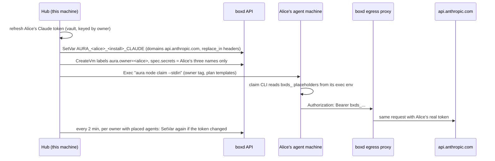

# Cloud agents on your model plans (Claude Max, ChatGPT, OpenRouter), multi-user

Let cloud agents use the Claude Max, ChatGPT and OpenRouter accounts linked by whoever owns each agent, with several users sharing one hub and one boxd org. Each agent is tied to the user who placed it; its machine holds only that user's boxd host-bound placeholders; the hub refreshes and rotates every owner's tokens; and machines, mail, costs and actions are kept apart per user.

## Todos

- [x] Owner model: OwnerTag, owner on VmPayload/PlacementPayload, machine label, registry owner field
- [x] Add set_secret/remove_secret, NewMachine.secrets and org lookup to VmProvider, BoxdProvider and FakeProvider
- [x] Add AuthManager::inference_credential_for(owner, provider, margin) and linked_plans(owner)
- [x] Add PlanCredentials trait and PlanSync (per-owner secrets, unlinked values, rotation, revoke, remove_owner)
- [x] Fleet: owner on provision, owner-only secret names in spec, no cross-owner forks
- [x] Claim: owner tag and PlanTemplate; claim CLI fills bxds_ placeholders and refuses others' names
- [x] Cloud node builds routed_provider with an owner-scoped PlanResolver
- [x] Hub: owner per placement, mesh token and directory per owner x project, cross-owner mail refused
- [x] Event loop: owner checks on every cloud action, plan model pass-through, link and sign-out rotation
- [x] HOST tab Owner and MODELS sections, costs by owner, agents-list owner marker, cloud status
- [x] Docs, new invariants and check_invariants.sh band for user ids in aura-engine-cloud
- [x] Two-owner unit tests plus an ignored live test of one real turn per linked plan

<!-- end of generated header: edit below -->

## Who is a user

aura already has one: `aura_core_auth::Owner` (`Local`, or `Zos { user_id }`), and the credential vault keys every linked plan by owner (`Vault::link(&owner, provider)`). This plan makes the owner a property of every cloud agent and of everything that agent touches. This is the same model the future web service needs: one hub, many signed-in users, each with their own linked plans.

**Assumption:** the hub uses one boxd key (yours today, a service key later), and users are separated by aura, not by separate boxd accounts. A per-user boxd key can come later as a `ProviderKind::Boxd` link in the same vault (see *Later*).

| Concept | Scoped to |
|---|---|
| Linked plans and refresh tokens | owner (already, in the vault) |
| boxd plan secrets | owner × install |
| Cloud machine, its node token | one agent, so one owner |
| Mesh token and directory | owner × project |
| Ledger rows, costs | tagged with the owner |
| Moving, pulling, sleeping or archiving a cloud agent | its owner only |

`OwnerTag` is the owner as it may appear outside this machine: the first 8 hex characters of `blake3("aura-owner:" + owner)`. Machine labels, secret names, ledger rows and logs use the tag. The zOS user id and email never leave the hub. The display name goes only into the hub's own UI.

## How plan tokens reach a machine

boxd provides what is needed (the boxd guide "Env vars and secrets", section *Host-bound secrets*):
- **Host-bound secrets** (`SetVarRequest.domains`): a machine only ever holds a `bxds_...` placeholder, and boxd substitutes the real value into requests to the bound host and scrubs it from responses.
- **`private-unattached` scope:** a secret reaches only machines whose `MachineSpec.secrets` lists it by name.
- **Rotation keeps the placeholder**, and substitution is per request.
- **Forks and restores** resolve the listed names again.

**Isolation between users comes from the spec.** A machine lists only its owner's three names, so Alice's machine has no placeholder for Bob's token. Even a root process on it can't name or reach Bob's secret.

A fork inherits its parent's names. So `fork_from` is allowed only when the parent and the child have the same owner; a child spawned for another owner gets a fresh machine.

**Plans a user hasn't linked** get the value `unlinked`, so the names always resolve and `CreateVm` can't fail. Linking later rotates the value, and that user's running machines can use it at once. Signing a user out of a plan sets their secret back to `unlinked`. Removing a user from the hub deletes their secrets and destroys their machines.

### Per-provider details

| Plan | Secret value | Bound host | Request part | Template sent in the claim |
|---|---|---|---|---|
| Claude Pro/Max | OAuth access token | `api.anthropic.com` | headers | `anthropic-beta: oauth-2025-04-20`, the Claude Code system preamble |
| ChatGPT Plus/Pro | OAuth access token | `api.openai.com` | headers | none |
| OpenRouter | API key | `openrouter.ai` | headers | `HTTP-Referer`, `X-Title` |

The headers and preamble come from each adapter's `credential()`, with the bearer swapped for the placeholder.

## Changes

### Owner model
| File(s) | Change |
|---|---|
| `aura-core-types/src/types/vm.rs` | Add `owner: Option<String>` (the tag, `serde(default)`) to `VmPayload` and `PlacementPayload`, so old rows still read. |
| `aura-engine-cloud/src/names.rs` | Add `owner_tag(&Owner)`, `LABEL_OWNER = "aura.owner"`, and `plan_secret(owner_tag, install, kind)`, which gives `AURA_<owner8>_<install6>_CLAUDE` / `_CHATGPT` / `_OPENROUTER`. Add `owner_ledger(tag)`, which gives `0://cloud/owner/<tag>`, for per-owner plan-sync rows. |
| `aura-engine-cloud/src/fleet.rs` | `ProvisionRequest.owner`: the machine gets the `aura.owner` label and its owner's secret names. `MachineView.owner`. `fork_from` is refused across owners. Add `views_of(owner)`. |
| `aura-app/src/cloud/hub.rs` | `PlaceRequest.owner`. Placements store the owner. The mesh token is per owner × project, as is the directory (`Directory::frame_for` filters by owner too). `HubRouter` refuses mail from one owner's agent to another owner's agent with "agent belongs to another user" unless the project is shared (*Later*). |

### Credentials per owner
| File(s) | Change |
|---|---|
| `aura-auth/src/manager.rs` | Add `inference_credential_for(&Owner, provider, margin)`: today's refresh-under-lock in `credential_for`, for any owner in the vault rather than only the current identity, with a caller-chosen margin (15 min here). `credential_for` calls it with `self.owner()` and 60 s. Add `linked_plans(&Owner)`. |
| `aura-engine-cloud/src/plans.rs` (new) | `trait PlanCredentials { async fn credential(&self, owner, kind) -> Result<Option<InferenceCredential>>; fn linked(&self, owner) -> Vec<ProviderKind>; }` is implemented by `AuthManager` in the app and by the web service later. `PlanSync`: `ensure_owner(owner)` creates the owner's three secrets; `tick()` runs every 2 min for each owner with a placed agent, hashes each bearer (blake3, never logged) and calls `SetVar` only when it changed. Each owner has its own backoff, so one user's broken link doesn't stall the others. `revoke(owner, kind)` and `remove_owner(owner)`. |
| `aura-engine-cloud/src/provider.rs`, `boxd.rs`, `fake.rs` | `VmProvider::set_secret` / `remove_secret` (`SetVar` / `RemoveVar`, kind `secret`, scope `private-unattached`, org from `BOXD_ORG` or the key's single org via `ListOrgs`). `NewMachine.secrets` maps to `MachineSpec.secrets` on create and create-from-snapshot. The fake refuses a create naming an unknown secret, as boxd does. |

### Machine side
| File(s) | Change |
|---|---|
| `aura-core-protocol/src/cloud/sync.rs` | `NodeClaim.owner` (the tag) and `NodeClaim.plans: Vec<PlanTemplate { provider, env, headers, system_preamble, placeholder: Option<String> }>`. `Debug` and `Display` show the tag and providers only. |
| `aura-cli/src/cloud_commands.rs` | `aura node claim --stdin` fills each placeholder from its exec env, falling back to `bash -lc 'printf %s "$NAME"'`. It refuses any value that doesn't start with `bxds_`, and any `env` name whose owner part isn't the claim's owner. |
| `aura-node/src/cloud_node.rs`, `node.rs` | A cloud node builds `aura_model::routed_provider(Some(plan_resolver))`. `PlanResolver` (in an `RwLock`, filled at claim and rebind) answers only for the claim's owner and returns `NotLinked` before a claim. Trace runs on the node carry the owner tag. |

### App
| File(s) | Change |
|---|---|
| `aura-app/src/agent_registry.rs` | `RegisteredAgent.owner: Option<String>` (the tag, `serde(default)`), set when an agent is created. Existing agents are claimed by the current owner the first time they move to the cloud. |
| `aura-app/src/event_loop/cloud.rs` | Placing uses the current identity as the owner. Recall, pull, sleep, wake, archive and sending turns to a cloud agent require the current owner to be the agent's owner. Otherwise the notice reads "Placed by Alice; sign in as Alice to manage it". Plan models pass through to cloud turns; "Sign in to Claude (`/login claude`) to use it from cloud agents" when the owner hasn't linked that plan, and the same message on a 401 from the node. On `/login <plan>`, sign-out and account switches, `PlanSync` rotates or revokes that owner's secrets at once. |
| `aura-app/src/cloud/host_info.rs` | The HOST tab gains an **Owner** fact and a **MODELS** section: the owner's plans as `linked · refreshed 3m ago` or `not linked`, and the bound host. Project scope groups hosts and costs by owner, with a subtotal for each. |
| `aura-ui-terminal` agents list | Cloud agents owned by someone else get a dimmed `☁ alice` marker, and their footer switch is disabled. |
| `aura cloud status` | Lists owners with placed agents, their machine counts and plan link state, by display name, locally only. |

### Docs
`docs/configuration.md` (multi-user section, the boxd secrets aura creates and how to remove them), `docs/invariants.md` (new invariants below), and the `machine_env.rs` docs.

## Invariants (new)

1. Plan tokens and refresh tokens never enter a machine; machines hold only `bxds_` placeholders.
2. A machine's `MachineSpec.secrets` names only its owner's plan secrets.
3. A fork never crosses owners.
4. Mail never crosses owners unless the project is explicitly shared.
5. Only an agent's owner can move, pull, sleep, wake or archive it.
6. Raw user ids and emails never appear in boxd (labels, names, secrets) or in logs; only the owner tag does.

These are pinned by unit tests and an `check_invariants.sh` band that rejects `user_id` or `email` in `aura-engine-cloud`.

## Tests

- **Two owners on the fake provider:**
  - Each owner's machine lists only that owner's names.
  - Rotating Alice's token touches only Alice's secret.
  - Revoking Bob's plan leaves Alice's alone.
  - A fork from Alice's agent for Bob gets a fresh machine.
  - `remove_owner` deletes only that owner's secrets and destroys only their machines.
- **Mesh:** a two-owner directory leaves each owner's agents out of the other's frames, and cross-owner mail is refused with the named error.
- **Event loop:** while signed in as Bob, every action on Alice's agent is refused with the "placed by" notice, and no hub call is made.
- **Auth:** `inference_credential_for` refreshes a non-current owner's token within the margin and leaves the current identity alone.
- **Claim:** the claim CLI refuses a non-`bxds_` value and another owner's secret name. `Debug` of claims never shows tokens or user ids.
- **Live (ignored, about a cent):** one real turn per linked plan on a cloud machine. Check `env` there shows only `bxds_` values, and boxd shows only the owner's three names in the machine's spec.

## Risks and open points

- **TLS trust:** boxd's proxy certificate is in the machine's system store. `aura-model`'s `reqwest` 0.11 with native TLS trusts it, which the live test confirms.
- **Secrets per org:** each user × install adds three boxd secrets, and boxd's per-org limit on secrets is not documented. `PlanSync` removes secrets of owners with no placed agents after 30 days idle, and the limit should be checked with boxd before the web service.
- **Shared rate limits:** a user's machines all share that user's plan limits, and Claude Max and ChatGPT terms are for personal use. This is per user, so one user can't spend another's plan. The HOST tab shows whose plan an agent spends.
- **Hub offline:** if the hub is offline longer than a token lives (about an hour for ChatGPT), those owners' cloud turns fail with 401 until it's back.
- **Local owner:** several OS users on one computer each have their own `AURA_HOME`, so their own install id and separate secrets; that is fine. But two people sharing one OS account are one `Local` owner, which is documented.

## Later (not in this plan)

- **Shared projects:** a project-level member list lets agents of different owners in one project mail each other. This needs a shared mesh token and a directory across owners.
- **Per-user boxd keys:** a `ProviderKind::Boxd` link in the vault, so each user's machines bill to their own boxd account. The fleet becomes one `BoxdProvider` per owner.
