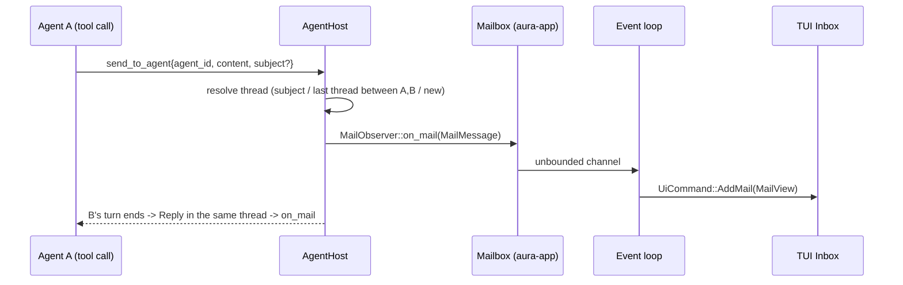

# INBOX tab: threaded agent-to-agent mail

Add an INBOX tab after POLICIES in the top-right Kernel panel. It lists the messages agents send each other, grouped into threads by a shared subject. Clicking a thread or a message opens the whole conversation over the chat panel on the left, as a stack of messages like an email thread. Each message can be folded, and the view closes like the other detail views.

## Todos

- [ ] Engine: `mail.rs` with ThreadId, MailMessage, MailObserver, Threads + unit tests
- [ ] Engine: thread/subject on Envelope, observe in enqueue and run_turn, set_mail_observer, subject in rendered prompts
- [ ] `send_to_agent` optional `subject`; default `deliver_message_in_thread` on AgentControlHook; engine override; tests
- [ ] aura-ui: `MailView` and `UiCommand::AddMail`
- [ ] aura-app: Mailbox observer, channel + loop arm, task Request/Reply mail in subagents.rs, tests
- [ ] TUI: RecordsTab::Inbox, Inbox state, filtering, keys/clicks, /inbox command
- [ ] TUI: DetailView::Thread with per-message folding, live updates, read marks
- [ ] TUI: renderer/inbox.rs list + header info, thread view lines in detail.rs
- [ ] Update tab-bar tests (renderer, members, desktop chrome) and add UI/render tests
- [ ] STYLEGUIDE and CHANGELOG entries
- [ ] fmt, clippy -D warnings, tests for aura-engine, aura-exec-tools, aura-ui, aura-app, aura-ui-terminal, aura-desktop

<!-- end of generated header: edit below -->

## Approach

Today agent-to-agent traffic runs through `HostInner::enqueue` in `aura-engine` and through the terminal's permanent-agent `task` path in `aura-app`. The UI never sees it, apart from a one-line "Message from X" notice in the root's chat. There is also no notion of a conversation: `send_to_agent` takes only `agent_id` and `content`.

The change has three layers:

1. **Engine (threading + observation).** Give every message a thread: a `ThreadId` and a subject. Let `send_to_agent` take an optional `subject`. Replies inherit the thread of the message that started the turn. A new `MailObserver` on `AgentHost` sees every message as it is delivered.
2. **App (collection).** `aura-app` implements the observer and also posts mail for permanent-agent `task` dispatches and their results. It forwards each message to the UI as `UiCommand::AddMail(MailView)`, which is global like `SetProcesses`.
3. **TUI (tab + thread view).** Add `RecordsTab::Inbox`. It lists the threads of the run on screen (the agent on screen plus its MEMBERS), newest activity first. A thread can be expanded to show its messages. Clicking either kind of row opens `DetailView::Thread` over the chat panel, which is the "left panel" here, the same place records and processes open. In the thread view each message folds and unfolds. Esc or the ✕ closes the view.



## Threading rules (shared context)

These rules live in a new module, `crates/engine/aura-engine/src/agents/mail.rs`, as `Threads`, kept in `HostInner` behind a mutex.

- **Explicit subject:** the key is (root of the sender's tree, normalized subject). Normalizing trims the text, strips leading `re:`/`fwd:` repeatedly, collapses whitespace and lowercases it. The same subject joins the existing thread; a different subject starts a new one. This is the email-subject behaviour you described.
- **No subject on `send_to_agent`:** the message continues the most recent thread between the two agents (an unordered pair). If they have none, it starts a new thread whose subject is the first line of the content, cut to 60 characters.
- **`spawn_agent` first prompt / host `task` prompt:** these always start a new thread. Its subject is the first line of the prompt.
- **Automatic replies** (`run_turn`'s final answer, routed or returned to a waiter): same thread as the envelope that started the turn. `Envelope` gains `thread: ThreadId` and `subject: String`, and `Turn` carries them.
- **Telling the model about subjects:** the rendered prompts carry the subject so models keep threads intact.
  - `render_for_hosted` and `InboxMessage::render` add a `Subject: …` line.
  - The root's text says: "To answer, call send_to_agent with agent_id "…" and subject "…"; use a new subject for a new topic."
  - The `send_to_agent` tool description says the same.

```rust
// aura-engine agents/mail.rs
#[derive(Debug, Clone, PartialEq, Eq, Hash)]
pub struct ThreadId(pub String); // "t17" for host threads, "task:<child hex>" for terminal tasks

#[derive(Debug, Clone)]
pub struct MailMessage {
    pub id: u64,
    pub thread: ThreadId,
    pub subject: String,
    pub from: AgentId,
    pub from_name: String,
    pub to: AgentId,
    pub to_name: String,
    pub kind: MessageKind,
    pub text: String,
    pub sent_ms: u64,
}

/// Sees every message between agents as it is delivered. Must not block.
pub trait MailObserver: Send + Sync {
    fn on_mail(&self, message: &MailMessage);
}
```

The `subject` reaches the host without breaking existing hook implementations. `AgentControlHook` (in `aura-exec-traits/src/hooks.rs`) gains a default method:

```rust
async fn deliver_message_in_thread(&self, subject: Option<&str>, /* same args as deliver_message */)
    -> Result<(), String> { self.deliver_message(/* … */).await } // remote hooks ignore subject
```

`SendToAgentTool::execute` calls it, and `AgentHooks` in the engine overrides it to pass the subject into `deliver_message`.

## What the UI shows

**INBOX tab** (Kernel panel, after POLICIES). The info cell reads `3 NEW` when there are unread threads, otherwise `5 THREADS`.

```text
┌──────────┬──────────┬──────────┬──────────┬──────────┐
│  KERNEL  │ MEMBERS  │ POLICIES │▓ INBOX  ▓│    2 NEW │
└──────────┴──────────┴──────────┴──────────┴──────────┘
 ● ▾ Review parser changes (3)   Lead ↔ scout    12:04
       Lead → scout   Please check the tokenizer…  12:01
       scout → Lead   Found two issues: …          12:03
       Lead → scout   Fix the first, skip …        12:04
   ▸ Benchmark run (1)           Lead → bench    11:50
```

- Rows show the unread dot, the fold arrow, the subject with its message count, the participants (`↔` for two-way, `→` for one-way) and the last time.
- Keys: ↑↓ and PgUp/PgDn move, Home/End jump, ←/→ fold and unfold a thread, Enter opens, ⇧←→ switch tabs. The wheel scrolls.
- Clicking a thread row opens the thread with its latest message unfolded. Clicking a message row opens the thread scrolled to that message, with it unfolded.
- Empty state: "No messages between agents yet."
- `/inbox` (alias `/mail`) shows the tab focused, like `/members`.

**Thread view** (`DetailView::Thread`, over the chat panel). The header is `THREAD <subject>`, with `N MESSAGES ✕` on the right.

```text
▸ Lead → scout · 12:01   Please check the tokenizer…
▾ scout → Lead · 12:03 · reply
  Found two issues:
  1. …
▾ Lead → scout · 12:04
  Fix the first, skip the second.
```

- Messages are stacked in order. A folded message is one line: header plus preview. An unfolded one shows the header plus its wrapped body.
- When the view opens, the clicked message and the newest message are unfolded.
- Keys: ↑↓ and PgUp/PgDn scroll, `n`/`p` select the next/previous message, Enter/Space folds or unfolds the selected one, `e`/`c` unfold or fold all, Esc closes. Clicking a message header toggles its fold.
- The view updates live: new mail in the open thread appears unfolded at the bottom. Opening a thread marks it read.

## Files to change

| File | Change |
|---|---|
| `crates/engine/aura-engine/src/agents/mail.rs` (new) | `ThreadId`, `MailMessage`, `MailObserver`, `Threads` (subject normalisation, pair index, id counter) + unit tests |
| `crates/engine/aura-engine/src/agents/host.rs` | `Envelope.thread/subject`; `envelope()` takes a thread choice; `deliver_message(.., subject)`; `observe_mail` in `enqueue` and in `run_turn` for the waiter result; `AgentHost::set_mail_observer`; `render_for_hosted` subject line |
| `crates/engine/aura-engine/src/agents/inbox.rs` | `InboxMessage.subject/thread`; `render` mentions the subject and how to keep it |
| `crates/engine/aura-engine/src/agents/hooks.rs`, `agents/mod.rs`, `lib.rs` | Override `deliver_message_in_thread`; re-export the mail types |
| `crates/exec/aura-exec-traits/src/hooks.rs` | Default `deliver_message_in_thread` on `AgentControlHook` |
| `crates/exec/aura-exec-tools/src/agents/send_to_agent.rs` | `SendToAgentInput.subject: Option<String>`; schema and description; call the threaded method; tests |
| `crates/ui/aura-ui/src/events.rs` | `MailView` (id, thread_id, subject, from/to id+name as hex, reply, text, sent_ms); `UiCommand::AddMail(MailView)` |
| `crates/surface/aura-app/src/event_loop/mail.rs` (new) | `Mailbox` implementing `MailObserver` over an unbounded `MailSender`; `mail_view(&MailMessage)`; `post_task_mail(..)` for terminal tasks |
| `crates/surface/aura-app/src/harness.rs`, `event_loop/mod.rs` | Create the channel, `host.set_mail_observer`, add a loop arm forwarding `AddMail` |
| `crates/surface/aura-app/src/event_loop/subagents.rs` | In `AgentHub::spawn`: post the Request (parent → instance, thread `task:<child>`, subject = todo text or first prompt line) after `begin_spawn`, and the Reply/failure from `report.outcome()` for both wait and detached paths |
| `crates/surface/aura-app/src/event_loop/host.rs` | `TerminalInbox` shows `Message from X: <subject>` |
| `crates/ui/aura-ui-terminal/src/app/inbox.rs` (new) | `Inbox` state (messages capped at 2000, thread rows, expanded set, read marks, selection/scroll); filtering to the run on screen; keys, clicks, `/inbox`; `open_thread`; fold state of the thread view |
| `crates/ui/aura-ui-terminal/src/app/members.rs` | `RecordsTab::Inbox` ("INBOX"/"INB"), `ALL` has 4, `next`/`prev`, `click_records_panel` and `handle_records_shortcut` branches |
| `crates/ui/aura-ui-terminal/src/app/{mod.rs,keys.rs,commands.rs,slash_menu.rs,panes.rs}` | `DetailView::Thread(Box<ThreadView>)`; `HoverTarget::InboxRow`; handle `AddMail`; route Records keys and wheel for Inbox; thread-view keys; `/inbox` command and menu entry |
| `crates/ui/aura-ui-terminal/src/renderer/inbox.rs` (new) | `render_inbox` (rows, scrollbar, hint `↑↓ move  ←→ fold  ⏎ open  ⇧←→ tabs`), `header_info`, `thread_lines` for the detail view |
| `crates/ui/aura-ui-terminal/src/renderer/{panels.rs,detail.rs,mod.rs}` | Dispatch the Inbox tab and its info cell; `detail_header`/`draw_record` arms for `Thread` |
| `crates/surface/aura-desktop/src/chrome.rs` | Kernel bar test now expects 4 tabs |
| `crates/ui/aura-ui-terminal/STYLEGUIDE.md`, `CHANGELOG.md` | Bar diagram with INBOX, a section on the tab and the thread view, `[Unreleased]` Added entry |

## Tests

- **Engine `mail.rs`:**
  - normalisation (`Re: RE:  Foo` matches `foo`)
  - the same subject in the same tree gives the same thread
  - a different subject or a different tree gives a new thread
  - no subject continues the last thread between the pair
- **Engine `host` (existing test harness with the mock provider):**
  - `spawn_agent` with a prompt sends a Request, and the child's reply shows up as a Reply in the same thread
  - `send_to_agent` with a subject from the child to the root reaches the observer and the `InboxMessage` carries the subject
  - the waiter path of a host `task` reports its result
- **`send_to_agent`:** the subject is forwarded through `deliver_message_in_thread`. An old-style hook (only `deliver_message`) still works.
- **aura-app:**
  - `mail_view` maps fields and hex ids
  - a loop test checks that an observed message becomes `UiCommand::AddMail`
  - a `task` spawn posts the Request and Reply under `task:<child>`
- **TUI app:**
  - Shift+Right cycles through all four tabs
  - threads group by `thread_id`, are ordered by last activity, and are filtered to the run on screen
  - expanding and collapsing rows works
  - clicking a message row opens `DetailView::Thread` focused on that message
  - Enter/Space folds and `n`/`p` move between messages
  - new mail updates the open view and the unread count
  - `/inbox` shows the tab focused
- **Renderer:**
  - the bar shows `INBOX`, and the info cell shows `2 NEW`
  - rows show glyphs and participants
  - the empty state
  - the thread view header and folded/unfolded lines
  - update the tab-bar string tests that match the three-tab bar (`renderer/members.rs`, `renderer/tests.rs`) and the desktop chrome test

## Risks and assumptions

- **"Left panel"** is taken to be the chat panel area, where record and process details already open. "Close each one" is taken as folding each message in the thread, plus closing the thread view. Thread rows in the list can also be folded.
- **Models may skip `subject`.** The pair fallback keeps a back-and-forth in one thread, but two unrelated topics between the same pair without subjects would merge. The tool description and the rendered prompts push models to set and reuse a subject.
- **In memory only:** the inbox lasts for the session; messages are not reloaded on restart. Messages a root could not take live are still recorded in its kernel log, as today. Persistence can come later.
- **Id format:** `MailView` must use `AgentId::to_hex()`, the same form as the process table's `task:`/`agent:` ids. Otherwise the filtering by MEMBERS misses agents.
- **Tab width:** four tabs leave less room for the info cell. On a narrow panel it falls back to `info_short` or is hidden, as with POLICIES.
- **Observer cost:** `on_mail` runs under no host lock and only does a channel send, so it cannot stall delivery.
