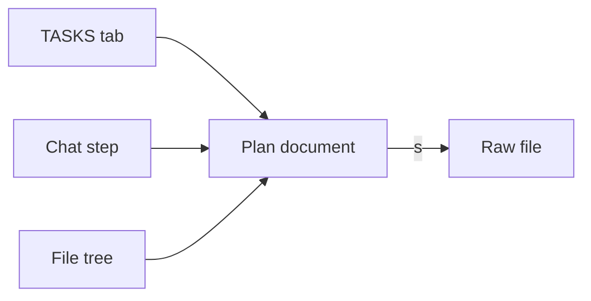

# Test plan: reading plans as documents

A hands-on check of the new plan document view in the terminal and the desktop app. This file is also the sample to test with: it uses every kind of Markdown a plan can hold, so opening it shows how each one looks.

## Todos

- [ ] Open this plan from the TASKS tab: header click, Enter, and Enter on a todo
- [ ] Open it from the create_plan step and from a read_file step in the chat
- [ ] Open it from the sandbox file tree
- [ ] Confirm no frontmatter or header marker shows anywhere
- [ ] Check title, overview, TODOS, divider and body styling against the table
- [ ] In the desktop app, check prose is in Inter and code, tables and rules stay monospace
- [ ] Scroll with keys, wheel and scrollbar; opening at a todo does not snap back
- [ ] Press s and confirm the raw file opens on the todo's line
- [ ] Resize the window and change the desktop font size while the plan is open
- [ ] Open an older plan and confirm it still reads correctly

<!-- end of generated header: edit below -->

## What this checks

Opening a plan used to show its raw Markdown file. It now opens as a document over the chat panel. The unit tests check the text drawn on screen. They do not check how the view looks in a real window, how it feels to scroll, or how the desktop app sets the text in its regular font. This plan covers those gaps by hand.

Use this plan as the test subject. Its body has headings, paragraphs, lists, a table, a code block, a quote and a diagram, and its todos are the checks themselves. Mark each todo as you go, and the check boxes in the view update with them.

## Before you start

Build both front ends from the workspace root with `cargo build -p aura-cli -p aura-desktop`, then open this workspace in each. Keep a narrow terminal (about 80 columns) and a wide one (160 or more) at hand, because line wrapping and the 100-column limit behave differently at each size.

## Opening a plan

A plan should open as a document from each of the places below. In every case the header reads `PLAN Test plan: reading plans as documents` with the todo count on the right.

- **TASKS tab:** click this plan's header, press Enter on it, and press Enter on one of its todos. Opening from a todo should scroll that todo near the top.
- **Chat:** click the `create_plan` step that wrote this plan. It should open the document even though the step is short.
- **Chat:** ask the agent to read this file with `read_file`, then click that step.
- **File tree:** click `.aura/plans/test-plan-reading-plans-as-documents_*.plan.md` in the sandbox panel.

Nothing from the top of the file should show: no `---` lines, no `name:` or `todos:`, and no `<!-- end of generated header -->` line.

## How the page should read

The layout runs top to bottom like this:

| Part | Look |
|---|---|
| Title | Bold, brightest text |
| Overview | Softer color, wraps as a paragraph |
| TODOS label | Bold and muted, with closed/total |
| Todos | Check boxes as elsewhere, cancelled ones struck through |
| Divider | A faint rule |
| Body | Set like an agent's reply |

> In the desktop app, the title, overview, todo text and body paragraphs should be in the regular font (Inter). Inline code such as `PlanDoc::parse` stays monospace. This table, the code block below and the divider stay on the cell grid.

A todo that wraps should continue under its text, not under its check box. A todo with an assignee shows the assignee after its text.

```rust
// A code block: monospace, highlighted, on the grid in both front ends.
fn open_plan(path: &str) -> Result<(), String> {
    Ok(())
}
```



## Moving around

The footer shows the visible rows, then `Esc close  s source  ↑↓ PgUp/PgDn scroll`.

1. Scroll with the arrow keys, Page Up and Page Down, Home and End, the mouse wheel and the scrollbar. The view never scrolls past the last line.
2. Open the plan from a todo near the bottom, then scroll up one line. The view should stay where you put it and not jump back to the todo.
3. Press `s`. The raw file opens with the cursor on that todo's checklist line. Esc closes it.
4. Resize the window while the plan is open. Text should rewrap and stay readable at both sizes, and wide windows should stop lines at about 100 columns.
5. In the desktop app, change the font size while the plan is open. The text should rewrap to the new size.

## What could go wrong

- Text in the regular font may overlap or leave gaps where it meets inline code. Watch lines that mix the two.
- A plan whose body starts with its own title shows the title twice. This is a known nit, not a regression.
- An old plan without the generated header should still show its title, overview and todos, taken from the top of the file. `channels-persistent-channels-with-a-coordinator_5fa9dc49.plan.md` is a good one to try alongside this one.

If something looks wrong, note the front end, the window width and the plan, and take a screenshot of the view.
