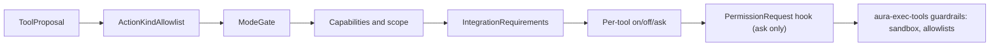

# Aura Harness — Architecture

This document is organized in three parts:

1. **Part 0 — Layer overview.** The twelve-layer stack and its folder layout, the strict downward-only dependency rule, the runtime diagram, the `AgentMode` resolution chain, and the tool authorization pipeline.
2. **Part 1 — Layered crate reference.** One section per layer, with a per-layer overview followed by a sub-section for every crate (purpose, key types, key modules).
3. **Part 2 — User flows.** Sequence diagrams showing how data moves through the system for interactive, headless, WebSocket, and error-recovery paths.

---

## Part 0 — Layer overview

Crates are grouped into twelve layers, ordered from most to least fundamental. Each layer is a folder under `crates/`, and each crate lives at `crates/<layer>/<crate>`:

```text
core  <  config  <  store  <  model  <  context  <  plugin  <
exec  <  agent  <  auth  <  engine  <  ui  <  surface
```

### Naming

Every crate below `surface` is named `aura-<layer>` or `aura-<layer>-<part>`. A plain `aura-<layer>` is the layer's main crate (`aura-config`, `aura-model`, `aura-plugin`, `aura-agent`, `aura-auth`, `aura-engine`, `aura-ui`); `aura-<layer>-<part>` crates are its parts. Surface crates are named after what you run: `aura-app`, `aura-cli`, `aura-node`, `aura-desktop`.

### Layers, in dependency order

Within a layer, crates are listed leaves first.

| Layer    | Purpose | Crates |
|----------|---------|--------|
| core     | Behavior-free IDs, domain types, capability enums, mode and auth primitives, wire types. | `aura-core-modes`, `aura-core-permissions`, `aura-core-types`, `aura-core-auth`, `aura-core-protocol` |
| config   | Single source of truth for env vars and TOML config. | `aura-config` |
| store    | Durable storage: content-addressed snapshots, the record log and its read seam, RocksDB. | `aura-store-snapshot`, `aura-store-record`, `aura-store-db` |
| model    | LLM provider trait and streaming completions. | `aura-model` |
| context  | Read-only context assembly: prompts, compaction, skills, memory. | `aura-context-prompts`, `aura-context-compaction`, `aura-context-skills`, `aura-context-memory` |
| plugin   | Plugin manifests and install, the in-process API, hooks, MCP, connectors. | `aura-plugin-api`, `aura-plugin-hooks`, `aura-plugin-mcp`, `aura-plugin-connectors`, `aura-plugin` |
| exec     | Tool seam traits, the HTTP `DomainApi`, the tool catalog and executor. | `aura-exec-traits`, `aura-exec-domain-http`, `aura-exec-tools` |
| agent    | One agent: kernel, turn loop, steering, subagent derivation, run traces, the Gate router. | `aura-agent-gate`, `aura-agent-subagent`, `aura-agent-steering`, `aura-agent-kernel`, `aura-agent`, `aura-agent-trace` |
| auth     | Sign-in: zOS identity, linked ChatGPT and Claude plans, credential storage. | `aura-auth-kit`, `aura-auth-zos`, `aura-auth-chatgpt`, `aura-auth-claude`, `aura-auth` |
| engine   | Many agents: scheduler, workers, agent host, automatons. | `aura-engine-automaton`, `aura-engine` |
| ui       | Renderer-agnostic UI protocol and the ratatui terminal UI. | `aura-ui`, `aura-ui-terminal` |
| surface  | What you run: the session host, the HTTP/WS node, the CLI, the desktop app. | `aura-app`, `aura-node`, `aura-cli`, `aura-desktop` |

### Dependency rules

- A crate may depend on crates in the same layer or any lower layer. Upward edges fail CI via [tests/layer_boundary.rs](../tests/layer_boundary.rs); there are no allowlisted exceptions. Dev-dependencies only shape the test graph and are not checked.
- A crate's layer comes from its name (`aura-<layer>-…`); only the surface crates are listed in the test's `KNOWN_CRATES` table.
- Every crate sits in its layer's folder (`every_crate_lives_in_its_layer_folder`) and its `src/lib.rs` carries a matching `//! Layer: <layer>` tag (`every_crate_carries_a_matching_layer_doc_tag`).

### Layered dependency diagram

Each box is a layer. Arrows point in the only allowed dependency direction: **downward**. A crate at any layer may depend on crates at the same layer or any layer below, never above.

```text
   ┌────────────────────────────────────────────────────────────────┐
   │  surface — what you run: session host · HTTP/WS node · CLI ·   │
   │  desktop app                                                   │
   │  aura-app, aura-node, aura-cli, aura-desktop                   │
   └─────────────────────────────┬──────────────────────────────────┘
                                 │
   ┌─────────────────────────────▼──────────────────────────────────┐
   │  ui — renderer-agnostic UI protocol · ratatui terminal UI      │
   │  aura-ui, aura-ui-terminal                                     │
   └─────────────────────────────┬──────────────────────────────────┘
                                 │
   ┌─────────────────────────────▼──────────────────────────────────┐
   │  engine — scheduler · workers · agent host · automatons        │
   │  aura-engine-automaton, aura-engine                            │
   └─────────────────────────────┬──────────────────────────────────┘
                                 │
   ┌─────────────────────────────▼──────────────────────────────────┐
   │  auth — zOS identity · linked ChatGPT / Claude plans · vault   │
   │  aura-auth-{kit,zos,chatgpt,claude}, aura-auth                 │
   └─────────────────────────────┬──────────────────────────────────┘
                                 │
   ┌─────────────────────────────▼──────────────────────────────────┐
   │  agent — kernel (mode gate + policy) · AgentLoop · steering ·  │
   │  subagent derivation · run traces                              │
   │  aura-agent-{subagent,steering,kernel,trace}, aura-agent       │
   └─────────────────────────────┬──────────────────────────────────┘
                                 │
   ┌─────────────────────────────▼──────────────────────────────────┐
   │  exec — tool seam traits · HTTP DomainApi · tool catalog +     │
   │  executor                                                      │
   │  aura-exec-{traits,domain-http,tools}                          │
   └─────────────────────────────┬──────────────────────────────────┘
                                 │
   ┌─────────────────────────────▼──────────────────────────────────┐
   │  plugin — manifest + install · in-process API · hooks · MCP ·  │
   │  connectors                                                    │
   │  aura-plugin-{api,hooks,mcp,connectors}, aura-plugin           │
   └─────────────────────────────┬──────────────────────────────────┘
                                 │
   ┌─────────────────────────────▼──────────────────────────────────┐
   │  context — prompt rendering · compaction · skills · memory     │
   │  aura-context-{prompts,compaction,skills,memory}               │
   └─────────────────────────────┬──────────────────────────────────┘
                                 │
   ┌─────────────────────────────▼──────────────────────────────────┐
   │  model — LLM provider trait · streaming completions            │
   │  aura-model                                                    │
   └─────────────────────────────┬──────────────────────────────────┘
                                 │
   ┌─────────────────────────────▼──────────────────────────────────┐
   │  store — snapshots · record log · sealed WriteStore (§10)      │
   │  aura-store-{snapshot,record,db}                               │
   └─────────────────────────────┬──────────────────────────────────┘
                                 │
   ┌─────────────────────────────▼──────────────────────────────────┐
   │  config — env vars + TOML config (single source of truth)      │
   │  aura-config                                                   │
   └─────────────────────────────┬──────────────────────────────────┘
                                 │
   ┌─────────────────────────────▼──────────────────────────────────┐
   │  core — IDs · domain types · capabilities · modes · auth and   │
   │  wire types                                                    │
   │  aura-core-{modes,permissions,types,auth,protocol}             │
   └────────────────────────────────────────────────────────────────┘
```

### Runtime diagram

How a request flows through the running system. The kernel boundary cuts at the `agent` layer.

```text
                 aura (TUI)  ·  aura run --ui none  ·  aura-node
                                    │
                    HTTP / WebSocket gateway (aura-node)
                                    │
                Scheduler (aura-engine): store-backed per-agent claim (§12.a)
                     │                  │                  │
                 Worker             Worker             Worker      one per agent
                     └──────────────────┼──────────────────┘
                                        │
              Kernel: build context · mode gate + policy · call reasoner
                      · execute actions · commit RecordEntry (sealed WriteStore)
                     │                  │                  │
        Reasoner (records every    Executor (tools:    Store (RocksDB: record,
        LLM call) → aura-router    FS, commands,       agent_meta, inbox,
        proxy → providers          domain, automaton)  memory_*, agent_skills)
```

### `AgentMode` resolution

`AgentMode` (`Agent` / `Plan` / `Ask` / `Debug`) is resolved once per session by `aura_config::session_mode`, a thin wrapper over the pure `aura_core_modes::resolve_session_mode`:

1. **Request** — `RuntimeRequest.mode` on `POST /v1/run`, or the CLI `--mode <agent|plan|ask|debug>` flag (`ModeFlag` in `aura-cli`) for the interactive terminal. Headless `aura run --ui none` ignores the flag with a warning.
2. **Daemon default** — `aura_config::AgentConfig::default_mode` (`AURA_DEFAULT_MODE`; the older `AURA_FLEET_DEFAULT_MODE` is still read).
3. **Fallback** — `AgentMode::Agent`.

The gateway stores the resolved mode on the chat session and sets `PolicyConfig::mode` when it builds the session kernel; the CLI terminal runner does the same for its local kernel. Child agents take `SubagentSpec.mode` from `derive_subagent`, which can only narrow. Dev-loop and task-run requests are rejected with `400` unless the resolved mode is `Agent`, so automaton kernels always run in `Agent` mode. In the TUI, `/mode`, `/plan` and `/build` pick an `aura_ui_terminal::PermissionMode` work mode per agent (`agent`, `plan`, `read-only`, `debug`), and `/approval` and Shift+Tab pick an `ApprovalLevel` (`yolo`, `ask`, `strict`); together they map to a session-mode ceiling, `PolicyConfig::approval` and per-tool `user_default` states. Under `yolo` the kernel marks each agent-proposed call it allowed without asking with `ExecuteContext::confine_writes`, and `run_command` then spawns the process from a thread restricted by Landlock to writing inside the workspace, temp folders and package caches (`aura_exec_tools::confine`); it fails closed where Landlock is unavailable, so there `yolo` keeps commands on `Ask`. The event loop switches through `Kernel::switch_permissions`, which appends one `mode_change` `System` record naming the mode and both permission tables (`agent/ask` → `agent/yolo`), then swaps the kernel's `PolicyConfig` with `Policy::reconfigure`, so the next tool call is evaluated, and its decision recorded, under the new policy hash. `Kernel::switch_mode` does the same for the mode alone; submitted `mode_change` transactions are rejected as kernel-only. Tools whose state is `Ask` go through the kernel's `ToolApprovalPrompter`, which the terminal implements with a prompt in that agent's chat; `aura -p` installs none, so those calls are denied.

### Tool authorization pipeline

Every tool call runs these stages in order. The first denial wins and is recorded as the turn's `decision` (Invariant §5).



- **Mode gate** — [`policy/check/mode_gate.rs`](../crates/agent/aura-agent-kernel/src/policy/check/mode_gate.rs) maps each tool to a `GatedAction` through an explicit table (unclassified tools map to `Network`) and asks `DefaultModeGate`. `Agent` mode skips it. [`crates/engine/aura-engine/tests/mode_gate_catalog.rs`](../crates/engine/aura-engine/tests/mode_gate_catalog.rs) fails if a catalog tool is missing from the table.
- **Capabilities, scope, integrations, per-tool state** — `Policy::check` in [`policy/check/`](../crates/agent/aura-agent-kernel/src/policy/check/).
- **PermissionRequest hook** — plugin hook consulted only on `ask`, before the interactive prompter (Invariant §4.b).
- **Guardrails** — `aura-exec-tools` command / binary / shell-script allowlists and the filesystem sandbox, applied after policy allows the call.

See [invariants.md §4](invariants.md#4-full-policy-enforcement) for the full rules.

### Subagents

Subagents are ordinary agents started by other agents, and they can start agents of their own. One mechanism, `aura_engine::AgentHost` ([`crates/engine/aura-engine/src/agents/`](../crates/engine/aura-engine/src/agents/)), backs two tools that both require `Capability::SpawnAgent`:

- `task` starts a child of a bundled kind (`explore`, `general_purpose`, ...) to get a job done and returns its result. In detached mode it returns at once and the result arrives later as a message. A task child is removed once its job is done.
- `spawn_agent` starts a long-lived named child that keeps its history and handles `send_to_agent` / `delegate_task` messages until `agent_lifecycle` stops it.

The gateway holds one node-wide `AgentHost` on `RouterState`. Each chat session registers itself as a root agent in [`gateway/session/helpers.rs`](../crates/surface/aura-node/src/gateway/session/helpers.rs) and attaches the returned `AgentHooks` to its kernel; `session/child_kernel.rs` builds the tool surface for each child. A spawn derives the child spec with `derive_subagent` (mode, permissions and model may only narrow; tools are filtered by the child's permissions), appends a `SubagentSpawn` audit row to the parent, and runs the child through the engine's `Scheduler`, so the child gets the same per-agent claim and record pipeline as ordinary work. Depth is capped by `AURA_SUBAGENT_MAX_DEPTH` (default 8) and concurrent children by `AURA_SUBAGENT_MAX_RUNNING` (default 32). Messages for a root (for example a detached task's result) land in the session's mailbox and start a new turn once the session is idle.

The interactive terminal holds its own `AgentHost` ([`event_loop/host.rs`](../crates/surface/aura-app/src/event_loop/host.rs)). Each terminal agent, and each permanent-agent instance it starts with `task`, registers as a root before its turn, and every terminal kernel gets that agent's `AgentHooks`, so `spawn_agent`, `send_to_agent`, `agent_lifecycle`, `get_agent_state` and `list_agents` work there too (`task` still goes to the terminal's permanent agents). A message for a terminal agent becomes a notice ([`event_loop/notices.rs`](../crates/surface/aura-app/src/event_loop/notices.rs)). Terminal agents work in parallel, each turn on its own task, so a notice is delivered like any other message: into the agent's running turn through its steering handle if it has one, else as the start of a new turn, whether or not the agent is on screen. Background `task` spawns (`spawn_mode: "detached"`) and background `run_command` calls report back the same way. `aura -p` builds the same hub (`aura-app`'s `harness::build_hub`) and feeds the notices for its agent into its turns, waiting for outstanding background work before it ends.

### Gate

`gate` is a model id that the surface resolves to a real model per turn and per subtask ([`aura-agent-gate`](../crates/agent/aura-agent-gate)). The crate holds the pure parts: candidates, routing, the classifier and judge requests, outcome rules, the table, the lead's limits and the `/compare` arithmetic. `aura-app` (`event_loop/` and `headless/`) runs them. Gate never calls a model itself.

- **Candidates.** `ModelSelection::gate_candidates` filters `model_catalog::catalog_with_plans` by `AuthSummary::can_use` and the installed local models. It keeps one route per upstream model (plan before router) and leaves out models whose route refused the user's sign-in until the sign-ins change. `ModelOption::tier` (`local`, `fast`, `standard`, `frontier`) is set in the curated lists and inferred from the name for models fetched live.
- **A turn** (`event_loop/turns.rs`, `run_prompt`): the prompt is classified by one `Auxiliary` request to the cheapest fast-tier candidate through the agent's `Kernel::reason`. `router::pick` chooses the model from `GateStats`: the cheapest proven model, or the category's start model (`router::start_tier`, moved up a tier while `Row::can_still_reach` rules the cheaper one out) when that is cheaper (candidates ordered by expected cost: the observed mean, or for an untried model its list price scaled by the observed-to-list ratio of the tried models of its tier), and the turn's `AgentLoopConfig` is pointed at it. The `UserPrompt` transaction carries a `PromptPayload` (text, category, classifier, route `{level, model, reason, explored, propensity}`, and for a subtask the permanent agent's name as `kind`). When the turn ends, an `Outcome` transaction refers back to the prompt with its category, model, signal, success, cost and latency. A routed turn that failed (`error` or `checks_failed`) on a model below the judge's tier is reviewed: `gate_record::judge_failed` sends `turn_judge::request` (the request, the `AttemptFiles::diff` of the file checkpoints, the final reply and `turns::failure_text`) to the strongest Opus candidate through the agent's `Kernel::reason` and appends the verdict as a later `Outcome`, `judged_fail` or `judged_excused`. A turn whose signal then `outcome::calls_for_stronger` (the model's fault, or nothing judged it) goes on in the same conversation on `GateLive::escalate`'s model with `task_check::takeover_prompt`, recorded as a prompt of its own with route reason `escalate`: in `turns::run_attempts` for the terminal and in `Headless::drive` for `aura -p` and evals. Rewinds, stronger retries, `/compare` checks and `/compare pick` append further `Outcome`s for the same prompt. On a pinned model the classifier runs beside the turn and the route reason is `pinned`.
- **The table.** `GateLive` ([`event_loop/gate_live.rs`](../crates/surface/aura-app/src/event_loop/gate_live.rs)) rebuilds `GateStats` from the records of the registered agents in the background at startup. It is also the `RecordObserver` of every kernel `harness::build_hub` builds (terminal and `aura -p`), so each committed prompt and `Outcome` updates the table before the next decision. Rows are keyed by level (turn or subtask), category and model. Each prompt counts once, with the user's latest rating, else its latest outcome with a known result, so replayed or duplicated entries change nothing. Escalated retries are not counted.
- **Subtasks** ([`event_loop/gate_subtask.rs`](../crates/surface/aura-app/src/event_loop/gate_subtask.rs)): the terminal's `SubagentDispatchHook` (shared by `aura -p`) classifies the `task` prompt and routes it unless the call, the permanent agent or a council seat names a model, or the user pinned the main model. The child records the prompt at level `subtask` and its own `Outcome`s. A `task` `check` runs after the child's turn as a `run_command` proposal through the child's kernel ([`event_loop/task_check.rs`](../crates/surface/aura-app/src/event_loop/task_check.rs)). A routed subtask that fails its check or errors is put back from the in-memory attempt checkpoint (`FileCheckpoints::begin_attempt`, the file tools' changes) and retried once with route reason `escalate` (`router::escalate`), unless the judge excused the failure (`AgentHub::finish_task` reviews a failed first attempt the same way as a failed turn). The first routing of a subtask goes through `router::below_lead`, which leaves out the frontier tier when the parent's turn (`GateLive::model_of`) is on a frontier model and a standard-tier candidate exists; the retry escalates among all candidates. When the attempt took its workspace's write lock itself and its caller waits for it, a git workspace is also put back from `aura_app::isolation::changes::snapshot`, taken before the attempt: a tree of its tracked and untracked non-ignored files, staged into a scratch copy of the index (`GIT_INDEX_FILE`). `Snapshot::restore` writes back changed and deleted files (`read-tree` and `checkout-index` on another scratch index) and removes created ones, skipping files ignored at the snapshot, so shell commands' changes are undone too. Instances whose tool lists change no files run concurrently; the rest hold a per-workspace write lock.
- **The lead.** `AgentHub::user_turn` returns a `LeadProfile` for the user's own agents under Gate. Once the prompt is classified, `LeadProfile::apply` makes the turn a led one when `aura_agent_gate::lead::leads(category)` says so (`multi_file_change` and `planning`); other turns keep their full tools. A led turn gets the `gate_lead` system-prompt section ([`aura-context-prompts`](../crates/context/aura-context-prompts/src/system/sections/gate_lead.rs)). With delegation enforced, it also drops the file-changing tools from the turn's tool list and wraps the executor in `LeadExecutor` ([`event_loop/lead.rs`](../crates/surface/aura-app/src/event_loop/lead.rs)). The wrapper refuses those tools and disallowed `run_command` lines, recording the refusal with source `gate_lead`, and caps `read_file` and search results (`aura_agent_gate::lead`).
- **`/compare`** ([`event_loop/compare.rs`](../crates/surface/aura-app/src/event_loop/compare.rs), `compare_run.rs`, `compare_view.rs`): each run is an agent registered under a `Compare #n` agent, working in an `aura_app::isolation` copy under `AURA_HOME/compare/` (a `WorktreeIsolation` worktree plus `changes::carry_changes`, or a `CopyIsolation` copy). `AgentHub::begin_compare_run` sets the run's routing: Gate without exploration, or pinned to the other model. After the run's turn its check is a `run_command` proposal through the run's kernel (source `compare_check`, shared with `task_check.rs`). The judge's requests go through the comparison agent's kernel. The comparison's state is a `System` transaction (`SystemKind::Compare`, `ComparePayload`) on that agent's record, which is also where `/compare` lists past comparisons from. Plan usage comes from the same records as tokens. `aura_model::plan_usage` reads the Claude and ChatGPT plan usage headers into `PlanUsage` readings. They travel on `StreamEvent::HttpMeta` and `ProviderTrace::plan_usage`, and the kernel records them as `plan_usage` in the `Reasoning` entry, through either `Kernel::reason` or `ReasonStreamHandle`. Once every run has ended, `compare::plan_shares` attributes each rise of a window to the run whose call saw it and stores it as `CompareRun::plan_usage`.

- **Approval levels.** Gate only narrows what an agent's mode and approval level allow. The lead's `LeadExecutor` limits sit on top of the kernel's policy, which still asks or confines as the level says, and a subtask (with its `check` and its escalated retry) takes its parent's `Permissions` when it is spawned. `/compare` runs and `aura eval run --model gate` runs are unattended in workspaces of their own, so their agents run at `agent`/`yolo`: `compare_run.rs` sets it on each run, and `headless::eval_harness` builds the harness with `--approval yolo`.

`aura -p` routes its turns and subtasks the same way through the same hub. `aura eval run --model gate` ([`headless/eval.rs`](../crates/surface/aura-app/src/headless/eval.rs)) runs on the `aura -p` harness: each run of a task registers an agent under the Headless agent with the task's workspace as its folder and drives its prompts with `Headless::drive`, recording them to the eval run's trace as well. Its verify command is then a `run_command` proposal through that agent's kernel (source `eval_verify`), and its verdict a later `Outcome` of the last prompt.

### Processes

The terminal's PROCESSES tab lists the work running for its agents. `ProcessTable` ([`event_loop/processes.rs`](../crates/surface/aura-app/src/event_loop/processes.rs)) merges four sources into one tree:

- agent turns and `task` spawns, which the event loop registers with their cancel tokens;
- the host's spawned agents;
- background commands in the `ProcessManager`, which `BackgroundCommands` (the tools' `BackgroundProcessHook`) registers at start; it also serves `job_output` (the log file's tail) and `job_kill` (kills the process group; a command its own agent stopped sends no notice);
- a `/proc` scan for processes tagged with `AURA_AGENT_ID`, `AURA_TOOL_USE_ID` and `AURA_HARNESS_PID`. Every command the tools spawn carries these tags, so a daemon that detaches and is reparented to init is still listed under the agent that started it.

Each row links to the agent that started it and to the record entry of its tool call. Killing a row cancels the turn or task, stops the agent, cancels the background command, or sends `SIGTERM` to the process group. Finished rows stay listed (the last 50). A publisher sends the table to the UI every 500 ms, and only when it changed, along with each agent's background jobs for its status line. A background command's completion is recorded on its agent's kernel (`ProcessComplete`), marked in the table, and becomes a notice with the exit code and the end of its log.

### External contract

External consumers (`aura-os`, any future client) talk to [`aura-node`](../crates/surface/aura-node) over the wire — `POST /v1/run` for submission, `WS /stream/:run_id` for events, the management endpoints (skills, memory, tool defaults, files, tx) for everything else. Workspace crates are internal packaging; no external `Cargo.toml` depends on them. `aura-os` keeps its own mirror of the `aura-core-protocol` wire types, so a wire change (such as `RuntimeRequest.mode`) has to land in both repositories. `tests/layer_boundary.rs::aura_node_reexports_canonical_wire_types` pins that the `POST /v1/run` + `WS /stream/:run_id` wire types stay reachable through `aura-node`.

---

## Part 1 — Layered crate reference

Each section opens with a paragraph describing the layer's purpose and the invariants it owns, then walks every crate at that layer. Per-crate entries cite the canonical files via markdown links so they can be opened directly in the editor.

---

### Core layer

The foundation. Behavior-free crates that define the IDs, domain types, capability enums, modes, auth contracts and wire types that every other layer reaches for. No I/O, no async runtime.

#### [`aura-core-modes`](../crates/core/aura-core-modes)

Closed `AgentMode` enum (`Agent`, `Plan`, `Ask`, `Debug`), the `ModeGate` trait with `DefaultModeGate` / `GatedAction` / `ModeViolation` (consulted by the kernel's mode gate on every tool call), the pure `resolve_session_mode` over `AgentModeInputs`, and `KernelMode` / `SpawnMode` / `ModeProfile`.

#### [`aura-core-permissions`](../crates/core/aura-core-permissions)

Privilege types (`Capability`, `Permissions`, `EffectivePermissions`) and the pure resolution math — `narrow`, `intersect`, `effective` — used by the kernel's policy gate and subagent derivation. Pure functions only; no I/O or config reads.

#### [`aura-core-types`](../crates/core/aura-core-types)

Strongly-typed identifier newtypes (`TurnId`, `RunId`, `ToolCallId`, `SessionId`) plus the shared domain types (`Transaction`, `TransactionType`, `Action`, `Effect`, `RecordEntry`, `ToolCall`, `ToolResult`, `SubagentDispatchRequest`), Gate's record payloads (`PromptPayload`, the payload of every `UserPrompt`; `OutcomePayload` for `TransactionType::Outcome`; `ComparePayload` for `SystemKind::Compare`). Re-exports `AgentMode` and `Capability` for crates that want a single import surface.

#### [`aura-core-auth`](../crates/core/aura-core-auth)

Auth primitives and the contracts each auth method implements. Types: `AccessToken`, `RefreshToken`, `Token`, `StoredSession`, `AuthError`, `ProviderKind` (`local`, `zos`, `chatgpt`, `claude`), `Owner`, `OAuthTokens`, `LinkedAccount`, `InferenceCredential`. Traits: `IdentityProvider` (zOS), `SubscriptionProvider` (ChatGPT, Claude) and `CredentialResolver`, which the model layer calls for a fresh plan credential per request. Keeping the traits here means provider crates never depend on each other and `aura-model` never depends on the auth layer. No I/O.

#### [`aura-core-protocol`](../crates/core/aura-core-protocol)

Serde types for the wire API consumed by `aura-node` and external clients (e.g. the `aura-os` web UI). It owns:

- **`RuntimeRequest`** — canonical `POST /v1/run` body. Fields: `r#type` (a `RuntimeRequestType` discriminated union over `Chat { conversation_messages }` / `DevLoop {}` / `TaskRun { task_id, prior_failure, work_log }`), `agent_identity` (an `AgentIdentity` wrapper carrying `template_id`, `partition_id`, `persona`, `skills`, `system_prompt`), `model` (a `ModelSelection`: id, max_tokens, max_turns, temperature, provider_overrides), `workspace` (a `WorkspaceLocation`), `project` (an `Option<ProjectContext>`), `agent_permissions` (kernel-enforced policy bundle), `tool_permissions` (per-tool on/off overrides), `agent_capabilities` (runtime-resolved tools / integrations / classifier the agent **can** use), `auth_jwt: Option<String>`, `user_id`, and optional `mode` (`agent` / `plan` / `ask` / `debug`; see [`AgentMode` resolution](#agentmode-resolution)).
- **`RuntimeRunResponse`** — synchronous body returned by `POST /v1/run`: `{ run_id, event_stream_url }`. The caller then opens `WS /stream/:run_id`.
- **`AgentPersona`** — the narrow `{ name, role, personality }` triple nested as the `persona` field of `AgentIdentity`. Renamed from the pre-Phase-A `AgentIdentityWire` to free the `AgentIdentity` name for the wider wrapper.
- **`InboundMessage`** — `UserMessage`, `Cancel`, `ApprovalResponse`, `ToolApprovalResponse`, `GenerationRequest`. The pre-Phase-A `InboundMessage::SessionInit` first-frame variant is **deleted**; runs are now started over HTTP before the WS opens.
- **`OutboundMessage`** — `SessionReady` (still the first server-emitted frame), `AssistantMessageStart`, `TextDelta`, `ThinkingDelta`, `ToolUseStart`, `ToolApprovalPrompt`, `ToolPolicyDecision` (the recorded policy decision for a tool call, sent before it runs), `ToolResult`, `AssistantMessageEnd`, `Error`, plus the generation-proxy progress family.

**Naming rationale** (kept here so future contributors don't reopen the question):

- `agent_permissions` vs `agent_capabilities` — permissions decide whether a capability is **allowed** (kernel-enforced policy gate); capabilities decide what concrete tools / integrations / classifier materialize it (runtime resolution). The "agent_" prefix qualifies the noun so neither field is confused with `aura_core_permissions::Capability` (the privilege enum).
- `auth_jwt: Option<String>` rather than a struct wrapper — the credential shape is a bare bearer JWT today, and the field stays a plain `Option<String>` so the wire surface doesn't pretend to support polymorphic credential types it doesn't actually have. If richer auth ever lands it gets its own field rather than a typed `AuthCredentials` enum.

`SessionInit`, `AutomatonStartRequest`, and the pre-rename `AgentIdentityWire` are all **removed** with no aliases. External consumers of `aura-core-protocol` (e.g. `aura-os`) mirror the same shape in their own kept-in-sync copy of this crate rather than depending on it; `aura-os` still calls its mirror `aura_protocol`.

The crate also carries the protocol version (`ProtocolVersion`, `PROTOCOL_VERSION`).

---

### Config layer

Configuration loading and the resolved configuration types. The single source of truth for env vars and TOML config — every other crate reaches `aura_config::loaded()` rather than calling `std::env::var` directly.

#### [`aura-config`](../crates/config/aura-config)

`AuraConfig` aggregate plus the per-subsystem `AgentConfig` (carries `default_mode` — the daemon rung of the `AgentMode` resolution chain), `ReasonerConfig`, `SubagentConfig` (depth and concurrency caps), `session_mode` (applies that chain), and the env loader (`env::AURA_HOME`, `AURA_DEFAULT_MODE`, retry/thinking budgets).

---

### Store layer

Durable persistence. Owns the append-only record log, all RocksDB column families and the content-addressed payload store. **Invariant §10** lives here: the record-append surface (`append_entry_atomic`, `append_entries_batch`, …) lives on the sealed `WriteStore` trait in `aura-store-db`, so only the kernel's `Arc<dyn WriteStore>` can commit a record entry. Read-only consumers depend on the backend-neutral `ReadStore` in `aura-store-record`.

#### [`aura-store-snapshot`](../crates/store/aura-store-snapshot)

Content-addressed payload storage behind the `SnapshotStore` trait. `FsSnapshotStore` keeps zstd-compressed blobs on disk, verifies that each hash is the BLAKE3 digest of its bytes, and writes through a temporary file so a crash never leaves a truncated blob. It backs run-trace observations and the full payloads behind `KernelMode::AuditedLite` summaries, which kernel replay resolves. `DirSnapshotStore` stores plain objects named by hash (the terminal's file checkpoints), and `NoopSnapshotStore` is the kernel default when no store is wired.

#### [`aura-store-record`](../crates/store/aura-store-record)

Backend-neutral record types and the read seam: `RecordEntry` / `RecordEntryBuilder`, `RecordKind`, `RecordPayload` and payload summarizing, the `RecordLog` trait, and `ReadStore` with its `DequeueToken` and `StoreError`. Consumers that only read the log (`aura-exec-tools` permission checks, the kernel's billing reads, the app's record loader) depend on this crate rather than on RocksDB.

#### [`aura-store-db`](../crates/store/aura-store-db)

RocksDB-backed durable storage. Owns the three column families (`record`, `agent_meta`, `inbox`), the `RecordKey` / `AgentMetaKey` / `InboxKey` encoders, and the atomic `WriteBatch` commit path. Implements `ReadStore` (re-exported from `aura-store-record`) and the sealed `WriteStore`; `Store` combines the two. Crates that write records or own column families (the kernel, `aura-agent`, `aura-context-memory`, `aura-context-skills`, the engine and the surface hosts) depend on it.

---

### Model layer

LLM provider abstraction. Defines the `ModelProvider` trait, normalized message and stream types, and the (single) Anthropic-shaped router/proxy client. **Invariant §1** lives here: only `KernelModelGateway` (in the agent layer) may hold a `ModelProvider` for production code paths — automatons take `P: aura_agent::RecordingModelProvider`, a sealed marker trait that only the recording gateway implements.

#### [`aura-model`](../crates/model/aura-model)

`ModelProvider` trait (`complete`, `complete_streaming`, `health_check`), `ModelRequest` / `ModelResponse` shapes, `Message` / `ContentBlock` / `StopReason`, the `StreamEvent` SSE family and `StreamAccumulator`, the proxy-routed `AnthropicProvider` (with retry + model-chain fallback), `RoutedProvider` (TUI only: `local/*` models to a local Anthropic-compatible Ollama server without the JWT, everything else to aura-router), the `model_catalog` used by the TUI `/model` selector, and `MockProvider` for tests. The Anthropic SSE parser is split into `anthropic/sse/{parse,event,state}.rs` for readability.

---

### Context layer

Read-only context assembly. Everything that pulls signal *into* the prompt without producing side effects: prompt rendering, message-history compaction, skill packages, per-agent memory.

#### [`aura-context-prompts`](../crates/context/aura-context-prompts)

Render-only construction of every model-facing string: system prompts (including the `plan_mode` and `gate_lead` sections), bootstrap blocks, steering injections, error-recovery fix prompts. Notable types: `SystemPromptBuilder`, `bootstrap`, `SteeringRenderer`, `descriptors`. Has no provider or store deps.

#### [`aura-context-compaction`](../crates/context/aura-context-compaction)

Unified pure compaction: message-history tier selection, pressure-gated write/edit input redaction, structured `_redacted` markers, cached tool-result summaries, tool-surface compaction, storage compaction, and the `SummaryInput` / `SummaryOutput` data used for summary escalation. Does not call a model itself — `aura-agent` performs the model call and applies the result through this crate.

#### [`aura-context-skills`](../crates/context/aura-context-skills)

Skill system wire-compatible with the Claude Code `SKILL.md` / `AgentSkills` open standard. Loader precedence: workspace → agent-personal → personal → extra dirs → bundled. `SkillManager` exposes activation and prompt-injection; `SkillInstallStore` persists per-agent installs in the `AGENT_SKILLS` column family.

Key types: `SkillLoader`, `SkillRegistry`, `SkillManager`, `SkillInstallStore`, `SkillActivation`, `AgentSkillPermissions`.

#### [`aura-context-memory`](../crates/context/aura-context-memory)

Per-agent long-term memory: fact storage, episodic events, procedural pattern detection, a two-stage write pipeline (heuristic extraction → optional LLM refinement), deterministic retrieval for prompt injection, and consolidation. `MemoryManager` is the facade embedders use. Stores live in dedicated column families (`MEMORY_FACTS`, `MEMORY_EVENTS`, `MEMORY_PROCEDURES`) — never the record log.

Key types: `MemoryManager`, `MemoryStore` / `MemoryStoreApi`, `MemoryWritePipeline`, `MemoryRetriever`, `MemoryConsolidator`, `TurnSummary`, `MemoryPacket`. Phase 6c inverted this crate's dependency on `aura-agent` by injecting a `ModelProvider` and accepting `TurnSummary` rather than calling back into the agent loop.

---

### Plugin layer

The plugin runtime. Splits into a contributor API surface (first-party plugins shipped in-tree), the runtime surfaces — hooks, MCP, connectors — that the agent loop calls, and the on-disk manifest / install / cache / marketplace pipeline.

#### [`aura-plugin-api`](../crates/plugin/aura-plugin-api)

In-process contributor trait surface for first-party plugins. `PluginContributor`, `ContributionKind`, `PluginRoot`, `PluginId`. Not a dynamic loader — plugins are compiled in and registered at startup.

#### [`aura-plugin-hooks`](../crates/plugin/aura-plugin-hooks)

Hook engine: closed `HookEvent` taxonomy (10 Codex/Claude-aligned lifecycle events), `HookEngine`, `HookOutcome`, and the sandboxed env scrubbing for hook commands. Hooks fire at every documented agent-loop lifecycle point; `SubagentStart` / `SubagentStop` are defined but not yet fired by the agent host.

#### [`aura-plugin-mcp`](../crates/plugin/aura-plugin-mcp)

Stdio MCP JSON-RPC client and a first-active-wins connection manager keyed by server id. Notable types: `McpClient`, `McpConnectionManager`, `ServerConfig`, `McpError`. The manager clears child environments before spawn and applies a per-request timeout so silent plugin-owned servers cannot pin the pool indefinitely.

#### [`aura-plugin-connectors`](../crates/plugin/aura-plugin-connectors)

Thread-safe registry of plugin-contributed external endpoints. `ConnectorRegistry`, `ConnectorEntry`, `ConnectorError`. Last-wins registration semantics covered by [crates/plugin/aura-plugin-connectors/tests/last_wins.rs](../crates/plugin/aura-plugin-connectors/tests/last_wins.rs).

#### [`aura-plugin`](../crates/plugin/aura-plugin)

Declarative manifest schema, install pipeline, cache layout under `AURA_HOME/plugins/`, and marketplace lookup. Owns `PluginManifest`, `install`, `marketplace`, and the trust-prompt flow. Consumed by `aura plugins install/list/enable/disable`.

---

### Exec layer

Tool execution: the seam traits the kernel, tools and engine share (`aura-exec-traits`), the HTTP `DomainApi` implementation (`aura-exec-domain-http`), and the tool catalog and executor (`aura-exec-tools`).

#### [`aura-exec-traits`](../crates/exec/aura-exec-traits)

The traits that let tools call back into higher layers without depending on them:

- `Executor`, `ExecuteContext`, `ExecutorError` and `SpawnHook`, implemented by `aura-exec-tools` and consumed by the kernel's `ExecutorRouter`.
- The tool hooks: `SubagentDispatchHook` (the `task` tool), `AgentControlHook` / `AgentReadHook` (`spawn_agent` and agent messaging), `BackgroundProcessHook` / `BackgroundProcess` / `BackgroundJob` (background `run_command`), `FileChangeHook`, and `AutomatonController` (dev-loop and task-run tools). `aura-engine` and the surface hosts implement them.
- `domain::DomainApi` and its descriptor types, implemented by `aura-exec-domain-http` and wrapped by the agent layer's `KernelDomainGateway`.

`aura-exec-tools` re-exports the hook traits and `DomainApi` at their historical paths.

#### [`aura-exec-domain-http`](../crates/exec/aura-exec-domain-http)

The HTTP `DomainApi` implementation that the kernel domain gateway and automaton bridge consume. It depends only on `aura-exec-traits`.

Layout:

- `http.rs` — `HttpDomainApi`: `reqwest`-backed `DomainApi` impl with Cloudflare-block retry handling, `aura-os-server` base-URL override routing, and JWT-bearer authentication.
- `jwt.rs` — `JwtDomainApi`: wraps any other `DomainApi` and injects a captured JWT on every call site that didn't supply one. Used by the automaton bridge to stamp the captured bearer onto every domain call without modifying the underlying `DomainApi` impl.
- `lib.rs` — re-exports `HttpDomainApi` and `JwtDomainApi`.

The `DomainApi` *trait* lives in `aura-exec-traits::domain`; only the HTTP implementations live here. `aura-node` therefore no longer depends on `reqwest` *for domain calls* — but it still depends on `reqwest` directly for the generation proxy in `gateway/session/generation.rs` and the cross-agent callback path in `gateway/session/cross_agent_hook.rs`, which are separate outbound surfaces.

#### [`aura-exec-tools`](../crates/exec/aura-exec-tools)

Tool catalog, resolver, `ToolExecutor`, and sandboxed filesystem/command execution. Implements the `Executor` trait from `aura-exec-traits`. Hosts:

- `sandbox.rs` — the filesystem sandbox every filesystem and command tool goes through: path canonicalisation, prefix check, symlink guard.
- Built-in filesystem tools: `list_files`, `read_file`, `write_file`, `edit_file`, `stat_file`, `find_files`, `delete_file`, `search_code` (ripgrep), `run_command` (with sync / async threshold).
- Git tools under `git_tool/`: `git_commit`, `git_push`, `git_commit_push` — the *only* permitted call-site for mutating `Command::new("git")` (Invariant §1, enforced by `scripts/check_invariants.sh`).
- Domain tools under `domain_tools/`: HTTP/API-backed handlers for orbit, network, specs, tasks, projects, storage via the `DomainApi` trait. The trait lives in `aura-exec-traits` and the HTTP implementation in [`aura-exec-domain-http`](#aura-exec-domain-http); `aura-exec-tools` owns the tool wrappers.
- `task` tool — consumes the `SubagentDispatchHook` trait from `aura-exec-traits`. The concrete dispatcher is `aura-engine`'s `AgentHooks`, so the strict layer boundary holds.
- Automaton tools under `automaton_tools/`: dev-loop and task-run controls gated behind the `AutomatonController` trait from `aura-exec-traits`.
- `permissions.rs` — `load_agent_tool_context` + `validate_user_defaults` + `validate_agent_tool_permissions`, lifted from the pre-refactor top-level `aura-node/src/tool_permissions.rs`. Pure utility functions consumed by the gateway's HTTP handlers; the gateway keeps the routing/HTTP wrapper alongside its other handlers.
- Catalog + resolver: `ToolCatalog`, `ToolResolver`, `ToolProfile` (`Core` / `Agent` / `Engine`), `CatalogEntry`. The resolver's trusted-integration helpers (GitHub, Linear, Slack, Resend, Brave) live under `resolver/trusted/integrations/`.

---

### Agent layer

The core of a single agent. The kernel records every reasoning call, every tool proposal, every policy decision (including mode-gate denials), every effect. **Invariants §1 through §11** are all owned here.

#### [`aura-agent-subagent`](../crates/agent/aura-agent-subagent)

Subagent derivation, inheritance, registry, and the pure-data adapter layer that any agent-layer caller needs to feed a child spawn. `derive_subagent(parent, request)` produces a `SubagentSpec` that may only narrow the parent's mode, permissions, and model. Owns:

- `derivation.rs` — `derive_subagent` and the `SubagentDerivation` trait.
- `parent.rs` — `ParentContext` (the atomically-captured parent session snapshot).
- `overrides.rs` — `SubagentOverrides`, `SubagentBudget`.
- `manifest.rs` — `OverrideManifest`, `OverriddenField`.
- `spec.rs` — `SubagentSpec`, `AuditAttribution`, `SubagentLineage`.
- `errors.rs` — the `DerivationError` closed taxonomy.
- `registry.rs` — `SubagentRegistry` + bundled kinds, absorbed from the pre-Phase-B `aura-node/src/subagent_registry.rs`.
- `adapters.rs` — `parent_context_from_request`, `overrides_from_request`, `narrow_permissions`, `legacy_permissions_to_modes`, `core_to_modes_kernel`. These are the dispatcher's pure-data helpers, lifted out of the old `aura-node/src/subagent_dispatch.rs` so the agent layer owns every piece of subagent state assembly without taking any runtime deps.

The `SubagentDispatchHook` trait lives at the **exec layer** in `aura-exec-traits`; the concrete impl is `AgentHooks` in `aura-engine`. Phase 7a routed the `task` tool through this crate; Phase B widened it to also own the dispatcher's data layer.

#### [`aura-agent-gate`](../crates/agent/aura-agent-gate)

Gate, the router behind the `gate` model id. `router.rs` holds the candidates the user's sign-ins allow (one route per upstream model), `pick` (the cheapest proven model, else the category default, with exploration) and `escalate`. `stats.rs` holds `GateStats`, the per level, category and model table built from record entries. `classify.rs`, `judge.rs` and `turn_judge.rs` build the requests of the classifier, the `/compare` judge and the judge of failed work, and read their replies. `outcome.rs` decides turn signals, retries on a stronger model and which outcome counts, and `checks.rs` finds a turn's last test or build command. `lead.rs` holds what the lead may run and read, `delegation.rs` the `/gate` delegation figures, and `compare.rs` the `/compare` arguments, schedule, estimate and per-arm summary. It depends on the core, config and model layers, does no I/O and never calls a model; the surfaces send its requests through an agent's kernel. See [Gate](#gate).

#### [`aura-agent-steering`](../crates/agent/aura-agent-steering)

Stateful per-turn steering evaluators. Built-ins: `RepeatedReadTracker`, `ImplementNow`, `EarlyOracle`. `SteeringRegistry` and `TurnSteering` thread them through each iteration; `inject` renders steering hints into the active system prompt.

#### [`aura-agent-kernel`](../crates/agent/aura-agent-kernel)

The kernel. Builds context from the record window, calls the reasoner, enforces the mode gate and policy, dispatches execution through the `ExecutorRouter`, and produces `RecordEntry`s. Context hashing is deterministic over the agent's own transaction window; replay re-reads recorded decisions rather than re-running the model.

Key types: `Kernel` (with `process_direct`, `process_dequeued`, `reason`, `reason_streaming`, `process_tools`), `KernelConfig` (`record_window_size`, `policy`, `workspace_base`, `replay_from`, `proposal_timeout_ms`), `ExecutorRouter`, `Policy`, `PolicyConfig` (including `mode`), `ContextBuilder`, `ReplayConsumer`. The `kernel/tools/` proposal pipeline is split into `{mod,single,batch,shared}.rs`; the `policy/check/` module is split into per-gate helpers, with `mode_gate.rs` running first.

#### [`aura-agent`](../crates/agent/aura-agent)

The multi-step turn loop (`AgentLoop`, `AgentLoopConfig`, `AgentLoopEvent`) and everything that wraps the kernel: streaming, blocking detection, stall detection, budget management, compaction orchestration, build verification, message sanitization, planning, self-review, file-ops pipeline.

Key types and modules:

- `AgentLoop` + `AgentLoopConfig` + `LoopState` — the loop itself (`agent_loop/{mod,iteration,streaming,tool_execution,tool_pipeline,tool_result_cache,context,search_cache,state,steering}.rs`).
- `KernelToolGateway`, `KernelModelGateway`, `KernelDomainGateway` — kernel bridges that implement the traits the loop and automatons expect (Invariant §8). `KernelDomainGateway` is the sole `DomainApi` wrapper.
- `RecordingModelProvider` — sealed marker trait. The only type that satisfies it from outside `aura-agent` is `KernelModelGateway` (Phase 4 type-level §1 seal).
- `agent_runner/` — higher-level run coordination for autonomous task execution.
- `session_bootstrap.rs` — shared embedder bootstrap (`open_store`, `default_agent_config`, `build_executor_router`).
- `blocking/`, `stall.rs`, `budget.rs`, `build.rs`, `verify/`, `planning.rs`, `self_review.rs`, `sanitize.rs`, `read_guard.rs`, `file_ops/`.
- `git.rs` — **read-only** git helpers only (`is_git_repo`, `list_unpushed_commits`). Mutating ops moved to `aura-exec-tools/src/git_tool/`.
- `events/` — `TurnEventSink`, the agent-loop event enum, and the `map_agent_loop_event` dispatch shared by the TUI `UiCommandSink` and the runtime `OutboundMessageSink`.

#### [`aura-agent-trace`](../crates/agent/aura-agent-trace)

Normalized run trajectories. Every coding run is recorded as ordered steps plus a reward log in a bundle under `AURA_HOME/runs/<run_id>/`, which feeds `RunScorecard` (efficiency, waste and outcome metrics), `RunGraph` (the run → turn → iteration → tool-call graph the terminal draws), dataset exports and replay against another model. The recorder is a sidecar: it never appends to the kernel record log. See [run-traces.md](run-traces.md).

---

### Auth layer

Sign-in and credential storage. It sits above the agent layer because nothing below needs it: the model layer asks for plan credentials through the `CredentialResolver` trait in `aura-core-auth`, which `aura-auth` implements.

#### [`aura-auth`](../crates/auth/aura-auth)

Auth composition root. `AuthManager` registers the identity provider (zOS) and the subscription providers (ChatGPT, Claude), links plans to the active identity (`Owner::Local` while signed out, otherwise the zOS user), and implements `CredentialResolver`. Refreshes are single-flight per link, rotated tokens are saved before use, and a revoked grant marks the link `ReauthRequired`. `Vault` stores the zOS session in the legacy slot (OS keyring, falling back to `~/.aura/credentials.json`, so existing logins still work), link metadata in `~/.aura/auth/index.json`, and each link's tokens in its own keyring entry or 0600 file. `CredentialStore` remains as a static shim over the zOS slot.

Each auth method is its own crate:

| Crate | Provides |
|-------|----------|
| [`aura-auth-kit`](../crates/auth/aura-auth-kit) | Shared plumbing: PKCE attempts, the loopback callback listener, pasted-code parsing, the OAuth HTTP client and refresh-error classification, error redaction, and the browser opener. |
| [`aura-auth-zos`](../crates/auth/aura-auth-zos) | `ZosClient` and `ZosIdentity` (email/password login, JWT for aura-router). |
| [`aura-auth-chatgpt`](../crates/auth/aura-auth-chatgpt) | Sign in with ChatGPT: dynamic client id per host, `id_token` checked against the issuer's JWKS, refresh and revocation. |
| [`aura-auth-claude`](../crates/auth/aura-auth-claude) | Claude Pro/Max through Claude Code's public OAuth client. Inference needs the `oauth-2025-04-20` beta header and the Claude Code system prompt opening. Anthropic does not publish this flow for other apps. |

---

### Engine layer

Many agents at once. The engine drives agent-layer kernels and loops: it schedules work per agent, runs workers, hosts recursive agents and runs long-lived automatons. Surfaces compose it; it knows nothing about HTTP or terminals.

#### [`aura-engine-automaton`](../crates/engine/aura-engine-automaton)

Long-running automaton workflows that drive `AgentLoop` on a schedule. Built-ins: `ChatAutomaton`, `DevLoopAutomaton` (with commit-and-push support; `dev_loop/{mod,aggregate,forward_event,validation}.rs`), `SpecGenAutomaton`, `TaskRunAutomaton`. `AutomatonRuntime` installs / runs / cancels instances; `TickContext` carries per-tick state.

#### [`aura-engine`](../crates/engine/aura-engine)

The orchestration engine: what `aura-node`'s gateway hands `RuntimeRequest` payloads to, and what `aura-app` uses to host background agents. Keeping it out of the surface crates lets each of them reuse it without HTTP/WS or terminal plumbing.

Layout:

- `scheduler.rs` — per-agent single-writer claim (Invariant §12.a), `IdentityRegistry`, per-turn `AgentLoopConfig` resolution. The claim semantics are unchanged from the pre-refactor `aura-node/src/scheduler.rs` — only the crate moved.
- `worker.rs` — `process_agent`: dequeue + `AgentLoop` execution + atomic record append. Owns the `AGENT_LOOP_TIMEOUT` boundary timeout (rules.md §6.2).
- `automaton/{mod,build,dispatch,event_channel}.rs` — `AutomatonBridge`: builds per-agent automaton kernels, turns automaton events into outbound `OutboundMessage` frames, records lifecycle changes. Formerly `aura-node/src/automaton_bridge/`.
- `memory_observer.rs` — `MemoryTurnObserver`: `TurnObserver` adapter feeding completed turns into `aura_context_memory::MemoryManager`.
- `capabilities.rs` — `record_runtime_capabilities` helper called by the automaton bridge during dev-loop / task-run bootstrap.
- `executor.rs` — shared `ToolResolver` / `ExecutorRouter` construction helpers (formerly `executor_factory.rs`).
- `agents/` — `AgentHost`: the node-wide table of recursive agents. `AgentHooks` (one per calling agent) implement the `task` dispatch, `spawn_agent`, messaging and lifecycle hooks; `ParentInbox` delivers results to root agents; `ChildKernelFactory` lets the surface build each child's tool surface. See [Subagents](#subagents).
- `model_context.rs` — `context_window_for_model` lookup used by the automaton bridge and the gateway-side session config.
- `lib.rs` — re-exports `AutomatonBridge`, `EventSubscription`, `AgentHost`, `AgentHooks`, `MemoryTurnObserver`, `turn_summary_from_result`, `context_window_for_model`, `Scheduler`, `SchedulerError`, `AgentIdentity`, `AgentIdentityRegistry`, `process_agent_detailed`, `ProcessedAgent`.

Library crate, so it ships typed `thiserror` errors (rules.md §4.2) — `aura-node`'s binary `aura-node` still uses `anyhow` at the top-level `main`.

---

### UI layer

Everything a frontend needs except the window it draws in.

#### [`aura-ui`](../crates/ui/aura-ui)

What every frontend shares, independent of how it draws: the `UiEvent` / `UiCommand` protocol between a UI and the agent event loop, input history, tool-call formatting, the sandbox file tree and the `/mode` parser.

#### [`aura-ui-terminal`](../crates/ui/aura-ui-terminal)

Ratatui-based terminal UI library: themed rendering, components (`HeaderBar`, `InputField`, `Message`, `ToolCard`, `StatusBar`, `ProgressBar`, `DiffView`), input handling, layout. `App` is the UI state machine; `UiEvent` and `UiCommand` are the bridge to the agent loop. `mode_command.rs` holds `PermissionMode` (`agent`, `plan`, `read-only`, `debug`) and the `/mode` and `/approval` parsers; the app sends `UiEvent::SetMode { agent_id, mode }` (`/mode`, `/plan`), `UiEvent::SetApproval` (`/approval`) and `UiEvent::CycleApproval` (Shift+Tab), and shows the level and mode badges before the model name once `UiCommand::SetMode` / `UiCommand::SetApproval` confirm them, and `/build` sends `UiEvent::BuildPlan`. `renderer/plan.rs` draws the active plan's todos above the input while any are open; `renderer/processes.rs` draws the PROCESSES tab. `alerts.rs` rings the bell and sends optional desktop notifications.

---

### Surface layer

What you run. Each surface composes the lower layers into an entry point and owns nothing the others need.

#### [`aura-app`](../crates/surface/aura-app)

The agent session host shared by the terminal, the desktop window and `aura -p`. `session::start(&SessionOptions, mode)` opens the agent registry, record store, model provider and kernel factory for the working directory and runs the event loop (`event_loop/`) behind a pair of UI channels; `headless::run(prompt, HeadlessOptions, mode)` runs one prompt and prints the result. `harness.rs` builds the agent hub both share (tool settings, provider, kernel policy, background agents and commands). It also owns the agent registry and permanent-agent definitions, session and file checkpoints, model selection, project instructions, recorded runs, the embedded API server and `isolation/`, the workspace copies `/compare` runs in and the git snapshots Gate's escalation restores (see [Gate](#gate)). It has no clap dependency: binaries turn their flags into its option structs.

#### [`aura-node`](../crates/surface/aura-node)

The HTTP/WS **gateway crate** plus the composition root for the `aura-node` binary. Scheduling, orchestration and subagent dispatch live in `aura-engine` and HTTP domain calls in `aura-exec-domain-http`. What remains is the inbound-traffic seam plus the composition root that assembles every lower layer into a runnable server.

`aura-node` owns the external wire contract (see [External contract](#external-contract)). External consumers talk to it over HTTP and WebSocket rather than depending on workspace crates.

Layout:

- `lib.rs` — re-exports + `run_node()` entry point (calls `Node::run`). Owns the `aura-node` binary body so `crates/surface/aura-node/src/main.rs` is a short shim.
- `main.rs` — `tokio::main` shim that calls `run_node()`.
- `node.rs` — `Node` composition root: binds the TCP listener, opens the store, builds the `aura-engine` `Scheduler` and `AutomatonBridge`, builds the `aura-exec-domain-http::HttpDomainApi`, builds the gateway `Router`, and runs the axum server with graceful shutdown.
- `config/` — `NodeConfig::from_env`: env loading, paths, auth-token resolution. Module path unchanged across the refactor.
- `auth.rs` — bearer-token check shared with `aura-app`'s embedded API server.
- `inbound_console.rs` — paired request/failure observer formatting under the `aura::console` target.
- `files_api.rs` — shared workspace walker and capped file reader used by the node's `/v1/files` + `/v1/read-file` and the TUI-embedded `src/api_server.rs`.
- `tool_permissions.rs` — HTTP-driven tri-state tool permission writes. The single sanctioned non-kernel `append_entry_*` call site, guarded by the per-agent scheduler claim.
- `protocol.rs` — wire ↔ core conversion shim now reduced to a re-export adapter; the canonical conversions live in `aura-core-protocol::conversions`.
- `gateway/` — the HTTP/WS gateway, renamed from `router/` in Phase C:
  - `mod.rs` — module declarations + `pub use create_router / RouterState / RouterStateConfig`.
  - `middleware.rs` — `create_router`, the middleware stack (CORS, governor, body-limit, connect-info, observer, timeout, trace), the terminal-WS route (`terminal_ws.rs`, PTY sessions for `/ws/terminal`), and the `/health` handler.
  - `state.rs` — `RouterState` + `RouterStateConfig` threaded through every handler.
  - `auth_mw.rs` — bearer-token enforcing axum middleware.
  - `errors.rs` — `ApiError` JSON failure shape.
  - `handlers/` — per-endpoint bundles: `run.rs` (`POST /v1/run` + the lifecycle endpoints), `run_ws.rs` (`WS /stream/:run_id`), `files.rs`, `tx.rs`, `memory/`, `skills.rs`, `tool_permissions.rs`, `util.rs`.
  - `session/` — per-WebSocket-connection state. `chat.rs` (bidirectional Chat-run handler), `child_kernel.rs` (session-scoped child-kernel factory), `cross_agent_hook.rs` (cross-agent callback path), `generation.rs` (router SSE generation proxy guarded by [`tests/generation_proxy_guard.rs`](../crates/surface/aura-node/tests/generation_proxy_guard.rs)), `helpers.rs` (session kernel policy, including `PolicyConfig::mode`, and registering the session as a root agent), `agent_inbox.rs` (mailbox for messages from spawned agents), `partial_json.rs`, `state.rs` (resolved session mode), `tool_approval.rs`.

Backward-compat re-exports preserved at the crate root: `aura_node::scheduler::*` and `aura_node::memory_observer::*` now resolve to thin re-export modules over `aura_engine::*`. Internal callers should reach `aura-engine` directly.

HTTP routes are listed in [api.md](api.md).

#### [`aura-cli`](../crates/surface/aura-cli)

The `aura` command line. Owns the clap `Cli` / `Commands` / `RunArgs` / `HeadlessArgs` / `DesktopArgs` definitions, the `ModeFlag` global flag (the request rung of the `AgentMode` resolution chain for the interactive terminal), the subcommands (`login`, `plugins`, `runs`, `dataset`, `eval`, …) and the ratatui terminal launcher. It converts its flags into `aura-app` options. The workspace root `src/main.rs` parses `aura_cli::cli::Cli`, opens the desktop window on the main thread when asked, and otherwise runs `aura_cli::run_cli`. `aura_cli::run_node` re-exports `aura_node::run_node`.

#### [`aura-desktop`](../crates/surface/aura-desktop)

The terminal UI in a native window that draws itself, with no UI toolkit: the window is winit's, and each frame is one list of quads over a glyph atlas, drawn by wgpu in one call or by a CPU rasterizer where there is no GPU. The agent session runs in-process on `aura-app`; the UI is `aura-ui-terminal`'s `App`, drawn on a cell grid. Commands from the session are applied as they arrive and the window renders at most once per frame of the display. `aura_desktop::run(DesktopOptions, mode)` must run on the main thread. Needs Rust 1.88, so the root binary only builds it with the default `desktop` feature.

---

## Part 2 — User flows

The same kernel/AgentLoop pipeline drives every front-end. Every tool call passes the [authorization pipeline](#tool-authorization-pipeline): the session's `AgentMode` gate first (resolved request → daemon default → `Agent`), then the policy layers.

### Flow 1: Interactive TUI session

Default mode when a user runs `aura --terminal` (`aura` alone opens the same UI in the desktop window, or in the terminal when there is no display). Participants (left → right): **User**, **TUI** (`aura-ui-terminal`), **EL** (event loop in `aura-app`), **AL** (`AgentLoop` in `aura-agent`), **MP** (`ModelProvider` in `aura-model`), **KTG** (`KernelToolGateway` + `ExecutorRouter` in `aura-agent-kernel`), **Tools** (`ToolExecutor` in `aura-exec-tools`).

Here **MP** is the `RoutedProvider`, which picks a backend from the model id prefix:

- `local/*` goes to Ollama.
- `claude/*` goes to the Anthropic API.
- `chatgpt/*` goes to the OpenAI Responses API through `openai_responses::OpenAiResponsesProvider`.
- Any other id goes to aura-router.

For the two plan routes, a `CredentialedProvider` asks `AuthManager` for the plan credential on each request. It strips the route prefix, adds the provider's headers and system prompt opening, and removes the Aura billing headers. There is no fallback between routes.

The session starts on `gate`, which sends turns to the local default model (`local/qwen3:4b`) while nothing is signed in, so no login is required. Under `gate` the EL classifies each prompt and points the turn's `AgentLoopConfig` at Gate's pick before the turn starts (see [Gate](#gate)). `/model` sends `UiEvent::SelectModel`, and the EL rewrites `AgentLoopConfig.model` together with its context and output limits. `/login` unlocks the aura-router models, and `/login claude` or `/login chatgpt` links a plan. Browser sign-ins finish in a background task that reports back to the EL. Paste sign-ins prompt for the code.

The session mode belongs to the terminal (`LoopState.mode`, starting from `--mode`). `UiEvent::SetMode` switches the active agent's kernel through `Kernel::switch_mode`, and an agent opened later is switched when it becomes active. In `Plan` mode each turn's system prompt gets the `plan_mode` section, which tells the model to research and save a plan with `create_plan` (`.aura/plans/<slug>_<id>.plan.md`, YAML frontmatter with todos, then Markdown). The forwarder reloads the plan after each successful `create_plan` or `todo_write` and sends `UiCommand::SetPlan`; the session keeps the latest plan path and restores it from the record when the agent is reopened. `/plan` again (`UiEvent::TogglePlan`) leaves plan mode without building and restores the permission mode from before it. `/build` (`UiEvent::BuildPlan`) switches to a mode that edits and sends the `build_plan` prompt, so the model works through the todos and reports progress with `todo_write`.

```text
 User       TUI         EL            AL              MP           KTG         Tools
  │          │           │             │               │             │           │
  │ types    │           │             │               │             │           │
  │ Enter ──▶│           │             │               │             │           │
  │          │ UiEvent:: │             │               │             │           │
  │          │ UserMsg ─▶│             │               │             │           │
  │          │           │ append +    │               │             │           │
  │          │           │ run_with_   │               │             │           │
  │          │           │ events ────▶│               │             │           │
  │          │           │             │ compact ctx   │             │           │
  │          │           │             │ build req     │             │           │
  │          │           │             │ complete_     │             │           │
  │          │           │             │ streaming ───▶│             │           │
  │          │           │             │◀── Stream of StreamEvents ──│           │
  │          │           │◀── TurnEvent::TextDelta /                 │           │
  │          │           │   ThinkingDelta / ToolStart                           │
  │          │◀── UiCommand::AppendText / StartThinking / ShowTool               │
  │ renders  │           │             │               │             │           │
  │ text + ◀─│           │             │               │             │           │
  │ cards    │           │             │               │             │           │
  │          │           │             │               │             │           │
  │          │  ┌─ Stop reason ────────┴──── ToolUse ──┴────┐        │           │
  │          │  │                                            ▼        │           │
  │          │  │             │             │ executor.execute(uncached) ──────▶│
  │          │  │             │             │               │  mode+policy check│
  │          │  │             │             │               │  router.execute ─▶│
  │          │  │             │             │               │             sandboxed
  │          │  │             │             │               │             FS / cmd
  │          │  │             │             │               │◀── Effect ─┤
  │          │  │             │             │◀── Vec<ToolCallResult> ────│
  │          │  │             │◀── TurnEvent::ToolResult (per tool)       │
  │          │◀── UiCommand::CompleteTool ──┤                              │
  │          │  │                                                          │
  │          │  └─ Stop reason ─── EndTurn ─┐                              │
  │          │                              ▼                              │
  │          │◀── UiCommand::Complete ──── TurnEvent::StepComplete ────────┤
  │ final ◀──│                              │                              │
  │          │                              │ (next iteration or exit)     │
```

**Data path:** User input → `UiEvent` channel → Event Loop appends to `Vec<Message>` → `AgentLoop.run_with_events()` → streaming `TurnEvent`s back through `mpsc` channel → Event Loop maps to `UiCommand` → Terminal renders.

---

### Flow 2: Run kickoff + WebSocket session (`aura-node` + `aura-engine`)

Used by `aura-os` and other clients connecting over the harness wire. After Phase A this is a **two-step exchange**: the client submits a `RuntimeRequest` over HTTP, receives a `run_id` back, then opens a per-run WebSocket. The client never sends an init frame — the run is already up by the time the WS attaches. Participants: **Client**, **GW** (gateway HTTP/WS handlers in `aura-node`), **Engine** (`aura-engine::Engine`), **Sess** (per-WS session state), **AL** (`AgentLoop`), **MP** (`ModelProvider`), **KTG** (`KernelToolGateway`), **Tools** (`ToolExecutor`).

```text
 Client            GW              Engine           Sess          AL         MP / KTG / Tools
   │                │                │                │             │              │
   │ POST /v1/run                    │                │             │              │
   │ { type: Chat | DevLoop | TaskRun,                │             │              │
   │   agent_identity, model,        │                │             │              │
   │   workspace, project,           │                │             │              │
   │   agent_permissions,            │                │             │              │
   │   tool_permissions,             │                │             │              │
   │   agent_capabilities,           │                │             │              │
   │   auth_jwt, user_id, mode? }    │                │             │              │
   │───────────────▶│                │                │             │              │
   │                │ session_mode(req.mode) → AgentMode            │              │
   │                │ Engine::submit(req) ───────────▶│             │              │
   │                │                │ build per-run state          │              │
   │                │                │ register pending_chat_runs   │              │
   │                │◀── RunHandle { run_id, event_stream_url } ────│              │
   │◀── 201 Created                  │                │             │              │
   │   { run_id,                     │                │             │              │
   │     event_stream_url:           │                │             │              │
   │       "/stream/:run_id" }       │                │             │              │
   │                │                │                │             │              │
   │ WS connect /stream/:run_id      │                │             │              │
   │───────────────▶│                │                │             │              │
   │                │ open_chat_stream(run_id) ──────▶│             │              │
   │                │ create Session ────────────────▶│             │              │
   │◀── Outbound::SessionReady ──────│                │             │              │
   │                │                │                │             │              │
   │ Inbound::UserMessage ──────────▶│                │             │              │
   │                │ append user msg ──────────────▶│             │              │
   │                │ run_with_events ──────────────────────────────▶│             │
   │                │                │                │             │ complete_streaming ──▶ MP
   │                │                │                │             │◀── StreamEvents ──────
   │                │◀── TurnEvent::TextDelta ─────────────────────│              │
   │◀── Outbound::TextDelta { text }                                              │
   │                │                                                              │
   │                │ ── alt: tool execution ─────────────────────────────────┐   │
   │                │                │                │             │ KTG.execute ──▶ Tools
   │                │                │                │             │           sandbox ──▶
   │                │                │                │             │◀── results ────────
   │                │◀── TurnEvent::ToolResult ───────────────────│              │
   │◀── Outbound::ToolResult { name, result, is_error }                           │
   │                │ ── end alt ────────────────────────────────────────────────┘ │
   │                │                                                              │
   │                │◀── AgentLoopResult ────────────────────────│                │
   │◀── Outbound::AssistantMessageEnd { usage, files_changed }                    │
   │                                                                                │
   │ Inbound::Cancel ─────────────▶│ CancellationToken::cancel() ─▶│              │
```

**Data path:** Client `POST /v1/run` (body: `RuntimeRequest`) → gateway resolves the auth-token chain, resolves `AgentMode` via `aura_config::session_mode` (dev-loop and task-run reject anything but `Agent`), calls `Engine::submit(req)` which prepares the per-run state and (on `Chat`) parks the pending session in `RouterState::pending_chat_runs` keyed by the new `run_id` → gateway returns `{ run_id, event_stream_url }` synchronously. Client follows up with `WS /stream/:run_id`; the gateway pulls the parked session, emits `OutboundMessage::SessionReady` as the first server frame (no client init frame at all), and bridges subsequent `TurnEvent`s to `OutboundMessage` for the duration of the run. A `Cancel` may arrive at any time and trips the `CancellationToken`.

`DevLoop` and `TaskRun` follow the same two-step exchange — the synchronous `POST /v1/run` returns a `run_id`, and the WS at `/stream/:run_id` is event-only (no `user_message` frames inbound). The gateway handler routes the request to `AutomatonBridge::start_dev_loop` / `AutomatonBridge::start_task_run` in `aura-engine` before responding.

---

### Flow 3: Headless node (scheduler-driven)

When running `aura run --ui none` or as `aura-node`, transactions are submitted via HTTP and processed by the engine's scheduler. Subagent spawns from inside the loop go through `aura-engine`'s `AgentHost`. Participants: **Client**, **Router** (HTTP gateway in `aura-node`), **Store** (`RocksStore`), **Sched** (`aura-engine::Scheduler`), **Worker** (`aura-engine::process_agent`), **AL** (`AgentLoop`), **MP** (`ModelProvider`), **KTG** (`KernelToolGateway`), **Host** (`AgentHost`).

```text
 Client     Router       Store        Sched         Worker         AL          MP / KTG / Host
   │          │            │            │              │            │                 │
   │ POST /tx │            │            │              │            │                 │
   │─────────▶│ enqueue_tx │            │              │            │                 │
   │          │───────────▶│            │              │            │                 │
   │◀── 202 ──│            │            │              │            │                 │
   │          │            │            │              │            │                 │
   │          │            │◀── check pending txs ─────│            │                 │
   │          │            │            │              │            │                 │
   │          │            │            │ acquire per-agent claim   │                 │
   │          │            │            │ (Invariant §12)           │                 │
   │          │            │            │ process_agent ───────────▶│                 │
   │          │            │◀── dequeue_tx ────────────│            │                 │
   │          │            │── (token, Transaction) ──▶│            │                 │
   │          │            │            │              │ agent_loop.run ────────────▶│
   │          │            │            │              │            │                 │
   │          │            │            │              │            │ ── loop ───────┐│
   │          │            │            │              │            │ model call ───▶│ MP
   │          │            │            │              │            │◀── response ───│
   │          │            │            │              │            │                 │
   │          │            │            │              │            │ alt: tool exec  │
   │          │            │            │              │            │ KTG ───────────▶│ Tools
   │          │            │            │              │            │◀── results ────│
   │          │            │            │              │            │                 │
   │          │            │            │              │            │ alt: task tool  │
   │          │            │            │              │            │ Host (derive_   │
   │          │            │            │              │            │ subagent +      │
   │          │            │            │              │            │ spawn) ────────▶│ Host
   │          │            │            │◀── schedule_agent_with_options(child) ──────│
   │          │            │            │── child result (Wait/Detached) ─────────────│
   │          │            │            │              │            │ ── end loop ───┘│
   │          │            │            │              │◀── AgentLoopResult ──────────│
   │          │            │◀── append_entry_atomic(agent_id, seq, entry, token) ─────│
   │          │            │            │◀── Worker done ───────────│                 │
   │          │            │            │                                              │
   │ GET /agents/{id}/record?from=1&limit=10                                          │
   │─────────▶│ scan_record│            │                                              │
   │          │───────────▶│            │                                              │
   │          │◀── Vec<RecordEntry>     │                                              │
   │◀── JSON record entries                                                            │
```

**Data path:** HTTP POST → Store inbox → Scheduler dequeues → Worker runs `AgentLoop` → Result committed atomically to record log → Client polls via GET. Subagent spawn lands through `aura-engine`'s `AgentHost` and re-enters the same scheduler lane, inheriting the per-agent processing claim (Invariant §12.a).

---

### Flow 4: Streaming error recovery (`StreamReset`)

When a streaming model call fails mid-stream, the system recovers deterministically. Participants: **AL** (`AgentLoop`), **MP** (`ModelProvider`), **UI** (TUI or WS consumer).

```text
 AL                              MP                             UI
  │                               │                              │
  │ provider.complete_streaming ─▶│                              │
  │◀── StreamEvent::TextDelta("partial...")                      │
  │ TurnEvent::TextDelta("partial...") ────────────────────────▶│
  │                               │                              │ renders
  │                               │                              │ partial text
  │                               │                              │
  │◀── StreamEvent::Error (connection lost)                      │
  │ TurnEvent::StreamReset { reason: "Stream error, retrying" } ▶│
  │                               │                              │ clears buffered
  │                               │                              │ partial content
  │                               │                              │
  │ provider.complete(request) ──▶│  (non-streaming fallback)    │
  │◀── Complete ModelResponse     │                              │
  │ TurnEvent::TextDelta(full_text) ───────────────────────────▶│
  │                               │                              │ renders
  │                               │                              │ authoritative
  │                               │                              │ content
```

---

### Data lifecycle summary

```text
 INPUT                 PROCESSING                                      OUTPUT
 ─────                 ──────────                                      ──────

 User Prompt           ┌─────────────────────────────────────────┐
     │                 │                                         │
     ▼                 │  AgentLoop                              │
 Transaction ─────────▶│     │                                   │
                       │     ▼                                   │
                       │  ModelProvider ──▶ ModelResponse        │
                       │                       │                 │
                       │                  StopReason?            │
                       │                 ╱          ╲            │
                       │           ToolUse          EndTurn      │     Record Entry
                       │              │                │         │──▶  ──▶ RocksDB
                       │              ▼                ▼         │
                       │  KernelToolGateway      AgentLoopResult │──▶  TurnEvents
                       │       │                                 │     ──▶ UI / WS
                       │       ▼                                 │
                       │  ExecutorRouter                         │
                       │       │                                 │
                       │       ▼                                 │
                       │  ToolExecutor + Sandbox                 │
                       │       │                                 │
                       │       ▼                                 │
                       │    Effect ───────▶ (back to AgentLoop)  │
                       │                                         │
                       └─────────────────────────────────────────┘
```

Every user interaction follows the same fundamental path: input becomes a transaction, the `AgentLoop` orchestrates model calls and tool execution in a loop, results are emitted as `TurnEvent`s for real-time display, and the final state is persisted as a `RecordEntry` in the append-only log.

For invariants enforcement details and the full per-invariant CI gate map, see [docs/invariants.md](invariants.md). For the running record of what landed in each phase of the refactor, see [CHANGELOG.md](../CHANGELOG.md).
