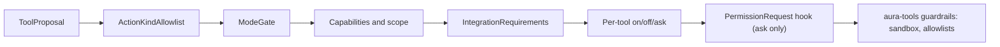

# Aura Harness — Architecture

This document is organized in three parts:

1. **Part 0 — Layer overview.** The ten-layer stack the workspace ships with today, the strict downward-only dependency rule, the runtime diagram, the `AgentMode` resolution chain, and the tool authorization pipeline.
2. **Part 1 — Layered crate reference.** One section per layer, with a per-layer overview followed by a sub-section for every crate (purpose, key types, key modules).
3. **Part 2 — User flows.** Sequence diagrams showing how data moves through the system for interactive, headless, WebSocket, and error-recovery paths.

---

## Part 0 — Layer overview

The architecture refactor (Phases 1 → 9, see [CHANGELOG.md](../CHANGELOG.md)) split the workspace into **nine layers** (a tenth, `fleet`, was later folded into recursive agents in `aura-engine`). Crates are named `aura-<layer>-<name>` and may depend only on crates whose layer is the same or lower. The boundary is enforced by [tests/layer_boundary.rs](../tests/layer_boundary.rs) and a per-crate `//! Layer: <layer>` doc-comment audit.

```text
core  <  store  <  config  <  model  <  context  <
plugin  <  exec  <  agent   <  surface
```

### Layers, in dependency order

| Layer    | Purpose                                                                          | Crates                                                                                                                                                                                       |
|----------|----------------------------------------------------------------------------------|----------------------------------------------------------------------------------------------------------------------------------------------------------------------------------------------|
| core     | Behavior-free IDs, domain types, capability enums, mode primitives, wire types. | `aura-core-types`, `aura-core-modes`, `aura-core-permissions`, `aura-core-auth`, `aura-core-protocol`, `aura-protocol`. |
| store    | Durable storage: agent state, append-only audit log, snapshot seam.              | `aura-store-db`, `aura-store-record`, `aura-store-snapshot`. |
| config   | Single source of truth for env vars + TOML config.                               | `aura-config`. |
| model    | LLM provider trait + streaming completions.                                      | `aura-model-reasoner`. |
| context  | Read-only context assembly (memory, skills, compaction, prompts).                | `aura-context-prompts`, `aura-context-memory`, `aura-context-compaction`, `aura-context-skills`. |
| plugin   | Plugin manifest schema, in-process API, hooks, MCP, connectors.                  | `aura-plugin-api`, `aura-plugin-core`, `aura-plugin-hooks`, `aura-plugin-mcp`, `aura-plugin-connectors`. |
| exec     | Tool catalog + executor, executor traits, sandbox, isolation.                    | `aura-tools`, `aura-exec-traits`, `aura-exec-sandbox`, `aura-exec-isolation`. |
| agent    | Single-agent kernel + turn loop + steering + subagent derivation.                | `aura-agent-kernel`, `aura-agent`, `aura-agent-steering`, `aura-agent-subagent`. |
| surface  | Composition roots: HTTP/WS gateway, orchestration engine, CLI, TUI, automaton host, domain HTTP, auth. | `aura-runtime`, `aura-engine`, `aura-surface-cli`, `aura-domain-http`, `aura-terminal`, `aura-automaton`, `aura-auth`, `aura-auth-kit`, `aura-auth-zos`, `aura-auth-chatgpt`, `aura-auth-claude`. |

### Dependency rules

- A crate may depend on crates in the same layer or any lower layer. Upward edges fail CI via [tests/layer_boundary.rs](../tests/layer_boundary.rs).
- Every `crates/<crate>/src/lib.rs` carries a `//! Layer: <layer>` doc-comment that must match the `KNOWN_CRATES` table in the boundary test (audited by `every_crate_carries_a_matching_layer_doc_tag`).
- There are no allowlisted upward edges.

### Layered dependency diagram

Each box is a layer. Arrows point in the only allowed dependency direction: **downward**. A crate at any layer may depend on crates at the same layer or any layer below, never above.

```text
   ┌────────────────────────────────────────────────────────────────┐
   │  surface — HTTP/WS gateway · orchestration engine · CLI · TUI  │
   │  · automaton host · domain HTTP · auth                         │
   │  aura-runtime, aura-engine, aura-surface-cli, aura-domain-http,│
   │  aura-terminal, aura-automaton, aura-auth                      │
   └─────────────────────────────┬──────────────────────────────────┘
                                 │
   ┌─────────────────────────────▼──────────────────────────────────┐
   │  agent — kernel (mode gate + policy) · AgentLoop · steering ·  │
   │  subagent derivation                                           │
   │  aura-agent-{kernel,steering,subagent}, aura-agent             │
   └─────────────────────────────┬──────────────────────────────────┘
                                 │
   ┌─────────────────────────────▼──────────────────────────────────┐
   │  exec — tool catalog + executor · executor traits · sandbox ·  │
   │  isolation                                                     │
   │  aura-tools, aura-exec-{traits,sandbox,isolation}              │
   └─────────────────────────────┬──────────────────────────────────┘
                                 │
   ┌─────────────────────────────▼──────────────────────────────────┐
   │  plugin — manifest schema · in-process API · hooks · MCP ·     │
   │  connectors                                                    │
   │  aura-plugin-{api,core,hooks,mcp,connectors}                   │
   └─────────────────────────────┬──────────────────────────────────┘
                                 │
   ┌─────────────────────────────▼──────────────────────────────────┐
   │  context — read-only prompt assembly · memory · compaction ·   │
   │  skills                                                        │
   │  aura-context-{prompts,memory,compaction,skills}               │
   └─────────────────────────────┬──────────────────────────────────┘
                                 │
   ┌─────────────────────────────▼──────────────────────────────────┐
   │  model — LLM provider trait · streaming completions            │
   │  aura-model-reasoner                                           │
   └─────────────────────────────┬──────────────────────────────────┘
                                 │
   ┌─────────────────────────────▼──────────────────────────────────┐
   │  config — env vars + TOML config (single source of truth)      │
   │  aura-config                                                   │
   └─────────────────────────────┬──────────────────────────────────┘
                                 │
   ┌─────────────────────────────▼──────────────────────────────────┐
   │  store — durable storage · sealed WriteStore (Invariant §10)   │
   │  aura-store-{db,record,snapshot}                               │
   └─────────────────────────────┬──────────────────────────────────┘
                                 │
   ┌─────────────────────────────▼──────────────────────────────────┐
   │  core — IDs · domain types · capability enums · modes · wire   │
   │  aura-core-{types,modes,permissions,auth,protocol},            │
   │  aura-protocol                                                 │
   └────────────────────────────────────────────────────────────────┘
```

### Runtime diagram

How a request flows through the running system. The kernel boundary cuts at the `agent` layer.

```text
                 aura (TUI)  ·  aura run --ui none  ·  aura-node
                                    │
                    HTTP / WebSocket gateway (aura-runtime)
                                    │
                Scheduler (aura-engine): store-backed per-agent claim (§12.a)
                     │                  │                  │
                 Worker             Worker             Worker      one per agent
                     └──────────────────┼──────────────────┘
                                        │
              Kernel: build context · mode gate + policy · call reasoner
                      · execute actions · commit RecordEntry (sealed WriteStore)
                     │                  │                  │
        Reasoner (records every    Executor (tools:    Store (RocksDB: record,
        LLM call) → aura-router    FS, commands,       agent_meta, inbox,
        proxy → providers          domain, automaton)  memory_*, agent_skills)
```

### `AgentMode` resolution

`AgentMode` (`Agent` / `Plan` / `Ask` / `Debug`) is resolved once per session by `aura_config::session_mode`, a thin wrapper over the pure `aura_core_modes::resolve_session_mode`:

1. **Request** — `RuntimeRequest.mode` on `POST /v1/run`, or the CLI `--mode <agent|plan|ask|debug>` flag (`ModeFlag` in `aura-surface-cli`) for the interactive terminal. Headless `aura run --ui none` ignores the flag with a warning.
2. **Daemon default** — `aura_config::AgentConfig::default_mode` (`AURA_DEFAULT_MODE`; the older `AURA_FLEET_DEFAULT_MODE` is still read).
3. **Fallback** — `AgentMode::Agent`.

The gateway stores the resolved mode on the chat session and sets `PolicyConfig::mode` when it builds the session kernel; the CLI terminal runner does the same for its local kernel. Child agents take `SubagentSpec.mode` from `derive_subagent`, which can only narrow. Dev-loop and task-run requests are rejected with `400` unless the resolved mode is `Agent`, so automaton kernels always run in `Agent` mode. The TUI `/mode` slash command (`aura_terminal::SlashModeCommand`) is parsed but not wired; changing mode mid-session must first append a `System` record.

### Tool authorization pipeline

Every tool call runs these stages in order. The first denial wins and is recorded as the turn's `decision` (Invariant §5).



- **Mode gate** — [`policy/check/mode_gate.rs`](../crates/aura-agent-kernel/src/policy/check/mode_gate.rs) maps each tool to a `GatedAction` through an explicit table (unclassified tools map to `Network`) and asks `DefaultModeGate`. `Agent` mode skips it. [`crates/aura-engine/tests/mode_gate_catalog.rs`](../crates/aura-engine/tests/mode_gate_catalog.rs) fails if a catalog tool is missing from the table.
- **Capabilities, scope, integrations, per-tool state** — `Policy::check` in [`policy/check/`](../crates/aura-agent-kernel/src/policy/check/).
- **PermissionRequest hook** — plugin hook consulted only on `ask`, before the interactive prompter (Invariant §4.b).
- **Guardrails** — `aura-tools` command / binary / shell-script allowlists and the filesystem sandbox, applied after policy allows the call.

See [invariants.md §4](invariants.md#4-full-policy-enforcement) for the full rules.

### Subagents

Subagents are ordinary agents started by other agents, and they can start agents of their own. One mechanism, `aura_engine::AgentHost` ([`crates/aura-engine/src/agents/`](../crates/aura-engine/src/agents/)), backs two tools that both require `Capability::SpawnAgent`:

- `task` starts a child of a bundled kind (`explore`, `general_purpose`, ...) to get a job done and returns its result. In detached mode it returns at once and the result arrives later as a message. A task child is removed once its job is done.
- `spawn_agent` starts a long-lived named child that keeps its history and handles `send_to_agent` / `delegate_task` messages until `agent_lifecycle` stops it.

The gateway holds one node-wide `AgentHost` on `RouterState`. Each chat session registers itself as a root agent in [`gateway/session/helpers.rs`](../crates/aura-runtime/src/gateway/session/helpers.rs) and attaches the returned `AgentHooks` to its kernel; `session/child_kernel.rs` builds the tool surface for each child. A spawn derives the child spec with `derive_subagent` (mode, permissions and model may only narrow; tools are filtered by the child's permissions), appends a `SubagentSpawn` audit row to the parent, and runs the child through the engine's `Scheduler`, so the child gets the same per-agent claim and record pipeline as ordinary work. Depth is capped by `AURA_SUBAGENT_MAX_DEPTH` (default 8) and concurrent children by `AURA_SUBAGENT_MAX_RUNNING` (default 32). Messages for a root (for example a detached task's result) land in the session's mailbox and start a new turn once the session is idle.

### External contract

External consumers (`aura-os`, any future client) talk to [`aura-runtime`](../crates/aura-runtime) over the wire — `POST /v1/run` for submission, `WS /stream/:run_id` for events, the management endpoints (skills, memory, tool defaults, files, tx) for everything else. Workspace crates are internal packaging; no external `Cargo.toml` depends on them. `aura-os` keeps its own mirror of the `aura-protocol` wire types, so a wire change (such as `RuntimeRequest.mode`) has to land in both repositories. `tests/layer_boundary.rs::aura_runtime_reexports_canonical_wire_types` pins that the `POST /v1/run` + `WS /stream/:run_id` wire types stay reachable through `aura-runtime`.

---

## Part 1 — Layered crate reference

Each section opens with a paragraph describing the layer's purpose and the invariants it owns, then walks every crate at that layer. Per-crate entries cite the canonical files via markdown links so they can be opened directly in the editor.

---

### Core layer

The foundation. Behavior-free crates that define the IDs, domain types, capability enums, modes, and wire types that every other layer reaches for. No I/O, no async runtime.

#### [`aura-core-types`](../crates/aura-core-types)

Strongly-typed identifier newtypes (`TurnId`, `RunId`, `ToolCallId`, `SessionId`) plus the shared domain types (`Transaction`, `TransactionType`, `Action`, `Effect`, `RecordEntry`, `ToolCall`, `ToolResult`, `SubagentDispatchRequest`). Re-exports `AgentMode` and `Capability` for crates that want a single import surface.

#### [`aura-core-modes`](../crates/aura-core-modes)

Closed `AgentMode` enum (`Agent`, `Plan`, `Ask`, `Debug`), the `ModeGate` trait with `DefaultModeGate` / `GatedAction` / `ModeViolation` (consulted by the kernel's mode gate on every tool call), the pure `resolve_session_mode` over `AgentModeInputs`, and `KernelMode` / `SpawnMode` / `ModeProfile`.

#### [`aura-core-permissions`](../crates/aura-core-permissions)

Privilege types (`Capability`, `Permissions`, `EffectivePermissions`) and the pure resolution math — `narrow`, `intersect`, `effective` — used by the kernel's policy gate and subagent derivation. Pure functions only; no I/O or config reads.

#### [`aura-core-auth`](../crates/aura-core-auth)

Auth primitives and the contracts each auth method implements. Types: `AccessToken`, `RefreshToken`, `Token`, `StoredSession`, `AuthError`, `ProviderKind` (`local`, `zos`, `chatgpt`, `claude`), `Owner`, `OAuthTokens`, `LinkedAccount`, `InferenceCredential`. Traits: `IdentityProvider` (zOS), `SubscriptionProvider` (ChatGPT, Claude) and `CredentialResolver`, which the model layer calls for a fresh plan credential per request. Keeping the traits here means provider crates never depend on each other and `aura-model-reasoner` never depends on a surface crate. No I/O.

#### [`aura-core-protocol`](../crates/aura-core-protocol)

Phase 1 wire-protocol primitives — currently just `ProtocolVersion` and `PROTOCOL_VERSION`.

#### [`aura-protocol`](../crates/aura-protocol)

Serde types for the wire API consumed by `aura-runtime` and external clients (e.g. the `aura-os` web UI). After the Phase A wire-shape unification this crate owns:

- **`RuntimeRequest`** — canonical `POST /v1/run` body. Fields: `r#type` (a `RuntimeRequestType` discriminated union over `Chat { conversation_messages }` / `DevLoop {}` / `TaskRun { task_id, prior_failure, work_log }`), `agent_identity` (an `AgentIdentity` wrapper carrying `template_id`, `partition_id`, `persona`, `skills`, `system_prompt`), `model` (a `ModelSelection`: id, max_tokens, max_turns, temperature, provider_overrides), `workspace` (a `WorkspaceLocation`), `project` (an `Option<ProjectContext>`), `agent_permissions` (kernel-enforced policy bundle), `tool_permissions` (per-tool on/off overrides), `agent_capabilities` (runtime-resolved tools / integrations / classifier the agent **can** use), `auth_jwt: Option<String>`, `user_id`, and optional `mode` (`agent` / `plan` / `ask` / `debug`; see [`AgentMode` resolution](#agentmode-resolution)).
- **`RuntimeRunResponse`** — synchronous body returned by `POST /v1/run`: `{ run_id, event_stream_url }`. The caller then opens `WS /stream/:run_id`.
- **`AgentPersona`** — the narrow `{ name, role, personality }` triple nested as the `persona` field of `AgentIdentity`. Renamed from the pre-Phase-A `AgentIdentityWire` to free the `AgentIdentity` name for the wider wrapper.
- **`InboundMessage`** — `UserMessage`, `Cancel`, `ApprovalResponse`, `ToolApprovalResponse`, `GenerationRequest`. The pre-Phase-A `InboundMessage::SessionInit` first-frame variant is **deleted**; runs are now started over HTTP before the WS opens.
- **`OutboundMessage`** — `SessionReady` (still the first server-emitted frame), `AssistantMessageStart`, `TextDelta`, `ThinkingDelta`, `ToolUseStart`, `ToolApprovalPrompt`, `ToolPolicyDecision` (the recorded policy decision for a tool call, sent before it runs), `ToolResult`, `AssistantMessageEnd`, `Error`, plus the generation-proxy progress family.

**Naming rationale** (kept here so future contributors don't reopen the question):

- `agent_permissions` vs `agent_capabilities` — permissions decide whether a capability is **allowed** (kernel-enforced policy gate); capabilities decide what concrete tools / integrations / classifier materialize it (runtime resolution). The "agent_" prefix qualifies the noun so neither field is confused with `aura_core_permissions::Capability` (the privilege enum).
- `auth_jwt: Option<String>` rather than a struct wrapper — the credential shape is a bare bearer JWT today, and the field stays a plain `Option<String>` so the wire surface doesn't pretend to support polymorphic credential types it doesn't actually have. If richer auth ever lands it gets its own field rather than a typed `AuthCredentials` enum.

`SessionInit`, `AutomatonStartRequest`, and the pre-rename `AgentIdentityWire` are all **removed** with no aliases. External consumers of `aura-protocol` (e.g. `aura-os`) mirror the same shape in their own kept-in-sync copy of this crate rather than depending on it.

---

### Store layer

Durable persistence. Owns the append-only record log and all RocksDB column families. **Invariant §10** lives here: the record-append surface (`append_entry_atomic`, `append_entries_batch`, …) lives on the sealed `WriteStore` trait, so only the kernel's `Arc<dyn WriteStore>` can commit a record entry. Non-kernel callers depend on `Arc<dyn ReadStore>`.

#### [`aura-store-db`](../crates/aura-store-db)

RocksDB-backed durable storage. Owns the three column families (`record`, `agent_meta`, `inbox`), the `RecordKey` / `AgentMetaKey` / `InboxKey` encoders, and the atomic `WriteBatch` commit path. Implements both `Store` (legacy) and the sealed `WriteStore` (Phase 2 split).

#### [`aura-store-record`](../crates/aura-store-record)

Append-only domain types and the `RecordLog` trait contract independent of any storage backend. Defines `RecordEntry`, `RecordKind`, and `RecordLogError`. Other layers consume this rather than `aura-store-db` so the backend can be swapped without touching them.

#### [`aura-store-snapshot`](../crates/aura-store-snapshot)

Content-addressed snapshot store trait (`SnapshotStore`, `SnapshotError`, `NoopSnapshotStore`) used to resolve AuditedLite payload summaries during replay. Only the no-op implementation exists, so replaying a summarized entry ends in `ReplayError::SnapshotMissing` today. The trait is kept as the seam a real store will plug into.

---

### Config layer

Configuration loading and the resolved configuration types. The single source of truth for env vars and TOML config — every other crate reaches `aura_config::loaded()` rather than calling `std::env::var` directly.

#### [`aura-config`](../crates/aura-config)

`AuraConfig` aggregate plus the per-subsystem `AgentConfig` (carries `default_mode` — the daemon rung of the `AgentMode` resolution chain), `ReasonerConfig`, `SubagentConfig` (depth and concurrency caps), `session_mode` (applies that chain), and the env loader (`env::AURA_HOME`, `AURA_DEFAULT_MODE`, retry/thinking budgets). Hosts the `aura migrate` stub (Phase 4a).

---

### Model layer

LLM provider abstraction. Defines the `ModelProvider` trait, normalized message and stream types, and the (single) Anthropic-shaped router/proxy client. **Invariant §1** lives here: only `KernelModelGateway` (in the agent layer) may hold a `ModelProvider` for production code paths — automatons take `P: aura_agent::RecordingModelProvider`, a sealed marker trait that only the recording gateway implements.

#### [`aura-model-reasoner`](../crates/aura-model-reasoner)

`ModelProvider` trait (`complete`, `complete_streaming`, `health_check`), `ModelRequest` / `ModelResponse` shapes, `Message` / `ContentBlock` / `StopReason`, the `StreamEvent` SSE family and `StreamAccumulator`, the proxy-routed `AnthropicProvider` (with retry + model-chain fallback), `RoutedProvider` (TUI only: `local/*` models to a local Anthropic-compatible Ollama server without the JWT, everything else to aura-router), the `model_catalog` used by the TUI `/model` selector, and `MockProvider` for tests. The Anthropic SSE parser is split into `anthropic/sse/{parse,event,state}.rs` for readability.

---

### Context layer

Read-only context assembly. Everything that pulls signal *into* the prompt without producing side effects: prompt rendering, per-agent memory, message-history compaction, skill packages.

#### [`aura-context-prompts`](../crates/aura-context-prompts)

Render-only construction of every model-facing string: system prompts, bootstrap blocks, steering injections, error-recovery fix prompts. Notable types: `SystemPromptBuilder`, `bootstrap`, `SteeringRenderer`, `descriptors`. Has no provider or store deps.

#### [`aura-context-memory`](../crates/aura-context-memory)

Per-agent long-term memory: fact storage, episodic events, procedural pattern detection, a two-stage write pipeline (heuristic extraction → optional LLM refinement), deterministic retrieval for prompt injection, and consolidation. `MemoryManager` is the facade embedders use. Stores live in dedicated column families (`MEMORY_FACTS`, `MEMORY_EVENTS`, `MEMORY_PROCEDURES`) — never the record log.

Key types: `MemoryManager`, `MemoryStore` / `MemoryStoreApi`, `MemoryWritePipeline`, `MemoryRetriever`, `MemoryConsolidator`, `TurnSummary`, `MemoryPacket`. Phase 6c inverted this crate's dependency on `aura-agent` by injecting a `ModelProvider` and accepting `TurnSummary` rather than calling back into the agent loop.

#### [`aura-context-compaction`](../crates/aura-context-compaction)

Unified pure compaction: message-history tier selection, pressure-gated write/edit input redaction, structured `_redacted` markers, cached tool-result summaries, tool-surface compaction, storage compaction, and the `SummaryInput` / `SummaryOutput` data used for summary escalation. Does not call a model itself — `aura-agent` performs the model call and applies the result through this crate.

#### [`aura-context-skills`](../crates/aura-context-skills)

Skill system wire-compatible with the Claude Code `SKILL.md` / `AgentSkills` open standard. Loader precedence: workspace → agent-personal → personal → extra dirs → bundled. `SkillManager` exposes activation and prompt-injection; `SkillInstallStore` persists per-agent installs in the `AGENT_SKILLS` column family.

Key types: `SkillLoader`, `SkillRegistry`, `SkillManager`, `SkillInstallStore`, `SkillActivation`, `AgentSkillPermissions`.

---

### Plugin layer

The plugin runtime. Splits into a contributor API surface (first-party plugins shipped in-tree) and an on-disk manifest / install / cache / marketplace pipeline. Phase 4c added the runtime surfaces — hooks, MCP, connectors — that Phase 8 then wired into the agent loop.

#### [`aura-plugin-api`](../crates/aura-plugin-api)

In-process contributor trait surface for first-party plugins. `PluginContributor`, `ContributionKind`, `PluginRoot`, `PluginId`. Not a dynamic loader — plugins are compiled in and registered at startup.

#### [`aura-plugin-core`](../crates/aura-plugin-core)

Declarative manifest schema, install pipeline, cache layout under `AURA_HOME/plugins/`, and marketplace lookup. Owns `PluginManifest`, `install`, `marketplace`, and the trust-prompt flow. Consumed by `aura plugins install/list/enable/disable`.

#### [`aura-plugin-hooks`](../crates/aura-plugin-hooks)

Hook engine: closed `HookEvent` taxonomy (10 Codex/Claude-aligned lifecycle events), `HookEngine`, `HookOutcome`, and the sandboxed env scrubbing for hook commands. Hooks fire at every documented agent-loop lifecycle point; `SubagentStart` / `SubagentStop` are defined but not yet fired by the agent host.

#### [`aura-plugin-mcp`](../crates/aura-plugin-mcp)

Stdio MCP JSON-RPC client and a first-active-wins connection manager keyed by server id. Notable types: `McpClient`, `McpConnectionManager`, `ServerConfig`, `McpError`. The manager clears child environments before spawn and applies a per-request timeout so silent plugin-owned servers cannot pin the pool indefinitely.

#### [`aura-plugin-connectors`](../crates/aura-plugin-connectors)

Thread-safe registry of plugin-contributed external endpoints. `ConnectorRegistry`, `ConnectorEntry`, `ConnectorError`. Last-wins registration semantics covered by [crates/aura-plugin-connectors/tests/last_wins.rs](../crates/aura-plugin-connectors/tests/last_wins.rs).

---

### Exec layer

Tool execution surface: the tool catalog and executor (`aura-tools`), the executor traits the kernel and tools share (`aura-exec-traits`), and the sandbox and worktree-isolation primitives.

#### [`aura-exec-traits`](../crates/aura-exec-traits)

`Executor`, `ExecuteContext`, `ExecutorError` and `SpawnHook`. Relocated out of `aura-agent-kernel` so `aura-tools` can implement them without an upward dependency; both `aura-tools` and the kernel depend on this crate.

#### [`aura-exec-isolation`](../crates/aura-exec-isolation)

Subagent workspace isolation. `WorktreeIsolation` (git worktree) is the preferred path; `CopyIsolation` is the fallback when git is unavailable or the workspace is not a git repo. Returns an `IsolatedWorkspace` handle that the spawner mounts before scheduling the child.

#### [`aura-exec-sandbox`](../crates/aura-exec-sandbox)

OS-level containment primitives: `FsSandbox` (path canonicalisation, prefix-check, symlink guard) and `ProcessSandbox` (subprocess spawn guardrails). Used by every filesystem and command tool.

#### [`aura-tools`](../crates/aura-tools)

Tool catalog, resolver, `ToolExecutor`, and sandboxed filesystem/command execution. Implements the `Executor` trait from `aura-exec-traits`. Hosts:

- Built-in filesystem tools: `list_files`, `read_file`, `write_file`, `edit_file`, `stat_file`, `find_files`, `delete_file`, `search_code` (ripgrep), `run_command` (with sync / async threshold).
- Git tools under `git_tool/`: `git_commit`, `git_push`, `git_commit_push` — the *only* permitted call-site for mutating `Command::new("git")` (Invariant §1, enforced by `scripts/check_invariants.sh`).
- Domain tools under `domain_tools/`: HTTP/API-backed handlers for orbit, network, specs, tasks, projects, storage via the `DomainApi` trait. The HTTP `DomainApi` implementation itself lives in the surface-layer [`aura-domain-http`](#aura-domain-http) crate — `aura-tools` only owns the trait + the tool wrappers.
- `task` tool — consumes the exec-layer `SubagentDispatchHook` trait this crate declares. The concrete dispatcher is `aura-engine`'s `AgentHooks`, so the strict layer boundary holds.
- Automaton tools under `automaton_tools/`: dev-loop and task-run controls gated behind an `AutomatonController` trait.
- `permissions.rs` (new in Phase B / Commit 3) — `load_agent_tool_context` + `validate_user_defaults` + `validate_agent_tool_permissions`, lifted from the pre-refactor top-level `aura-runtime/src/tool_permissions.rs`. Pure utility functions consumed by the gateway's HTTP handlers; the gateway keeps the routing/HTTP wrapper alongside its other handlers.
- Catalog + resolver: `ToolCatalog`, `ToolResolver`, `ToolProfile` (`Core` / `Agent` / `Engine`), `CatalogEntry`. The resolver's trusted-integration helpers (GitHub, Linear, Slack, Resend, Brave) live under `resolver/trusted/integrations/`.

---

### Agent layer

The core of a single agent. The kernel records every reasoning call, every tool proposal, every policy decision (including mode-gate denials), every effect. **Invariants §1 through §11** are all owned here.

#### [`aura-agent-kernel`](../crates/aura-agent-kernel)

The kernel. Builds context from the record window, calls the reasoner, enforces the mode gate and policy, dispatches execution through the `ExecutorRouter`, and produces `RecordEntry`s. Context hashing is deterministic over the agent's own transaction window; replay re-reads recorded decisions rather than re-running the model.

Key types: `Kernel` (with `process_direct`, `process_dequeued`, `reason`, `reason_streaming`, `process_tools`), `KernelConfig` (`record_window_size`, `policy`, `workspace_base`, `replay_from`, `proposal_timeout_ms`), `ExecutorRouter`, `Policy`, `PolicyConfig` (including `mode`), `ContextBuilder`, `ReplayConsumer`. The `kernel/tools/` proposal pipeline is split into `{mod,single,batch,shared}.rs`; the `policy/check/` module is split into per-gate helpers, with `mode_gate.rs` running first.

#### [`aura-agent-steering`](../crates/aura-agent-steering)

Stateful per-turn steering evaluators. Built-ins: `RepeatedReadTracker`, `ImplementNow`, `EarlyOracle`. `SteeringRegistry` and `TurnSteering` thread them through each iteration; `inject` renders steering hints into the active system prompt.

#### [`aura-agent-subagent`](../crates/aura-agent-subagent)

Subagent derivation, inheritance, registry, and the pure-data adapter layer that any agent-layer caller needs to feed a child spawn. `derive_subagent(parent, request)` produces a `SubagentSpec` that may only narrow the parent's mode, permissions, and model. Owns:

- `derivation.rs` — `derive_subagent` and the `SubagentDerivation` trait.
- `parent.rs` — `ParentContext` (the atomically-captured parent session snapshot).
- `overrides.rs` — `SubagentOverrides`, `SubagentBudget`.
- `manifest.rs` — `OverrideManifest`, `OverriddenField`.
- `spec.rs` — `SubagentSpec`, `AuditAttribution`, `SubagentLineage`.
- `errors.rs` — the `DerivationError` closed taxonomy.
- `registry.rs` — `SubagentRegistry` + bundled kinds, absorbed from the pre-Phase-B `aura-runtime/src/subagent_registry.rs`.
- `adapters.rs` — `parent_context_from_request`, `overrides_from_request`, `narrow_permissions`, `legacy_permissions_to_modes`, `core_to_modes_kernel`. These are the dispatcher's pure-data helpers, lifted out of the old `aura-runtime/src/subagent_dispatch.rs` so the agent layer owns every piece of subagent state assembly without taking any runtime deps.

The `SubagentDispatchHook` trait stays at the **exec layer** in `aura-tools` (unchanged — see below); the concrete impl is `AgentHooks` in `aura-engine`. Phase 7a routed the `task` tool through this crate; Phase B widened it to also own the dispatcher's data layer.

#### [`aura-agent`](../crates/aura-agent)

The multi-step turn loop (`AgentLoop`, `AgentLoopConfig`, `AgentLoopEvent`) and everything that wraps the kernel: streaming, blocking detection, stall detection, budget management, compaction orchestration, build verification, message sanitization, planning, self-review, file-ops pipeline.

Key types and modules:

- `AgentLoop` + `AgentLoopConfig` + `LoopState` — the loop itself (`agent_loop/{mod,iteration,streaming,tool_execution,tool_pipeline,tool_result_cache,context,search_cache,state,steering}.rs`).
- `KernelToolGateway`, `KernelModelGateway`, `KernelDomainGateway` — kernel bridges that implement the traits the loop and automatons expect (Invariant §8). `KernelDomainGateway` is the sole `DomainApi` wrapper.
- `RecordingModelProvider` — sealed marker trait. The only type that satisfies it from outside `aura-agent` is `KernelModelGateway` (Phase 4 type-level §1 seal).
- `agent_runner/` — higher-level run coordination for autonomous task execution.
- `session_bootstrap.rs` — shared embedder bootstrap (`open_store`, `default_agent_config`, `build_executor_router`).
- `blocking/`, `stall.rs`, `budget.rs`, `build.rs`, `verify/`, `planning.rs`, `self_review.rs`, `sanitize.rs`, `read_guard.rs`, `file_ops/`.
- `git.rs` — **read-only** git helpers only (`is_git_repo`, `list_unpushed_commits`). Mutating ops moved to `aura-tools/src/git_tool/`.
- `events/` — `TurnEventSink`, the agent-loop event enum, and the `map_agent_loop_event` dispatch shared by the TUI `UiCommandSink` and the runtime `OutboundMessageSink`.

---

### Surface layer

Composition roots. Each surface assembles dependencies from the lower layers into a runnable entry point (CLI, TUI, headless server, automaton host) or a side-effectful client (zOS HTTP).

#### [`aura-surface-cli`](../crates/aura-surface-cli)

CLI composition root. Owns the clap `Cli` / `Commands` / `RunArgs` definitions, the `ModeFlag` global flag (the request rung of the `AgentMode` resolution chain for the interactive terminal), the event-loop wiring (`event_loop/`), the record-loader utility, and the surface-layer `session_helpers` that chain `aura_auth::CredentialStore` onto `aura_agent::session_bootstrap`. The workspace root `src/main.rs` is now a thin binary that delegates to `aura_surface_cli::run`; the `aura-node` binary still enters through `aura_runtime::run_node` and is re-exported as `aura_surface_cli::run_node` to avoid a dependency cycle.

#### [`aura-runtime`](../crates/aura-runtime)

The HTTP/WS **gateway crate** plus the composition root for the `aura-node` binary. After the Phase C / Commit 4 reorganization `aura-runtime` no longer owns scheduling, orchestration, subagent dispatch, HTTP domain calls, or the PTY terminal handler — those moved out to dedicated crates (see the next two entries). What remains is the inbound-traffic seam plus the composition root that assembles every lower layer into a runnable server.

`aura-runtime` owns the external wire contract (see [External contract](#external-contract)). External consumers talk to it over HTTP and WebSocket rather than depending on workspace crates.

Layout:

- `lib.rs` — re-exports + `run_node()` entry point (calls `Node::run`). Phase 10 carve-out 1 owns the `aura-node` binary body here so `crates/aura-runtime/src/main.rs` is a ≤10-line shim.
- `main.rs` — `tokio::main` shim that calls `run_node()`.
- `node.rs` — `Node` composition root: binds the TCP listener, opens the store, builds the `aura-engine` `Scheduler` and `AutomatonBridge`, builds the `aura-domain-http::HttpDomainApi`, builds the gateway `Router`, and runs the axum server with graceful shutdown.
- `config/` — `NodeConfig::from_env`: env loading, paths, auth-token resolution. Module path unchanged across the refactor.
- `auth.rs` — bearer-token check shared with `aura-surface-cli`'s embedded API server.
- `inbound_console.rs` — paired request/failure observer formatting under the `aura::console` target.
- `files_api.rs` — shared workspace walker and capped file reader used by the node's `/v1/files` + `/v1/read-file` and the TUI-embedded `src/api_server.rs`.
- `tool_permissions.rs` — HTTP-driven tri-state tool permission writes. The single sanctioned non-kernel `append_entry_*` call site, guarded by the per-agent scheduler claim.
- `protocol.rs` — wire ↔ core conversion shim now reduced to a re-export adapter; the canonical conversions live in `aura-protocol::conversions`.
- `gateway/` — the HTTP/WS gateway, renamed from `router/` in Phase C:
  - `mod.rs` — module declarations + `pub use create_router / RouterState / RouterStateConfig`.
  - `middleware.rs` — `create_router`, the middleware stack (CORS, governor, body-limit, connect-info, observer, timeout, trace), the terminal-WS delegate (`terminal_ws_handler` → `aura_terminal::ws::handle_terminal_ws`), and the `/health` handler.
  - `state.rs` — `RouterState` + `RouterStateConfig` threaded through every handler.
  - `auth_mw.rs` — bearer-token enforcing axum middleware.
  - `errors.rs` — `ApiError` JSON failure shape.
  - `handlers/` — per-endpoint bundles: `run.rs` (`POST /v1/run` + the lifecycle endpoints), `run_ws.rs` (`WS /stream/:run_id`), `files.rs`, `tx.rs`, `memory/`, `skills.rs`, `tool_permissions.rs`, `util.rs`.
  - `session/` — per-WebSocket-connection state. `chat.rs` (bidirectional Chat-run handler), `child_kernel.rs` (session-scoped child-kernel factory), `cross_agent_hook.rs` (cross-agent callback path), `generation.rs` (router SSE generation proxy guarded by [`tests/generation_proxy_guard.rs`](../crates/aura-runtime/tests/generation_proxy_guard.rs)), `helpers.rs` (session kernel policy, including `PolicyConfig::mode`, and registering the session as a root agent), `agent_inbox.rs` (mailbox for messages from spawned agents), `partial_json.rs`, `state.rs` (resolved session mode), `tool_approval.rs`.

Backward-compat re-exports preserved at the crate root: `aura_runtime::scheduler::*` and `aura_runtime::memory_observer::*` now resolve to thin re-export modules over `aura_engine::*`. Internal callers should reach `aura-engine` directly, but the old paths keep `aura-surface-cli` and any future re-export-driven external consumer building without ripple changes.

HTTP routes are listed in [api.md](api.md).

#### [`aura-engine`](../crates/aura-engine)

Phase B / Commit 3 crate that owns the orchestration engine. Lives at the surface layer because every member composes lower-layer (kernel + store + agent) types into a runnable orchestration loop; the engine is what `aura-runtime`'s gateway hands `RuntimeRequest` payloads to. Splitting it out of `aura-runtime` lets the gateway crate shrink to inbound-only concerns, and lets another surface composition re-use the engine without dragging in HTTP/WS plumbing.

Layout:

- `scheduler.rs` — per-agent single-writer claim (Invariant §12.a), `IdentityRegistry`, per-turn `AgentLoopConfig` resolution. The claim semantics are unchanged from the pre-refactor `aura-runtime/src/scheduler.rs` — only the crate moved.
- `worker.rs` — `process_agent`: dequeue + `AgentLoop` execution + atomic record append. Owns the `AGENT_LOOP_TIMEOUT` boundary timeout (rules.md §6.2).
- `automaton/{mod,build,dispatch,event_channel}.rs` — `AutomatonBridge`: builds per-agent automaton kernels, turns automaton events into outbound `OutboundMessage` frames, records lifecycle changes. Formerly `aura-runtime/src/automaton_bridge/`.
- `memory_observer.rs` — `MemoryTurnObserver`: `TurnObserver` adapter feeding completed turns into `aura_context_memory::MemoryManager`.
- `capabilities.rs` — `record_runtime_capabilities` helper called by the automaton bridge during dev-loop / task-run bootstrap.
- `executor.rs` — shared `ToolResolver` / `ExecutorRouter` construction helpers (formerly `executor_factory.rs`).
- `agents/` — `AgentHost`: the node-wide table of recursive agents. `AgentHooks` (one per calling agent) implement the `task` dispatch, `spawn_agent`, messaging and lifecycle hooks; `ParentInbox` delivers results to root agents; `ChildKernelFactory` lets the surface build each child's tool surface. See [Subagents](#subagents).
- `model_context.rs` — `context_window_for_model` lookup used by the automaton bridge and the gateway-side session config.
- `lib.rs` — re-exports `AutomatonBridge`, `EventSubscription`, `AgentHost`, `AgentHooks`, `MemoryTurnObserver`, `turn_summary_from_result`, `context_window_for_model`, `Scheduler`, `SchedulerError`, `AgentIdentity`, `AgentIdentityRegistry`, `process_agent_detailed`, `ProcessedAgent`.

Library crate, so it ships typed `thiserror` errors (rules.md §4.2) — `aura-runtime`'s binary `aura-node` still uses `anyhow` at the top-level `main`.

#### [`aura-domain-http`](../crates/aura-domain-http)

Phase C / Commit 4 crate hosting the HTTP `DomainApi` implementation that the kernel domain gateway and automaton bridge consume. Stays at the surface layer because it composes lower-layer storage / network clients into a deployable HTTP edge — analogous to how `aura-runtime` composes the engine + middleware stack into a deployable HTTP server.

Layout:

- `http.rs` — `HttpDomainApi`: `reqwest`-backed `DomainApi` impl with Cloudflare-block retry handling, `aura-os-server` base-URL override routing, and JWT-bearer authentication.
- `jwt.rs` — `JwtDomainApi`: wraps any other `DomainApi` and injects a captured JWT on every call site that didn't supply one. Used by the automaton bridge to stamp the captured bearer onto every domain call without modifying the underlying `DomainApi` impl.
- `lib.rs` — re-exports `HttpDomainApi` and `JwtDomainApi`.

The `DomainApi` *trait* continues to live in `aura-tools::domain_tools`; only the HTTP implementations live here. `aura-runtime` therefore no longer depends on `reqwest` *for domain calls* — but it still depends on `reqwest` directly for the generation proxy in `gateway/session/generation.rs` and the cross-agent callback path in `gateway/session/cross_agent_hook.rs`, which are separate outbound surfaces.

#### [`aura-terminal`](../crates/aura-terminal)

Ratatui-based terminal UI library: themed rendering, components (`HeaderBar`, `InputField`, `Message`, `ToolCard`, `StatusBar`, `ProgressBar`, `DiffView`), input handling, layout. `App` is the UI state machine; `UiEvent` and `UiCommand` are the bridge to the agent loop. `mode_command.rs` holds the `SlashModeCommand` parser for `/mode <agent|plan|ask|debug>`, not yet wired into the input loop.

#### [`aura-automaton`](../crates/aura-automaton)

Long-running automaton workflows that drive `AgentLoop` on a schedule. Built-ins: `ChatAutomaton`, `DevLoopAutomaton` (with commit-and-push support; `dev_loop/{mod,aggregate,forward_event,validation}.rs`), `SpecGenAutomaton`, `TaskRunAutomaton`. `AutomatonRuntime` installs / runs / cancels instances; `TickContext` carries per-tick state.

#### [`aura-auth`](../crates/aura-auth)

Auth composition root. `AuthManager` registers the identity provider (zOS) and the subscription providers (ChatGPT, Claude), links plans to the active identity (`Owner::Local` while signed out, otherwise the zOS user), and implements `CredentialResolver`. Refreshes are single-flight per link, rotated tokens are saved before use, and a revoked grant marks the link `ReauthRequired`. `Vault` stores the zOS session in the legacy slot (OS keyring, falling back to `~/.aura/credentials.json`, so existing logins still work), link metadata in `~/.aura/auth/index.json`, and each link's tokens in its own keyring entry or 0600 file. `CredentialStore` remains as a static shim over the zOS slot.

Each auth method is its own crate:

| Crate | Provides |
|-------|----------|
| [`aura-auth-kit`](../crates/aura-auth-kit) | Shared plumbing: PKCE attempts, the loopback callback listener, pasted-code parsing, the OAuth HTTP client and refresh-error classification, error redaction, and the browser opener. |
| [`aura-auth-zos`](../crates/aura-auth-zos) | `ZosClient` and `ZosIdentity` (email/password login, JWT for aura-router). |
| [`aura-auth-chatgpt`](../crates/aura-auth-chatgpt) | Sign in with ChatGPT: dynamic client id per host, `id_token` checked against the issuer's JWKS, refresh and revocation. |
| [`aura-auth-claude`](../crates/aura-auth-claude) | Claude Pro/Max through Claude Code's public OAuth client. Inference needs the `oauth-2025-04-20` beta header and the Claude Code system prompt opening. Anthropic does not publish this flow for other apps. |

---

## Part 2 — User flows

The same kernel/AgentLoop pipeline drives every front-end. Every tool call passes the [authorization pipeline](#tool-authorization-pipeline): the session's `AgentMode` gate first (resolved request → daemon default → `Agent`), then the policy layers.

### Flow 1: Interactive TUI session

Default mode when a user runs `cargo run` or `aura`. Participants (left → right): **User**, **TUI** (`aura-terminal`), **EL** (event loop in `aura-surface-cli`), **AL** (`AgentLoop` in `aura-agent`), **MP** (`ModelProvider` in `aura-model-reasoner`), **KTG** (`KernelToolGateway` + `ExecutorRouter` in `aura-agent-kernel`), **Tools** (`ToolExecutor` in `aura-tools`).

Here **MP** is the `RoutedProvider`, which picks a backend from the model id prefix:

- `local/*` goes to Ollama.
- `claude/*` goes to the Anthropic API.
- `chatgpt/*` goes to the OpenAI Responses API through `openai_responses::OpenAiResponsesProvider`.
- Any other id goes to aura-router.

For the two plan routes, a `CredentialedProvider` asks `AuthManager` for the plan credential on each request. It strips the route prefix, adds the provider's headers and system prompt opening, and removes the Aura billing headers. There is no fallback between routes.

The session starts on the local default model (`local/qwen3:4b`), so no login is required. `/model` sends `UiEvent::SelectModel`, and the EL rewrites `AgentLoopConfig.model` together with its context and output limits. `/login` unlocks the aura-router models, and `/login claude` or `/login chatgpt` links a plan. Browser sign-ins finish in a background task that reports back to the EL. Paste sign-ins prompt for the code.

```text
 User       TUI         EL            AL              MP           KTG         Tools
  │          │           │             │               │             │           │
  │ types    │           │             │               │             │           │
  │ Enter ──▶│           │             │               │             │           │
  │          │ UiEvent:: │             │               │             │           │
  │          │ UserMsg ─▶│             │               │             │           │
  │          │           │ append +    │               │             │           │
  │          │           │ run_with_   │               │             │           │
  │          │           │ events ────▶│               │             │           │
  │          │           │             │ compact ctx   │             │           │
  │          │           │             │ build req     │             │           │
  │          │           │             │ complete_     │             │           │
  │          │           │             │ streaming ───▶│             │           │
  │          │           │             │◀── Stream of StreamEvents ──│           │
  │          │           │◀── TurnEvent::TextDelta /                 │           │
  │          │           │   ThinkingDelta / ToolStart                           │
  │          │◀── UiCommand::AppendText / StartThinking / ShowTool               │
  │ renders  │           │             │               │             │           │
  │ text + ◀─│           │             │               │             │           │
  │ cards    │           │             │               │             │           │
  │          │           │             │               │             │           │
  │          │  ┌─ Stop reason ────────┴──── ToolUse ──┴────┐        │           │
  │          │  │                                            ▼        │           │
  │          │  │             │             │ executor.execute(uncached) ──────▶│
  │          │  │             │             │               │  mode+policy check│
  │          │  │             │             │               │  router.execute ─▶│
  │          │  │             │             │               │             sandboxed
  │          │  │             │             │               │             FS / cmd
  │          │  │             │             │               │◀── Effect ─┤
  │          │  │             │             │◀── Vec<ToolCallResult> ────│
  │          │  │             │◀── TurnEvent::ToolResult (per tool)       │
  │          │◀── UiCommand::CompleteTool ──┤                              │
  │          │  │                                                          │
  │          │  └─ Stop reason ─── EndTurn ─┐                              │
  │          │                              ▼                              │
  │          │◀── UiCommand::Complete ──── TurnEvent::StepComplete ────────┤
  │ final ◀──│                              │                              │
  │          │                              │ (next iteration or exit)     │
```

**Data path:** User input → `UiEvent` channel → Event Loop appends to `Vec<Message>` → `AgentLoop.run_with_events()` → streaming `TurnEvent`s back through `mpsc` channel → Event Loop maps to `UiCommand` → Terminal renders.

---

### Flow 2: Run kickoff + WebSocket session (`aura-runtime` + `aura-engine`)

Used by `aura-os` and other clients connecting over the harness wire. After Phase A this is a **two-step exchange**: the client submits a `RuntimeRequest` over HTTP, receives a `run_id` back, then opens a per-run WebSocket. The client never sends an init frame — the run is already up by the time the WS attaches. Participants: **Client**, **GW** (gateway HTTP/WS handlers in `aura-runtime`), **Engine** (`aura-engine::Engine`), **Sess** (per-WS session state), **AL** (`AgentLoop`), **MP** (`ModelProvider`), **KTG** (`KernelToolGateway`), **Tools** (`ToolExecutor`).

```text
 Client            GW              Engine           Sess          AL         MP / KTG / Tools
   │                │                │                │             │              │
   │ POST /v1/run                    │                │             │              │
   │ { type: Chat | DevLoop | TaskRun,                │             │              │
   │   agent_identity, model,        │                │             │              │
   │   workspace, project,           │                │             │              │
   │   agent_permissions,            │                │             │              │
   │   tool_permissions,             │                │             │              │
   │   agent_capabilities,           │                │             │              │
   │   auth_jwt, user_id, mode? }    │                │             │              │
   │───────────────▶│                │                │             │              │
   │                │ session_mode(req.mode) → AgentMode            │              │
   │                │ Engine::submit(req) ───────────▶│             │              │
   │                │                │ build per-run state          │              │
   │                │                │ register pending_chat_runs   │              │
   │                │◀── RunHandle { run_id, event_stream_url } ────│              │
   │◀── 201 Created                  │                │             │              │
   │   { run_id,                     │                │             │              │
   │     event_stream_url:           │                │             │              │
   │       "/stream/:run_id" }       │                │             │              │
   │                │                │                │             │              │
   │ WS connect /stream/:run_id      │                │             │              │
   │───────────────▶│                │                │             │              │
   │                │ open_chat_stream(run_id) ──────▶│             │              │
   │                │ create Session ────────────────▶│             │              │
   │◀── Outbound::SessionReady ──────│                │             │              │
   │                │                │                │             │              │
   │ Inbound::UserMessage ──────────▶│                │             │              │
   │                │ append user msg ──────────────▶│             │              │
   │                │ run_with_events ──────────────────────────────▶│             │
   │                │                │                │             │ complete_streaming ──▶ MP
   │                │                │                │             │◀── StreamEvents ──────
   │                │◀── TurnEvent::TextDelta ─────────────────────│              │
   │◀── Outbound::TextDelta { text }                                              │
   │                │                                                              │
   │                │ ── alt: tool execution ─────────────────────────────────┐   │
   │                │                │                │             │ KTG.execute ──▶ Tools
   │                │                │                │             │           sandbox ──▶
   │                │                │                │             │◀── results ────────
   │                │◀── TurnEvent::ToolResult ───────────────────│              │
   │◀── Outbound::ToolResult { name, result, is_error }                           │
   │                │ ── end alt ────────────────────────────────────────────────┘ │
   │                │                                                              │
   │                │◀── AgentLoopResult ────────────────────────│                │
   │◀── Outbound::AssistantMessageEnd { usage, files_changed }                    │
   │                                                                                │
   │ Inbound::Cancel ─────────────▶│ CancellationToken::cancel() ─▶│              │
```

**Data path:** Client `POST /v1/run` (body: `RuntimeRequest`) → gateway resolves the auth-token chain, resolves `AgentMode` via `aura_config::session_mode` (dev-loop and task-run reject anything but `Agent`), calls `Engine::submit(req)` which prepares the per-run state and (on `Chat`) parks the pending session in `RouterState::pending_chat_runs` keyed by the new `run_id` → gateway returns `{ run_id, event_stream_url }` synchronously. Client follows up with `WS /stream/:run_id`; the gateway pulls the parked session, emits `OutboundMessage::SessionReady` as the first server frame (no client init frame at all), and bridges subsequent `TurnEvent`s to `OutboundMessage` for the duration of the run. A `Cancel` may arrive at any time and trips the `CancellationToken`.

`DevLoop` and `TaskRun` follow the same two-step exchange — the synchronous `POST /v1/run` returns a `run_id`, and the WS at `/stream/:run_id` is event-only (no `user_message` frames inbound). The gateway handler routes the request to `AutomatonBridge::start_dev_loop` / `AutomatonBridge::start_task_run` in `aura-engine` before responding.

---

### Flow 3: Headless node (scheduler-driven)

When running `aura run --ui none` or as `aura-node`, transactions are submitted via HTTP and processed by the engine's scheduler. Subagent spawns from inside the loop go through `aura-engine`'s `AgentHost`. Participants: **Client**, **Router** (HTTP gateway in `aura-runtime`), **Store** (`RocksStore`), **Sched** (`aura-engine::Scheduler`), **Worker** (`aura-engine::process_agent`), **AL** (`AgentLoop`), **MP** (`ModelProvider`), **KTG** (`KernelToolGateway`), **Host** (`AgentHost`).

```text
 Client     Router       Store        Sched         Worker         AL          MP / KTG / Host
   │          │            │            │              │            │                 │
   │ POST /tx │            │            │              │            │                 │
   │─────────▶│ enqueue_tx │            │              │            │                 │
   │          │───────────▶│            │              │            │                 │
   │◀── 202 ──│            │            │              │            │                 │
   │          │            │            │              │            │                 │
   │          │            │◀── check pending txs ─────│            │                 │
   │          │            │            │              │            │                 │
   │          │            │            │ acquire per-agent claim   │                 │
   │          │            │            │ (Invariant §12)           │                 │
   │          │            │            │ process_agent ───────────▶│                 │
   │          │            │◀── dequeue_tx ────────────│            │                 │
   │          │            │── (token, Transaction) ──▶│            │                 │
   │          │            │            │              │ agent_loop.run ────────────▶│
   │          │            │            │              │            │                 │
   │          │            │            │              │            │ ── loop ───────┐│
   │          │            │            │              │            │ model call ───▶│ MP
   │          │            │            │              │            │◀── response ───│
   │          │            │            │              │            │                 │
   │          │            │            │              │            │ alt: tool exec  │
   │          │            │            │              │            │ KTG ───────────▶│ Tools
   │          │            │            │              │            │◀── results ────│
   │          │            │            │              │            │                 │
   │          │            │            │              │            │ alt: task tool  │
   │          │            │            │              │            │ Host (derive_   │
   │          │            │            │              │            │ subagent +      │
   │          │            │            │              │            │ spawn) ────────▶│ Host
   │          │            │            │◀── schedule_agent_with_options(child) ──────│
   │          │            │            │── child result (Wait/Detached) ─────────────│
   │          │            │            │              │            │ ── end loop ───┘│
   │          │            │            │              │◀── AgentLoopResult ──────────│
   │          │            │◀── append_entry_atomic(agent_id, seq, entry, token) ─────│
   │          │            │            │◀── Worker done ───────────│                 │
   │          │            │            │                                              │
   │ GET /agents/{id}/record?from=1&limit=10                                          │
   │─────────▶│ scan_record│            │                                              │
   │          │───────────▶│            │                                              │
   │          │◀── Vec<RecordEntry>     │                                              │
   │◀── JSON record entries                                                            │
```

**Data path:** HTTP POST → Store inbox → Scheduler dequeues → Worker runs `AgentLoop` → Result committed atomically to record log → Client polls via GET. Subagent spawn lands through `aura-engine`'s `AgentHost` and re-enters the same scheduler lane, inheriting the per-agent processing claim (Invariant §12.a).

---

### Flow 4: Streaming error recovery (`StreamReset`)

When a streaming model call fails mid-stream, the system recovers deterministically. Participants: **AL** (`AgentLoop`), **MP** (`ModelProvider`), **UI** (TUI or WS consumer).

```text
 AL                              MP                             UI
  │                               │                              │
  │ provider.complete_streaming ─▶│                              │
  │◀── StreamEvent::TextDelta("partial...")                      │
  │ TurnEvent::TextDelta("partial...") ────────────────────────▶│
  │                               │                              │ renders
  │                               │                              │ partial text
  │                               │                              │
  │◀── StreamEvent::Error (connection lost)                      │
  │ TurnEvent::StreamReset { reason: "Stream error, retrying" } ▶│
  │                               │                              │ clears buffered
  │                               │                              │ partial content
  │                               │                              │
  │ provider.complete(request) ──▶│  (non-streaming fallback)    │
  │◀── Complete ModelResponse     │                              │
  │ TurnEvent::TextDelta(full_text) ───────────────────────────▶│
  │                               │                              │ renders
  │                               │                              │ authoritative
  │                               │                              │ content
```

---

### Data lifecycle summary

```text
 INPUT                 PROCESSING                                      OUTPUT
 ─────                 ──────────                                      ──────

 User Prompt           ┌─────────────────────────────────────────┐
     │                 │                                         │
     ▼                 │  AgentLoop                              │
 Transaction ─────────▶│     │                                   │
                       │     ▼                                   │
                       │  ModelProvider ──▶ ModelResponse        │
                       │                       │                 │
                       │                  StopReason?            │
                       │                 ╱          ╲            │
                       │           ToolUse          EndTurn      │     Record Entry
                       │              │                │         │──▶  ──▶ RocksDB
                       │              ▼                ▼         │
                       │  KernelToolGateway      AgentLoopResult │──▶  TurnEvents
                       │       │                                 │     ──▶ UI / WS
                       │       ▼                                 │
                       │  ExecutorRouter                         │
                       │       │                                 │
                       │       ▼                                 │
                       │  ToolExecutor + Sandbox                 │
                       │       │                                 │
                       │       ▼                                 │
                       │    Effect ───────▶ (back to AgentLoop)  │
                       │                                         │
                       └─────────────────────────────────────────┘
```

Every user interaction follows the same fundamental path: input becomes a transaction, the `AgentLoop` orchestrates model calls and tool execution in a loop, results are emitted as `TurnEvent`s for real-time display, and the final state is persisted as a `RecordEntry` in the append-only log.

For invariants enforcement details and the full per-invariant CI gate map, see [docs/invariants.md](invariants.md). For the running record of what landed in each phase of the refactor, see [CHANGELOG.md](../CHANGELOG.md).
