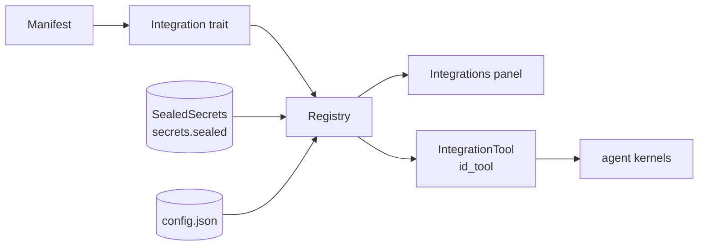

# Integrations

An integration is how aura talks to one external service: GitHub, boxd,
RunPod, Vercel, and so on. Before this there was no shared way to do it.
Each service had its own credentials, config, status and UI, or none.
`crates/engine/aura-engine-integrations` is now the one standard way to
plug in a service.

## What existed before

| Service | Credentials | Config | Agent tools | Status / health | UI |
|---|---|---|---|---|---|
| GitHub (local) | `gh` CLI login, or `GH_TOKEN`/`GITHUB_TOKEN`, read in `aura-app/src/event_loop/repo/github.rs` (`Api::from_env`) | none | git tools in `aura-exec-tools/src/git_tool`, not GitHub's API | the REPO tab says "Sign in with gh auth login…" on failure | REPO tab only |
| GitHub (cloud) | GitHub App key path in `.env` (`AURA_GITHUB_APP_*`, `aura-config/src/cloud`); per-repository installation tokens kept as boxd host-bound secrets (`aura-engine-cloud/src/github`, `repos.rs`) | `.env` | `git_ship` and pushes on machines | none | none |
| boxd | `BOXD_API_KEY` or `BOXD_TOKEN`, written in plain text to `~/.aura/.env` by `aura cloud setup` (`aura-config/src/cloud/credential.rs`) | `.env` (`BOXD_API_URL`, ...) | none | `aura cloud status` (CLI only) | cloud mark on agents |
| Model plans (`aura auth`) | `aura-auth` vault: OS keychain, plain `0600` fallback file | `auth/index.json` | none | `aura whoami` | header dot |
| Trusted integrations (Notion, GitHub, Linear, Slack, Brave, Resend, Google) | sent per request by aura-os in `installed_integrations` / `installed_tools` (`aura-core-types` `InstalledToolRuntimeIntegration`), run by `aura-exec-tools/src/resolver/trusted` | aura-os | yes, behind the kernel's `integration_gate` | none | none |
| Plugin connectors | `aura-plugin` manifest `connectors` (id and endpoint only) | `config.toml` | none (registry only) | none | `aura plugins list` |

So aura had no list of the services it talks to, and no shared
credential path: boxd's key sat in plain text. There was no common
health check and no panel.

## The model



An integration is two things:

- **A [`Manifest`]** (`src/manifest.rs`), everything known without a call:
  - `id: IntegrationId`: `[a-z0-9-]{1,32}`, starting with a letter. It
    names the stored secret, the settings and the tools' prefix.
  - `name`, `icon` (one glyph), `description` (one line), and `provides`
    (short phrases for the panel).
  - `auth: AuthKind`, one of:
    - `None`;
    - `ApiKey(KeyAuth { label, env, hint })`, a key the user pastes and
      that is also read from `env` variables;
    - `CliLogin { program, login, token }`, a CLI sign-in such as
      `gh auth login`, optionally also taking a token;
    - `OAuth { authorize_url, scopes }`, declared only for now.
  - `config: Vec<ConfigField { key, label, kind, required, default, advanced }>`
    (`ConfigField::new` sets the common defaults), where `kind` is `Text`,
    `Url`, `Bool`, `Choice(..)` or `Number { min, max, integer }`. Values
    are checked against their kind when set. An `advanced` field (an API
    URL override, say) is hidden in the panel until it is set.
  - `tools: Vec<ToolSpec { name, description, input_schema, effect, timeout }>`,
    where `effect` is `Read`, `Write`, `Spends` or `Destroys`. `timeout`
    replaces the registry's limit for that tool (a job that waits for its
    result).
  - `cloud: CloudDelivery`, either `Never` (the default) or
    `HostBound { env }` (see below).
- **An [`Integration`]** (`src/integration.rs`), a trait:
  - `manifest()`;
  - `status(&ctx) -> Status`: `Connected { via }`, `NotConnected { hint }`
    or `Misconfigured { why }`. It is local and quick, with no network.
    The default, `default_status`, is "connected when a credential is
    there", and says where the credential came from;
  - `health(&ctx) -> Result<HealthReport { summary, detail }>`: one real call that proves the
    credential and config work. It is the panel's **Test**, and what
    **Connect** runs before storing anything;
  - `call_tool(&ctx, tool, args) -> Result<Value>`: runs a tool by its
    local name.

`IntegrationContext` (`src/context.rs`) is what each call gets:

- `secret()` and `secret_source()`: the stored credential, else the first
  of the manifest's env variables that is set;
- `config(key)`: values with their defaults filled in;
- `http()`: a shared `reqwest` client;
- `timeout()`, `timed(fut)` and `send(request)`. `send` applies the
  timeout, reads the response as JSON, and turns a non-2xx status into
  `IntegrationError::Http` carrying only the service's own `message` or
  `error` field, cut to 200 characters. Network errors drop the URL.

The **[`Registry`]** (`src/registry.rs`) holds every integration and does
the rest the same way for all of them:

| Method | What it does |
|---|---|
| `add` | Register one; a duplicate id is refused |
| `list`, `get` | Manifests in the order added; one by id |
| `status`, `views` | Status within the time limit; the panel's `IntegrationView`s (manifest, status, config values, access, whether a credential is stored) |
| `test` | The health check |
| `connect(id, secret)` | Runs the health check **with the new secret**, and only stores it, sealed, when the check passes |
| `configure(id, key, value)` | Checks the value against its field; an empty value clears it |
| `disconnect(id)` | Removes the **stored** credential only. One from the environment or a CLI login stays, and the status says so |
| `set_access(id, Access)` | `AllAgents` (the default), or `Only { agents, channels }` |
| `tools_for(agent, channel)` | The `IntegrationTool`s this agent gets |
| `call(id, tool, args, caller)` | Checks access and connection again, then runs the tool within its time limit |

`IntegrationError` (`src/error.rs`) uses `thiserror` and always carries
the integration id. Variants include `NotConnected`, `Timeout { after }`,
`Http { status, message }`, `Network`, `UnknownTool`, `BadArgs`,
`BadConfig`, `Denied` and `Store`. No variant carries a credential.

### Agent tools

- An agent sees each tool as `<id>_<tool>`, with `-` turned into `_`. For
  example, `runpod` + `list_pods` becomes `runpod_list_pods`.
- `IntegrationTool` (`src/tools.rs`) implements `aura-exec-tools`'s
  `Tool`, so it registers on an agent's `ToolExecutor` like any built-in.
- Each agent's executor gets the tools its `Access` allows when its
  kernel is built, connected or not. The model is offered them each turn
  only while the integration is connected (`Integrations::tool_definitions`,
  appended to the turn's tool list), so one connected mid-session shows
  up on the next turn. Every call checks connection and access again, so
  a disconnect or an access change takes effect at once.
- The `effect` decides the mode gate and the approval prompt
  (`Integrations::tool_classes`, fed into `PolicyConfig::tool_classes`
  and `modes::user_defaults`):
  - `Read` tools are invocations, like `web_search`: they run in agent,
    plan and ask mode, and don't ask at any approval level.
  - `Write`, `Spends` and `Destroys` tools are network calls: agent mode
    only, and they ask under `ask` and `strict`.
  - A built-in tool's own class always wins; a name in neither is a
    network call.

### Credentials

- **Never in plain text.** `SealedSecrets` (`src/secret.rs`) keeps every
  integration's credential in one file,
  `<data_dir>/integrations/secrets.sealed`. The file holds a JSON map of
  id to secret, inside the local store's AES-256-GCM envelope
  (`aura-store-db`'s `SealCipher`).
  - The key is the local store's own (#93): it lives in the OS keychain
    entry `aura/store-key:<store id>`, or in `AURA_STATE_KEY_FILE`.
  - The file is replaced atomically (temp file, then rename) and is
    `0600` on Unix.
  - A file that isn't sealed, or doesn't open with the key, is an error.
    It is never read as empty and overwritten.
- **Never logged.** `Secret` wraps `Zeroizing<String>`, and its `Debug`
  and `Display` print `…`. Tracing records ids only.
- **Non-secret settings** (config values, access) go in
  `<data_dir>/integrations/config.json`.
- **Off the async threads:** all store IO runs in `spawn_blocking`.

### Cloud machines

A credential reaches a cloud machine only when its manifest says
`CloudDelivery::HostBound { env }`, and then never as the real value:

- The hub sets the credential as a boxd **host-bound secret**, as it
  already does for GitHub App repository tokens (`aura-engine-cloud/src/repos.rs`)
  and plan tokens (`plans.rs`).
- The machine's `env` holds only boxd's placeholder. boxd swaps in the
  real value on the machine's outbound requests to the service's host,
  so the credential never sits on the machine and can't be read there.

`Never`, the default, sends nothing. boxd's own key always stays on the
hub.

### Time limits

- Status, health checks and tool calls default to 10 seconds
  (`DEFAULT_TIMEOUT`, set with `Registry::with_timeout`).
- A tool can set its own limit (`ToolSpec::timeout`).
- Running past the limit is `IntegrationError::Timeout`. A status that
  runs past it shows as `Misconfigured` instead of hanging the panel.

## GitHub and boxd

The first two integrations live in `src/builtin/` and are listed by
`builtin(BuiltinOptions { github_app })`. Neither changes how its service
works today: each only describes what aura already uses, checks it, and
adds a sealed place for a token or key entered in the panel.

| | GitHub (`github`) | boxd (`boxd`) |
|---|---|---|
| Sign-in | `CliLogin { gh auth login }`, or a token (`GH_TOKEN`, `GITHUB_TOKEN`, or stored) | `ApiKey` (`BOXD_TOKEN`, `BOXD_API_KEY`, which `.env` sets at startup, or stored) |
| Status (local) | A token (stored, then env), else `gh auth token` succeeding, run with a time limit and its output dropped. It adds "GitHub App set for cloud pushes" when `AURA_GITHUB_APP_*` is set | A key from the store or the environment |
| Test | `GET <api_url>/user`, else `gh api user` | An API key (`bxd_…`) is exchanged at `<console_url>/api/v1/auth/token`, as cloud mode does; a `BOXD_TOKEN` is used as is |
| Config | `api_url` (default `https://api.github.com`) | `console_url` (default `https://app.boxd.sh`) |
| Tools | none yet | none |
| Cloud | `Never`: the GitHub App's installation tokens still reach machines through `aura-engine-cloud` (host-bound secrets) | `Never`: boxd's key stays on the hub |

### In the app

`aura-app/src/integrations/` owns the process's `Registry`:
- It opens right after the local store, whose key it seals with. When the
  key can't be read, credentials are kept in memory for the session, with
  a WARN; they are never written in plain text.
- Kernels are built synchronously, so the service keeps a snapshot of
  which integrations are connected (`refresh`, at startup and after every
  change). Each agent's executor gets the tools that snapshot and the
  agent's `Access` allow. Each call checks both again.
- The REPO tab reads GitHub's stored token after `GH_TOKEN` and
  `GITHUB_TOKEN`.

## The Integrations panel

The plug icon `🔌` in the agents panel's header, just left of BENCH's
wrench, opens INTEGRATIONS in the terminal and in the desktop app. It
uses the same icon cell, tooltip and active state as BENCH.

- **Each row:** the shared `StatusDot` (`aura-ui-widgets`, as MEMBERS and
  QUEUE draw it) for its state, `Ok` connected, `Off` not connected,
  `Failed`, or `Busy` while a Connect or Test runs, then its icon, name
  and description.
- **The selected row** adds its status, its last action's result, what it
  provides, and its actions: **Connect**, **Configure**, **Test** and
  **Disconnect**. Click one, or press `c` `e` `t` `d`.
  - Connect asks for the key in the input, masked. A CLI login says what
    to run instead.
  - Configure asks for a setting's value (`key=value` when there are
    several).
- **The wiring:** `UiCommand::SetIntegrations` carries `IntegrationView`s
  (`aura-ui` `events/views/integrations.rs`), and `UiEvent::Integration
  { id, action }` carries the action. `IntegrationAction`'s `Debug` hides
  a Connect's key. aura-app runs each action off the event loop
  (`integrations/ui.rs`), refreshes the connected snapshot, and sends the
  list back.
- **Code:** terminal `app/apps/integrations.rs`,
  `renderer/agents/integrations.rs`; desktop `chrome/glyphs.rs` `plug`.

## How to add an integration

1. **Write the manifest and the trait.** In a module of your own, either
   in this crate (`src/builtin/<id>.rs`) or in a crate that depends on
   it:

   ```rust
   use aura_engine_integrations::*;

   pub struct Vercel { manifest: Manifest }

   impl Vercel {
       pub fn new() -> Result<Self, IntegrationError> {
           let mut manifest = Manifest::new(IntegrationId::new("vercel")?, "Vercel");
           manifest.icon = "▲".into();
           manifest.description = "Deployments and preview URLs".into();
           manifest.provides = vec!["deployments".into()];
           manifest.auth = AuthKind::ApiKey(KeyAuth {
               label: "Token".into(),
               env: vec!["VERCEL_TOKEN".into()],
               hint: "vercel.com/account/tokens".into(),
           });
           manifest.tools = vec![ToolSpec {
               name: "list_deployments".into(),
               description: "List recent deployments".into(),
               input_schema: serde_json::json!({"type": "object", "properties": {}}),
               effect: ToolEffect::Read,
               timeout: None,
           }];
           Ok(Self { manifest })
       }
   }

   #[async_trait::async_trait]
   impl Integration for Vercel {
       fn manifest(&self) -> &Manifest { &self.manifest }

       async fn health(&self, ctx: &IntegrationContext) -> Result<HealthReport, IntegrationError> {
           let token = ctx.require_secret("add a Vercel token")?;
           let me = ctx.send(ctx.http().get("https://api.vercel.com/v2/user")
               .bearer_auth(token.expose())).await?;
           Ok(HealthReport::new(format!("signed in as {}", me["user"]["username"])))
       }

       async fn call_tool(&self, ctx: &IntegrationContext, tool: &str, args: serde_json::Value)
           -> Result<serde_json::Value, IntegrationError> { /* match tool { .. } */ }
   }
   ```

2. **Use the context for every call.** Send through `ctx.send` (or wrap
   other work in `ctx.timed`), so the call has a time limit and its
   errors carry no secret. Never log `Secret::expose()`, and never put it
   in an error or a tool result.
3. **Register it** in the app's registry, next to GitHub and boxd. You
   don't write any storage code: the panel's Connect, Configure, Test and
   Disconnect, the sealed storage, access and the agent tools come with
   the registry.
4. **Cloud:** leave `cloud: CloudDelivery::Never` unless agents on cloud
   machines must call the service themselves. If they must, use
   `HostBound { env }` and say why in the manifest's module docs.
5. **Test it** with a fake service the way
   `tests/registry.rs` does:
   - Connect refuses a bad key and stores a good one;
   - Test times out;
   - tools only reach allowed agents.
6. **Add a changelog fragment** in `changelog.d/`.

## Runpod

The tools live in `aura-exec-tools/src/runpod`; the adapter
(`aura-engine-integrations/src/builtin/runpod.rs`) puts them on this
model, so Runpod is in the Integrations panel and agents get its tools
once it is connected.

Runpod rents GPUs by the hour (pods) and by the second (serverless
endpoints). The Runpod tools let agents find GPUs, start and stop pods,
read their logs and run serverless jobs, over the
[Runpod REST API v2](https://docs.runpod.io/api-reference-v2/overview)
and the serverless job API.

### The key

Create an API key on Runpod's
[Credentials page](https://console.runpod.io/user/settings) and add it
under Integrations > Runpod. It is kept in the integration secret storage,
not in a plain file. Without one there, the tools read `RUNPOD_API_KEY`,
the variable Runpod's own CLI uses. The key is only sent as the
`Authorization` header: it never appears in logs, errors or tool output.
The health check calls `GET /v2/account` and shows whether the key works.

### Tools

| Tool | What it does | Kind |
| --- | --- | --- |
| `runpod_list_gpu_types` | GPU types with memory, price per GPU per hour and availability | read |
| `runpod_list_pods` | Your pods with status, GPU, cost per hour and uptime | read |
| `runpod_get_pod` | One pod, with image, ports, SSH command and env variable names | read |
| `runpod_pod_logs` | The latest log lines of a pod (at most 500) | read |
| `runpod_balance` | The account balance | read |
| `runpod_job_status` | Status and output of a serverless job | read |
| `runpod_create_pod` | Create and start a pod | spends |
| `runpod_pod_action` | Start, stop or restart a pod | spends (start) |
| `runpod_run_job` | Run a job on a serverless endpoint, waiting for it or not | spends |
| `runpod_terminate_pod` | Delete a pod and its disk | destroys |

The read tools run without asking, and in plan and ask mode too. Under
the `ask` and `strict` approval levels the spending and destroying tools
ask before they run, and they run in agent mode only. Every request times out (20 s, or the job wait
for `runpod_run_job`), and every result is capped at 32 KiB.

### Spending limits

The tools refuse a call over these limits before they send anything, at
every approval level, `yolo` included. Change them under Integrations >
Runpod.

| Setting | Default | What it bounds |
| --- | --- | --- |
| `max_hourly_usd` | 1.00 | A new or started pod's price per hour (catalog price x GPU count). An unknown price is refused. |
| `max_gpu_count` | 1 | GPUs in one pod. |
| `max_running_pods` | 2 | Pods running at once, counting the one asked for. |
| `max_job_seconds` | 300 | A serverless job's execution timeout, sent with the job. |

`runpod_terminate_pod` also needs the pod id repeated in
`confirm_pod_id`. Stopping a pod is never limited: it ends GPU billing.

## Later

These are not done yet:

- **`aura cloud setup`** should write boxd's key into the sealed store
  instead of `~/.aura/.env`. Until then, an existing `.env` key keeps
  working, and wins over a stored one.
- **The `aura-auth` vault's fallback file** (used when there is no
  keychain) is still plain `0600` JSON and should be sealed the same way.
- **aura-os trusted integrations** (`resolver/trusted`) and **plugin
  connectors** should be listed through the same registry.
- **Access changed mid-session.** An agent whose kernel was built before
  its access allowed an integration gets the tools with its next kernel.
- **`aura -p`, `task` subagents and compare runs.** `aura -p` doesn't
  open the integrations, and `task` subagent turns and compare attempts
  don't append their tools to the model's list yet; agents' own turns do.
- **Channel access in the app.** Kernels pass no channel id yet, so
  `Access::Only { channels }` only applies where a caller passes one.
- **boxd's sealed key in cloud mode.** Cloud mode still reads its key from
  the environment and `.env`. A key stored in the panel shows as
  connected and passes Test, but cloud mode starts with it only once
  `aura cloud setup` and `CloudConfig` read the sealed store.
- **OAuth sign-in flows** (`AuthKind::OAuth` is declared only), and
  **GitHub agent tools** (pull requests, issues).
