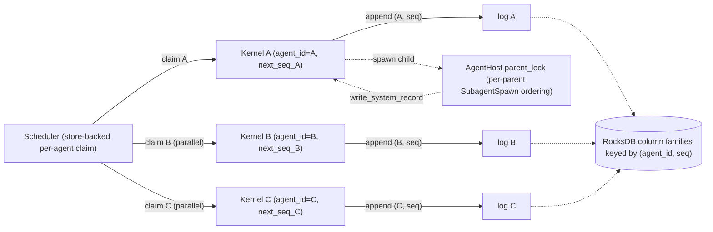
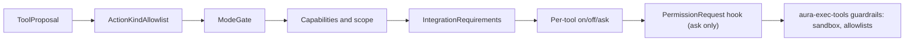
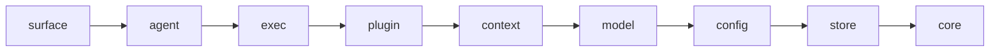

# Architectural Invariants

This document defines the invariants that the Aura system must uphold. Every
code change should be validated against these rules. Violations are bugs.

Unless a section says otherwise, every invariant below is **scoped to a single
agent's kernel and that agent's record log**. Cross-agent contracts live
under Principle 3 (§15, Cross-Agent Parallelism). The architecture model
below establishes the per-agent framing that the rest of the document relies
on.

---

## Architecture Model

Aura is built around **per-agent kernels with cross-agent parallelism**:

- **Each agent owns its own `Kernel` instance.** `Kernel::new(store, provider,
  executor, config, agent_id)` binds an `agent_id` at construction. The
  in-kernel `next_seq` counter and the record window the kernel hashes against
  are both scoped to that `agent_id`. See
  [`crates/agent/aura-agent-kernel/src/kernel/mod.rs`](../crates/agent/aura-agent-kernel/src/kernel/mod.rs)
  (`Kernel::new` ~line 343; `next_seq` ~line 409; the in-kernel `seq` `Mutex`
  initialised to `head_seq + 1` ~line 374).
- **Each agent owns its own append-only record log.** Sequence monotonicity
  (§7), context-hash determinism (§6), append atomicity (§10), and replay
  (§5 AuditedLite + `ReplayConsumer`) are all per-agent guarantees. There
  is no global cross-agent sequence, and the system intentionally does not
  promise one. The physical RocksDB store backs many agents at once via column
  families keyed by `(agent_id, seq)` — see
  [`crates/store/aura-store-db/src/keys/mod.rs`](../crates/store/aura-store-db/src/keys/mod.rs) —
  but the **logical** contract is per-agent.
- **Cross-agent parallelism is a first-class property, not an accident.**
  Unrelated agents process concurrently. The only intentional cross-agent
  serialization points are the per-agent processing claim (§12) and the
  per-parent `SubagentSpawn` audit lock (§12 / §15). The agent host's
  running-children cap gates admission, not record ordering.
- **Auditability survives parallelism.** Because every guarantee is per-agent,
  replaying any one agent's log is byte-deterministic regardless of which
  other agents were running concurrently. That is the property that lets us
  run agents in parallel for speed without losing the audit/replay contract.



### What "deterministic" means here

Replay re-reads **recorded decisions**: model outputs, policy verdicts, tool
effects. It never re-runs the model and expects the same behavior. The
deterministic parts are the per-agent context hash (§6), the sequence (§7),
and the replay of what was recorded. Memory and skills are derived indexes
stored beside the log; they are not covered by the record's hashes.

### Crate landscape

Every crate cited below uses its current name; there are no re-export shell
crates left in the workspace. One seam is thinner than its name suggests:
[`aura-store-snapshot`](../crates/store/aura-store-snapshot/src/lib.rs) defines the
`SnapshotStore` trait used to resolve AuditedLite summaries during replay,
but only the no-op `NoopSnapshotStore` implementation exists today (see §5.a).

---

## How To Read This Document

The invariants are grouped under **four principles**. **Numbering of
individual invariants (§1–§15) is stable** — same numbers as previous
revisions and as the `Invariant §N` annotations in the source — so external
references continue to resolve. The physical order is grouped by principle
rather than strictly numeric:

| Principle | Invariants |
|---|---|
| [1. Per-agent audit log](#principle-1--per-agent-audit-log) | §5, §6, §7, §10 |
| [2. Mediated effects](#principle-2--mediated-effects) | §1, §2, §3, §8, §9, §4, §11, §14 |
| [3. One writer per agent, unrelated agents in parallel](#principle-3--one-writer-per-agent-unrelated-agents-in-parallel) | §12, §15 |
| [4. The wire API is the contract](#principle-4--the-wire-api-is-the-contract) | §13 |

Strict numeric index for cross-references:

| # | Title | Principle |
|---|---|---|
| §1 | Each Agent's Kernel Is The Sole External Gateway | 2 |
| §2 | Every State Change For Agent A Passes Through Agent A's Kernel | 2 |
| §3 | Every LLM Call Is Recorded | 2 |
| §4 | Full Policy Enforcement | 2 |
| §5 | Complete Audit Trail | 1 |
| §6 | Per-Agent Deterministic Context | 1 |
| §7 | Per-Agent Monotonic Sequencing | 1 |
| §8 | Gateway Transparency | 2 |
| §9 | AgentLoop Isolation | 2 |
| §10 | Per-Agent Append-Only Record | 1 |
| §11 | Session-Scoped Tool Decisions | 2 |
| §12 | Single Writer Per Agent | 3 |
| §13 | Layered Architecture | 4 |
| §14 | Plugin Sandbox | 2 |
| §15 | Cross-Agent Parallelism | 3 |

---

## Enforcement Map

Each invariant below is guarded by one or more tests. The table below is
the living index of which suite enforces which invariant; it is kept in
sync with the `Enforcement:` lines under each section.

### Principle 1 — Per-agent audit log

| # | Invariant | Enforcement |
|---|---|---|
| §5 | Complete audit trail | [`crates/agent/aura-agent-kernel/src/kernel/tests.rs`](../crates/agent/aura-agent-kernel/src/kernel/tests.rs) + the §4 matrix asserts `decision`/`actions`/`context_hash`. AuditedLite summarisation round-trip pinned by [`crates/agent/aura-agent-kernel/tests/replay_round_trip.rs`](../crates/agent/aura-agent-kernel/tests/replay_round_trip.rs) and the `maybe_summarise_effect_payload` unit tests in [`crates/agent/aura-agent-kernel/src/kernel/tools/shared.rs`](../crates/agent/aura-agent-kernel/src/kernel/tools/shared.rs) (`summarisation_tests` module). |
| §6 | Per-agent deterministic context | [`crates/agent/aura-agent-kernel/tests/invariant_determinism.rs`](../crates/agent/aura-agent-kernel/tests/invariant_determinism.rs) (proptest). |
| §7 | Per-agent monotonic sequencing | [`crates/store/aura-store-db/tests/invariant_atomicity.rs`](../crates/store/aura-store-db/tests/invariant_atomicity.rs), [`crates/store/aura-store-db/src/rocks_store/tests.rs`](../crates/store/aura-store-db/src/rocks_store/tests.rs), and [`crates/store/aura-store-db/src/rocks_store/tests_concurrent.rs`](../crates/store/aura-store-db/src/rocks_store/tests_concurrent.rs) (concurrent appends across distinct agents). |
| §10 | Per-agent append-only record | [`crates/store/aura-store-db/tests/invariant_atomicity.rs`](../crates/store/aura-store-db/tests/invariant_atomicity.rs) (sealed-trait `static_assertions` + atomic-commit fault injection) + [`crates/store/aura-store-db/tests/invariant_readstore_surface.rs`](../crates/store/aura-store-db/tests/invariant_readstore_surface.rs) (pins the `ReadStore` trait surface so record-append methods stay on the sealed `WriteStore`). |

### Principle 2 — Mediated effects

| # | Invariant | Enforcement |
|---|---|---|
| §1 | Each agent's kernel is the sole external gateway | CI-gated `rg` bands in [`scripts/check_invariants.sh`](../scripts/check_invariants.sh) + [`.github/workflows/invariants.yml`](../.github/workflows/invariants.yml) (`ModelProvider.complete(`, `append_entry_*`, `Command::new("git")`, `aura_store` imports inside `aura-agent/src/agent_loop/`). Type-level seal: [`aura_agent::RecordingModelProvider`](../crates/agent/aura-agent/src/kernel_gateway.rs) is a crate-sealed marker trait; automatons take `P: RecordingModelProvider` so only `KernelModelGateway` (the recording wrapper) can be plugged in. Git-mutation surface covered by [`crates/exec/aura-exec-tools/src/git_tool/tests.rs`](../crates/exec/aura-exec-tools/src/git_tool/tests.rs) (`commit_reports_sha_when_there_are_changes`, `commit_rejects_empty_message`, `commit_surfaces_nonzero_exit_from_add`, `spawn_git_enforces_subcommand_allowlist`, `tool_executes_commit_via_context`, `tool_rejects_workspace_escape_via_config`, `git_push_rejects_missing_fields`). Automaton `DomainApi` mediation covered by [`crates/agent/aura-agent/src/kernel_domain_gateway/tests.rs`](../crates/agent/aura-agent/src/kernel_domain_gateway/tests.rs). |
| §2 | Every state change for agent A passes through agent A's kernel | [`tests/pipeline_tests.rs`](../tests/pipeline_tests.rs), [`tests/kernel_integration.rs`](../tests/kernel_integration.rs), [`crates/agent/aura-agent-kernel/src/kernel/tests.rs`](../crates/agent/aura-agent-kernel/src/kernel/tests.rs), [`crates/engine/aura-engine/src/automaton/tests.rs`](../crates/engine/aura-engine/src/automaton/tests.rs) (`start_then_stop_records_two_automaton_lifecycle_entries`), and the recursive-spawn tests in [`crates/engine/aura-engine/src/agents/tests.rs`](../crates/engine/aura-engine/src/agents/tests.rs) (`task_children_spawn_their_own_children`, `detached_task_result_reaches_the_parent`). |
| §3 | Every LLM call is recorded | [`crates/agent/aura-agent/src/recording_stream.rs`](../crates/agent/aura-agent/src/recording_stream.rs) tests (`streaming_natural_end_records_completed`, `streaming_error_records_failed`, `streaming_drop_records_failed`), [`crates/agent/aura-agent-kernel/src/kernel/tests.rs`](../crates/agent/aura-agent-kernel/src/kernel/tests.rs) (`reason_sync_error_records_failed`, `reason_streaming_handshake_error_records_failed`), [`tests/automaton_reasoning_recording.rs`](../tests/automaton_reasoning_recording.rs). |
| §8 | Gateway transparency | [`crates/agent/aura-agent/src/agent_loop/parity_tests.rs`](../crates/agent/aura-agent/src/agent_loop/parity_tests.rs). |
| §9 | AgentLoop isolation | Architectural / `rg` grep bands (see Declared Exceptions) — CI-gated via [`scripts/check_invariants.sh`](../scripts/check_invariants.sh) (`aura_store` import band scoped to `aura-agent/src/agent_loop/`). |
| §4 | Full policy enforcement | [`crates/core/aura-core-permissions/src/tests.rs`](../crates/core/aura-core-permissions/src/tests.rs) resolver/full-access tests, [`crates/agent/aura-agent-kernel/src/policy/check/tests.rs`](../crates/agent/aura-agent-kernel/src/policy/check/tests.rs) (including the per-mode gate matrix), [`crates/agent/aura-agent-kernel/src/kernel/tests.rs`](../crates/agent/aura-agent-kernel/src/kernel/tests.rs) (Plan-mode denial is recorded), [`crates/engine/aura-engine/tests/mode_gate_catalog.rs`](../crates/engine/aura-engine/tests/mode_gate_catalog.rs) (every catalog tool has a mode classification), [`crates/surface/aura-node/src/tool_permissions.rs`](../crates/surface/aura-node/src/tool_permissions.rs) validation/monotonic tests, [`crates/surface/aura-node/src/gateway/session/helpers.rs`](../crates/surface/aura-node/src/gateway/session/helpers.rs) session tool-config composition tests, [`crates/agent/aura-agent-subagent/src/tests.rs`](../crates/agent/aura-agent-subagent/src/tests.rs) policy-narrowing tests, [`crates/exec/aura-exec-tools/src/fs_tools/cmd/tests.rs`](../crates/exec/aura-exec-tools/src/fs_tools/cmd/tests.rs) command guardrail tests (including `test_confined_run_command_cannot_write_above_the_workspace`), [`crates/exec/aura-exec-tools/src/confine.rs`](../crates/exec/aura-exec-tools/src/confine.rs) Landlock confinement tests, and [`crates/surface/aura-node/tests/hook_permission_request_short_circuits.rs`](../crates/surface/aura-node/tests/hook_permission_request_short_circuits.rs) (carve-out 5b). |
| §11 | Session-scoped tool decisions | [`crates/agent/aura-agent-kernel/src/policy/check/tests.rs`](../crates/agent/aura-agent-kernel/src/policy/check/tests.rs) live prompt and session-state tests. |
| §14 | Plugin sandbox | [`crates/plugin/aura-plugin-hooks/tests/sandbox_env_scrubbing.rs`](../crates/plugin/aura-plugin-hooks/tests/sandbox_env_scrubbing.rs), [`crates/surface/aura-node/tests/hook_permission_request_short_circuits.rs`](../crates/surface/aura-node/tests/hook_permission_request_short_circuits.rs), [`crates/surface/aura-node/tests/plugin_e2e.rs`](../crates/surface/aura-node/tests/plugin_e2e.rs). |

### Principle 3 — One writer per agent

| # | Invariant | Enforcement |
|---|---|---|
| §12 | Single writer per agent | [`crates/engine/aura-engine/src/scheduler.rs`](../crates/engine/aura-engine/src/scheduler.rs) (`test_processing_claim_released_after_error`, `scheduler must construct at most one Kernel per agent claim`), [`crates/store/aura-store-db/src/rocks_store/tests_concurrent.rs`](../crates/store/aura-store-db/src/rocks_store/tests_concurrent.rs), and [`crates/engine/aura-engine/src/agents/tests.rs`](../crates/engine/aura-engine/src/agents/tests.rs). |
| §15 | Cross-agent parallelism | [`crates/engine/aura-engine/src/agents/tests.rs`](../crates/engine/aura-engine/src/agents/tests.rs) (`task_child_is_visible_while_it_runs`), [`crates/store/aura-store-db/src/rocks_store/tests_concurrent.rs`](../crates/store/aura-store-db/src/rocks_store/tests_concurrent.rs), [`crates/agent/aura-agent-kernel/tests/replay_round_trip.rs`](../crates/agent/aura-agent-kernel/tests/replay_round_trip.rs). |

### Principle 4 — The wire API is the contract

| # | Invariant | Enforcement |
|---|---|---|
| §13 | Layered architecture | [`tests/layer_boundary.rs`](../tests/layer_boundary.rs) (`every_crate_carries_a_matching_layer_doc_tag`, `no_upward_layer_dependencies`). |

---

# Principle 1 — Per-agent audit log

Each agent has one append-only, hashed, sequenced log that can be replayed
on its own. Read as a stack of properties about a single agent's log: §5
says what each entry must contain; §6 says how the entry's context hash is
computed; §7 says how entries are sequenced; §10 says the resulting log is
immutable. Together they let any one agent's recorded history replay
byte-for-byte without a live reasoner or executor.

---

## 5. Complete Audit Trail

**Every `RecordEntry` for a `ToolProposal` contains the full decision chain.**

A tool proposal entry must include:

- `proposals`: the `ProposalSet` containing the proposed action.
- `decision`: `Decision` with `accepted_action_ids` or `rejected` (with reasons).
- `actions`: the authorized `Action` (empty if rejected).
- `effects`: the `Effect` from execution (empty if rejected).
- `context_hash`: deterministic hash of inputs.

This allows offline replay: given the same record, the same decisions can be
verified without a live reasoner or executor.

### 5.a AuditedLite summarisation round-trip

When the kernel is configured for
[`aura_core_modes::KernelMode::AuditedLite`](../crates/core/aura-core-modes/) and an
effect payload exceeds `KernelConfig::lite_payload_threshold`,
[`crates/agent/aura-agent-kernel/src/kernel/tools/shared.rs`](../crates/agent/aura-agent-kernel/src/kernel/tools/shared.rs)
(`maybe_summarise_effect_payload`) replaces the verbatim payload with a
`RecordPayload::Summary` produced by
[`aura_store_record::summarize_payload`](../crates/store/aura-store-record/src/payload.rs).
The summary carries `full_len` and `full_hash` so replay can verify the
original content against an `aura_store_snapshot::SnapshotStore`
([`crates/store/aura-store-snapshot/src/lib.rs`](../crates/store/aura-store-snapshot/src/lib.rs)).
Only the no-op `NoopSnapshotStore` exists today, so replaying a summarized
entry ends in `ReplayError::SnapshotMissing`: AuditedLite logs are auditable
(lengths and hashes are recorded) but not fully replayable until a real
snapshot store lands.

`KernelMode::Audited` (the default) stores payloads verbatim; AuditedLite is
the size-bounded mode for high-volume agents.

**Enforcement:** [`crates/agent/aura-agent-kernel/tests/replay_round_trip.rs`](../crates/agent/aura-agent-kernel/tests/replay_round_trip.rs)
exercises the AuditedLite → summarise → replay loop, including the
`SnapshotMissing` outcome against `NoopSnapshotStore`.
The `summarisation_tests` module at the bottom of
[`tools/shared.rs`](../crates/agent/aura-agent-kernel/src/kernel/tools/shared.rs)
pins the per-mode payload shape.

---

## 6. Per-Agent Deterministic Context

**The context hash for a `RecordEntry` in agent `A`'s log is derived solely
from that transaction and `A`'s record window.**

```
context_hash = hash(serialize(tx) || A.seq[0].context_hash || A.seq[1].context_hash || ...)
```

Re-processing the same transaction against the same record window for the
same agent must produce the same context hash. There is no cross-agent
dependency in the chain — which is exactly what lets unrelated agents run
in parallel without losing per-agent determinism (see §15).

**Enforcement:** [`crates/agent/aura-agent-kernel/tests/invariant_determinism.rs`](../crates/agent/aura-agent-kernel/tests/invariant_determinism.rs)
uses `proptest` to assert that `hash_tx_with_window` is deterministic,
order-sensitive (swapping adjacent window entries changes the hash),
insertion-sensitive (adding a no-op entry changes the hash), and
transaction-sensitive (mutating the transaction body changes the hash).

---

## 7. Per-Agent Monotonic Sequencing

**Within each agent, record entries have strictly increasing, contiguous
sequence numbers.**

- `next_seq = head_seq + 1` for that agent.
- No gaps: if entries exist at seq 1 and seq 3 for agent `A`, there must be
  an entry at seq 2 for `A`.
- No duplicates: `append_entry_atomic` rejects sequence mismatches.
- Atomicity: inbox dequeue and record append happen in a single `WriteBatch`
  (see [`crates/store/aura-store-db/src/rocks_store/mod.rs`](../crates/store/aura-store-db/src/rocks_store/mod.rs)
  `append_entry_atomic_internal` ~line 281).

No cross-agent ordering is implied or required. Two agents committing entries
at the "same" wall-clock moment produce two independent, internally-monotonic
chains.

**Enforcement:** [`crates/store/aura-store-db/tests/invariant_atomicity.rs`](../crates/store/aura-store-db/tests/invariant_atomicity.rs)
(fault injection across the `WriteBatch` boundary asserts no partial state,
and the sequence-mismatch row asserts strict monotonicity);
[`crates/store/aura-store-db/src/rocks_store/tests.rs`](../crates/store/aura-store-db/src/rocks_store/tests.rs)
for the per-agent path; and
[`crates/store/aura-store-db/src/rocks_store/tests_concurrent.rs`](../crates/store/aura-store-db/src/rocks_store/tests_concurrent.rs)
for concurrent appends across distinct agents.

---

## 10. Per-Agent Append-Only Record

**Each agent's record log is immutable. Entries are never modified or deleted.**

The physical store backs many agents at once via column families keyed by
`(agent_id, seq)` — see
[`crates/store/aura-store-db/src/keys/mod.rs`](../crates/store/aura-store-db/src/keys/mod.rs) —
but the *logical* contract is per-agent: each agent owns its own monotonic
sequence of append-only entries.

- The record-append surface (`append_entry_atomic`, `append_entry_dequeued`,
  `append_entry_direct`, and their `*_with_runtime_capabilities` variants,
  plus `append_entries_batch`) lives on the **sealed**
  [`aura_store_db::WriteStore`](../crates/store/aura-store-db/src/store.rs) trait
  (canonical definition in [`aura-store-db`](../crates/store/aura-store-db/src/store.rs)).
  Non-kernel crates depend only on `aura_store_db::ReadStore`; the kernel's
  `Arc<dyn WriteStore>` is the only path that can commit a record entry.
  New storage backends cannot be written outside the `aura-store-db` crate
  because the sealing marker (`aura_store_db::store::sealed::Sealed`) is
  crate-private.
- The abstract per-agent append trait
  [`aura_store_record::RecordLog`](../crates/store/aura-store-record/src/log.rs) wraps
  the same surface with `append` / `head_seq` / `scan` for layered consumers
  (kernel replay). `impl RecordLog for RocksStore` lives in
  [`crates/store/aura-store-db/src/record_log_bridge.rs`](../crates/store/aura-store-db/src/record_log_bridge.rs)
  and delegates to `append_entry_direct` + `get_head_seq`.
- No `update_entry`, `delete_entry`, or `truncate_record` operations exist.
- Compaction (in the AgentLoop) operates on in-memory message history, not on
  the persisted record.

### Schema versioning

[`aura_store_record::SCHEMA_VERSION`](../crates/store/aura-store-record/src/lib.rs) is
currently `3`. The Phase 10 bump (v2) consolidated three closed-enum additions:

- `RecordKind::SessionStop` — reserved session-lifecycle tag. No production
  writer emits it today; the variant keeps the wire tag stable.
- `RecordKind::ToolCallBlockedByHook` — audit row replacing `ToolCallResult`
  when a `PreToolUse` hook blocks dispatch.
- `TransactionType::SubagentSpawn` — typed wire variant replacing the
  Phase 7a `TransactionType::System + JSON-discriminator` workaround.

Older binaries reading v2 logs gracefully degrade unknown tags via
`RecordKind::Unknown` (serde `#[serde(other)]` fallback in
[`crates/store/aura-store-record/src/kind.rs`](../crates/store/aura-store-record/src/kind.rs)).

Version `3` adds `TransactionType::PolicyDecision` and records every tool
call as linked entries:

1. `ToolProposal` — the bare proposal, no decision or effects.
2. `PolicyDecision` — `reference_tx_hash` = proposal hash; payload names the
   verdict, the rule that decided (`decided_by`), the ordered gate trace, any
   live approval (hook or user + remember scope), and a hash of the policy
   configuration. `entry.proposals` / `entry.decision` live here.
3. `ToolExecution` — only for approved calls; `reference_tx_hash` = decision
   hash; carries `entry.actions` / `entry.effects`.

Entries 1 and 2 are persisted before the executor runs. `PolicyDecision` and
`ToolExecution` are kernel-only and rejected by `POST /tx`. v2 single-entry
tool rows still parse and render. The kernel writes only v3 going forward.

**Enforcement:** [`crates/store/aura-store-db/tests/invariant_atomicity.rs`](../crates/store/aura-store-db/tests/invariant_atomicity.rs)
— `static_assertions::assert_impl_all!(RocksStore: WriteStore, Store)` pins
the sealed-trait surface at compile time, and the fault-injection rows prove
the append path is all-or-nothing.
[`crates/store/aura-store-db/tests/invariant_readstore_surface.rs`](../crates/store/aura-store-db/tests/invariant_readstore_surface.rs)
pins the `ReadStore` surface so record-append methods stay on the sealed
`WriteStore`.

### `Arc<dyn Store>` allowlist

CI gate in [`scripts/check_invariants.sh`](../scripts/check_invariants.sh) §10
band. Production holders:

- [`crates/surface/aura-node/src/gateway/state.rs`](../crates/surface/aura-node/src/gateway/state.rs)
  — the `RouterState.store` field piped into `WsContext`.
- [`crates/engine/aura-engine/src/automaton/`](../crates/engine/aura-engine/src/automaton/)
  (`mod.rs` + `build.rs` + `dispatch.rs` + `event_channel.rs`) —
  `AutomatonBridge` builds per-agent automaton kernels.
- [`crates/engine/aura-engine/src/scheduler.rs`](../crates/engine/aura-engine/src/scheduler.rs)
  — `Scheduler` builds per-agent kernels.
- [`crates/surface/aura-node/src/gateway/session/mod.rs`](../crates/surface/aura-node/src/gateway/session/mod.rs)
  — `WsContext` handed to `Kernel::new`.
- [`crates/surface/aura-node/src/gateway/session/child_kernel.rs`](../crates/surface/aura-node/src/gateway/session/child_kernel.rs)
  — session-scoped child-kernel factory captures the same store handle as
  `WsContext` so nested child runs route through `AgentHost` /
  `Scheduler`.
- [`crates/engine/aura-engine/src/agents/host.rs`](../crates/engine/aura-engine/src/agents/host.rs)
  — `AgentHost` runs spawned agents through the scheduler and writes
  `SubagentSpawn` audit rows and inbox fallback records.
- [`crates/surface/aura-node/src/node.rs`](../crates/surface/aura-node/src/node.rs)
  — boots the process-wide store.
- [`crates/surface/aura-node/src/tool_permissions.rs`](../crates/surface/aura-node/src/tool_permissions.rs)
  — HTTP-driven tool-permissions append serialized via the scheduler claim.
- [`crates/surface/aura-node/src/gateway/session/cross_agent_hook.rs`](../crates/surface/aura-node/src/gateway/session/cross_agent_hook.rs)
  — cross-agent chat/spawn hook.
- [`crates/surface/aura-app/src/harness.rs`](../crates/surface/aura-app/src/harness.rs)
  — the interactive session host constructs a per-agent kernel for local
  sessions.

Test-only holders (filenames don't match `*test*.rs` but hits live inside
`#[cfg(test)] mod tests`): [`crates/agent/aura-agent/src/kernel_gateway.rs`](../crates/agent/aura-agent/src/kernel_gateway.rs),
the [`crates/agent/aura-agent/src/kernel_domain_gateway/`](../crates/agent/aura-agent/src/kernel_domain_gateway/)
directory, [`crates/agent/aura-agent/src/recording_stream.rs`](../crates/agent/aura-agent/src/recording_stream.rs),
and [`crates/engine/aura-engine/src/worker.rs`](../crates/engine/aura-engine/src/worker.rs).

---

# Principle 2 — Mediated effects

Model calls, tool calls, domain mutations and subagent spawns cross the
agent's kernel and leave a record entry. §1–§3 define **what crosses the
boundary and how the kernel mediates every crossing**; §8 and §9 keep the
boundary tight (gateways are transparent, the agent loop is isolated from
kernel-owned resources); §4 and §11 decide **whether a proposed tool call
may proceed** and how live `ask` decisions are scoped; §14 keeps plugins
outside the boundary. A small, frozen set of named control-plane writers
append audited `System` rows outside a turn — they are enumerated under
[Declared Exceptions](#declared-exceptions).

---

## 1. Each Agent's Kernel Is The Sole External Gateway

**For any agent `A`, the only code permitted to interact with external
systems on `A`'s behalf is `A`'s `Kernel` instance.**

No code outside the kernel may:

- Call a `ModelProvider` (`complete`, `complete_streaming`).
- Execute an `Action` via `ExecutorRouter`.
- Append to a record log. The record-append family
  (`append_entry_atomic`, `append_entry_dequeued`, `append_entry_direct`,
  their `*_with_runtime_capabilities` variants, and `append_entries_batch`)
  lives on the **sealed** `aura_store_db::WriteStore` trait — see §10. Non-kernel
  callers bind to `Arc<dyn ReadStore>` and may still invoke the explicitly-
  allowed inbox/metadata writes (`enqueue_tx`, `set_agent_status`) that live
  on `ReadStore`.
- Make HTTP calls to domain services (`DomainApi` mutating methods).
- Spawn subprocesses for git mutations (`git add`, `git commit`, `git push`).

All external interactions for agent `A` are mediated through
`Kernel::process_direct`, `Kernel::process_dequeued`, `Kernel::process_tools`,
`Kernel::reason`, or `Kernel::reason_streaming` on the per-agent kernel — or
through the [`aura_agent_kernel::write_system_record`](../crates/agent/aura-agent-kernel/src/kernel/mod.rs)
helper, which assembles a context-hashed `RecordEntry` and calls the sealed
`WriteStore::append_entry_direct` for the named agent.

The harness is the runtime authorization and execution boundary, not the
credential authority. Org-level credential persistence and canonical secret
retrieval live in the surface-layer [`aura-auth`](../crates/auth/aura-auth/)
crate, not inside any agent kernel.

The trace [`ReplayProvider`](../crates/agent/aura-agent-trace/src/replay.rs)
is the one `.complete(` caller outside these crates. It wraps a provider and
is itself passed to `Kernel::new`, so the kernel still records every call,
including the hand-off to the live provider after the replayed prefix.

### Type-level enforcement: sealed `RecordingModelProvider`

In addition to the `rg`-band CI gate on `.complete(`, automatons
(`SpecGenAutomaton`, `DevLoopAutomaton`, `TaskRunAutomaton`, `ChatAutomaton`)
accept their `ModelProvider` parameter as `P: aura_agent::RecordingModelProvider`
rather than `Arc<dyn ModelProvider>`. The `RecordingModelProvider` trait is
sealed via a crate-private marker module
([`crates/agent/aura-agent/src/kernel_gateway.rs`](../crates/agent/aura-agent/src/kernel_gateway.rs)
lines ~126–150) so the *only* type that can satisfy the bound from outside
`aura-agent` is `KernelModelGateway` — the recording wrapper that funnels
every call through `Kernel::reason` / `Kernel::reason_streaming`. External
crates — including tests — cannot smuggle a raw `dyn ModelProvider` into an
automaton without opting in through the `#[cfg(test)]`-gated test-double
constructor.

### Sanctioned non-kernel `append_*` callers

Two production sites append to an agent's record log *without* going through
`Kernel::process_*`, both via the `aura_agent_kernel::write_system_record`
helper (so they still emit a kernel-built, context-hashed `RecordEntry`):

- [`crates/surface/aura-node/src/tool_permissions.rs`](../crates/surface/aura-node/src/tool_permissions.rs)
  (`append_agent_tool_permissions_entry` ~line 172) — HTTP-driven tool-permission
  PUT. Acquires the scheduler's per-agent processing claim first so the write
  serializes with concurrent inbox drains for the same agent.
- [`crates/engine/aura-engine/src/agents/host.rs`](../crates/engine/aura-engine/src/agents/host.rs)
  — `AgentHost::create_child` appends the `TransactionType::SubagentSpawn`
  audit row to the parent under the per-parent spawn lock (§12.b). When a
  root agent's inbox is gone, the host records the undelivered message as a
  `System` entry on the root instead.

Both sites are pinned by the §2 allowlist in
[`scripts/check_invariants.sh`](../scripts/check_invariants.sh); any other
non-kernel/non-store call into the `append_entry_*` family is a CI failure.

### Subprocess surfaces

Sanctioned `Command::new(...)` call sites:

| Call site | Purpose | Rule |
|---|---|---|
| [`crates/exec/aura-exec-tools/src/git_tool/`](../crates/exec/aura-exec-tools/src/git_tool/) (`commit.rs`, `push.rs`, `commit_push.rs`, `executor.rs`) | Mutating `git add` / `commit` / `push` | Funnels through the kernel's `ToolExecutor`; allowlisted by `Command::new("git")` band. |
| [`crates/agent/aura-agent/src/git.rs`](../crates/agent/aura-agent/src/git.rs) | Read-only `git log` / `git status` helpers (`is_git_repo`, `list_unpushed_commits`) | No external side effect; declared exception. |
| [`crates/surface/aura-app/src/isolation/mod.rs`](../crates/surface/aura-app/src/isolation/mod.rs) | `git worktree add` / `worktree remove` for the workspace copies `/compare` runs in | Isolation infrastructure, not a mutating commit/push; declared exception. |
| [`crates/surface/aura-app/src/isolation/changes.rs`](../crates/surface/aura-app/src/isolation/changes.rs) | `/compare` workspace copies: carry uncommitted work into a worktree (`diff`, `apply`, `ls-files`), record a baseline tree (`init`, `add`, `write-tree`), diff a run (`diff-index`), apply the chosen run's patch back (`apply`). Escalated subtasks: snapshot the workspace into a scratch index (`rev-parse`, `add`, `write-tree`, `ls-files`) and restore it (`diff-tree`, `read-tree`, `checkout-index`) | Isolation infrastructure, local subcommands only, terminal prompting disabled; no commit/fetch/push; the user's index, `HEAD`, refs and stash are never written; declared exception. Its subcommands are pinned to exactly this list by a check after the `Command::new("git")` band in [`scripts/check_invariants.sh`](../scripts/check_invariants.sh). |
| [`crates/surface/aura-node/src/gateway/handlers/safe_workspace.rs`](../crates/surface/aura-node/src/gateway/handlers/safe_workspace.rs) | Local worktree, imported-project baseline, shadow checkpoint, restore, and apply lifecycle for explicitly selected hosted Safe Workspaces | Control-plane isolation infrastructure. A closed local subcommand allowlist rejects clone/fetch/pull/push/remote operations and terminal prompting is disabled; declared exception. |
| [`crates/plugin/aura-plugin-hooks/src/engine.rs`](../crates/plugin/aura-plugin-hooks/src/engine.rs) | Lifecycle hook scripts (PreToolUse, PostToolUse, PermissionRequest, …) | Scrubbed env per §14; never touches `append_entry_*` or `ModelProvider`. |
| [`crates/plugin/aura-plugin-mcp/src/client.rs`](../crates/plugin/aura-plugin-mcp/src/client.rs) | MCP server stdio JSON-RPC clients | Scrubbed env per §14; tool calls reaching models must still route through the kernel gateway. |

---

## 2. Every State Change For Agent A Passes Through Agent A's Kernel

**Every mutation to agent `A`'s state passes through `A`'s
`Kernel::process_direct` or `Kernel::process_dequeued` and produces a
`RecordEntry` in `A`'s log.**

State changes include:

- User message arrives (`TransactionType::UserPrompt`). Its payload is a
  JSON `PromptPayload` (text, Gate's category, classifier and route), never
  raw text; `POST /tx` wraps submitted text in one.
- How a prompt's work went (`TransactionType::Outcome`, referring to the
  prompt). Later signals append more outcomes; none is ever rewritten.
- Agent produces a response (`AgentMsg`).
- LLM suggests a tool call (`ToolProposal`).
- Tool execution completes (`ToolExecution`).
- Session boundary (`SessionStart`).
- Async process completes (`ProcessComplete`).
- Automaton starts/stops, capability install, domain mutation, auth change
  (`System` with the matching `SystemKind`).
- Subagent spawn audit (`SubagentSpawn` — Phase 10 schema-v2 typed wire variant,
  defined in [`crates/core/aura-core-types/src/types/transaction.rs`](../crates/core/aura-core-types/src/types/transaction.rs)).
- Legacy fleet lifecycle events (`ChildCancelledByParentDeath`,
  `ChildOrphanedByParentDeath`, `OrphanReaped` `RecordKind` variants in
  [`crates/store/aura-store-record/src/kind.rs`](../crates/store/aura-store-record/src/kind.rs)).
  No current writer emits them; they stay so older logs still parse.

The kernel's transaction dispatcher
([`crates/agent/aura-agent-kernel/src/kernel/process.rs`](../crates/agent/aura-agent-kernel/src/kernel/process.rs)
`process_tx`) routes each tx by `TransactionType` to the matching handler
(`process_tool_proposal`, capability-install decoder, `SubagentSpawn` arm, etc.)
and the wrapping `process_direct` / `process_dequeued` call the appropriate
`append_entry_*_with_runtime_capabilities` variant on the kernel's store.

No state change to agent `A` may occur without a corresponding entry in `A`'s
record log.

---

## 3. Every LLM Call Is Recorded

**Every call to a model provider passes through the kernel's
`reason` / `reason_streaming` and produces a `RecordEntry` with
`TransactionType::Reasoning` in the calling agent's log.**

The entry records:

- Request snapshot: model name, message count, tool count, system prompt hash,
  token config.
- Response metadata: model used, stop reason, token usage (input + output),
  tool_use block names.

For streaming calls, recording occurs when the stream completes (accumulated
by the kernel's stream wrapper in
[`crates/agent/aura-agent-kernel/src/kernel/stream.rs`](../crates/agent/aura-agent-kernel/src/kernel/stream.rs)
— `ReasonStreamHandle::record_completed` / `record_failed`). The agent-side
[`crates/agent/aura-agent/src/recording_stream.rs`](../crates/agent/aura-agent/src/recording_stream.rs)
wrapper guarantees the handle is finalized exactly once on natural end,
error, or drop.

**Enforcement:** [`crates/agent/aura-agent/src/recording_stream.rs`](../crates/agent/aura-agent/src/recording_stream.rs)
(`streaming_natural_end_records_completed`, `streaming_error_records_failed`,
`streaming_drop_records_failed`) covers natural-end, mid-stream error, and
early-drop termination paths.
[`crates/agent/aura-agent-kernel/src/kernel/tests.rs`](../crates/agent/aura-agent-kernel/src/kernel/tests.rs)
covers the sync (`reason_sync_error_records_failed`) and handshake-error
(`reason_streaming_handshake_error_records_failed`) paths.

Gate ([`aura-gate`](../crates/gate/aura-gate)) never calls a provider
and never holds a `ModelProvider`. Its crates build the classifier's,
the judge's and the `/compare` judge's requests, and every one goes
through an agent's `Kernel::reason`: Gate's own calls from
[`aura-gate-live`](../crates/gate/aura-gate-live), the `/compare`
judge's from the surface.
A classifier call is an `Auxiliary` `Reasoning` record in the classified
agent's log, and a judge call is one in the comparison agent's log. Gate's
pick only sets the model of the turn's or subtask's own kernel-mediated
calls. A pinned model's route never changes. Under `gate` the model, and so
who pays, may change between turns and between subtasks. Each choice is
shown in the chat (`gate → <model> (<route>) · <category>, <reason>`) and
recorded as the prompt's `route`, so it is never silent.

---

## 8. Gateway Transparency

**Kernel gateways implement existing traits. Consumers are unaware of kernel
mediation.**

| Gateway | Implements | Consumer | Source |
|---|---|---|---|
| `KernelModelGateway` | `ModelProvider` | AgentLoop, automatons | [`crates/agent/aura-agent/src/kernel_gateway.rs`](../crates/agent/aura-agent/src/kernel_gateway.rs) |
| `KernelToolGateway` | `AgentToolExecutor` | AgentLoop, AgentRunner | [`crates/agent/aura-agent/src/kernel_gateway.rs`](../crates/agent/aura-agent/src/kernel_gateway.rs) |
| `KernelDomainGateway` | `DomainApi` | Automatons | [`crates/agent/aura-agent/src/kernel_domain_gateway/handle.rs`](../crates/agent/aura-agent/src/kernel_domain_gateway/handle.rs) (+ `routes.rs`, `wire.rs`, `tests.rs`) |

The AgentLoop's public API (`run`, `run_with_events`) accepts
`&dyn ModelProvider` and `&dyn AgentToolExecutor`. It must never depend on
the concrete gateway types.

This boundary also means the harness executes tools from runtime metadata
without becoming the system of record for integration credentials or catalog
state.

**Enforcement:** [`crates/agent/aura-agent/src/agent_loop/parity_tests.rs`](../crates/agent/aura-agent/src/agent_loop/parity_tests.rs).

---

## 9. AgentLoop Isolation

**The AgentLoop never directly accesses kernel-owned resources.**

The AgentLoop must not:

- Import or reference `Store`, `RocksStore`, or any store type (via the
  `aura_store` shell or `aura_store_db` directly).
- Import or reference `RecordEntry` or `RecordEntryBuilder`.
- Import or reference kernel `Policy` internals.
- Call `ModelProvider::complete` on anything other than the provider it
  receives as a parameter.
- Call `AgentToolExecutor::execute` on anything other than the executor it
  receives as a parameter.
- Construct `Transaction` objects.

The AgentLoop owns: iteration logic, streaming, compaction, budget management,
stall detection, message history.

The harness as a whole may receive runtime-resolved capabilities or short-lived
secrets through approved gateways, but it must not persist org credentials or
become the catalog authority for integrations.

**Enforcement:** `rg`-band CI gate in [`scripts/check_invariants.sh`](../scripts/check_invariants.sh)
scopes the `use aura_store_db::` band to `crates/agent/aura-agent/src/agent_loop/**` and
excludes test files.

---

## 4. Full Policy Enforcement

**Every tool call passes through `Policy::check()` with the complete
permission model — mode gate first — before execution.**



The policy pipeline for a `ToolProposal`:

1. Deserialize `ToolProposal` from transaction payload.
2. Build `Proposal` with `ActionKind::Delegate` + serialized `ToolCall`.
3. `Policy::check(&proposal)` evaluates orthogonal hard-denial layers first:
   - Is `ActionKind::Delegate` in `allowed_action_kinds`?
   - **Mode gate:** does the session's `AgentMode` allow the tool? See §4.0.
   - Does the caller hold every capability required by the tool?
   - Are scoped arguments inside the caller's `AgentScope`?
   - Are required runtime integrations installed?
4. The per-tool layer resolves once with `Policy::resolve_tool_state`, using
   `UserToolDefaults` plus optional `AgentToolPermissions`:
   - `ToolState::Allow` (`"on"`) — continue to execution guardrails.
   - `ToolState::Deny` (`"off"`) — reject at the policy gate.
   - `ToolState::Ask` (`"ask"`) — emit a structured live approval prompt
     when a `ToolApprovalPrompter` is attached; otherwise deny with a
     headless ask reason.
5. Decision is recorded: accepted action IDs or rejected proposals with reasons.
6. Only approved proposals become `Action`s and are executed.

**Corollary:** A `Deny`-only check is insufficient. The full `Policy::check()`
must run.

### 4.0 Mode gate

`PolicyConfig::mode` carries the session's
[`AgentMode`](../crates/core/aura-core-modes/src/modes.rs) (`Agent` / `Plan` /
`Ask` / `Debug`). The gate in
[`crates/agent/aura-agent-kernel/src/policy/check/mode_gate.rs`](../crates/agent/aura-agent-kernel/src/policy/check/mode_gate.rs)
maps every tool call to a `GatedAction` through an explicit table and asks
[`DefaultModeGate`](../crates/core/aura-core-modes/src/gate.rs) whether the mode
allows it:

- read / list / stat / find / search tools → `ReadFile`
- `write_file` / `edit_file` / `delete_file` → `WriteMarkdown` for `.md` /
  `.markdown` paths, otherwise `WriteNonMarkdown`; spec tools →
  `WriteMarkdown`; `git_commit` → `WriteNonMarkdown`
- `run_command` → `Subprocess`
- `task` / `spawn_agent` / `delegate_task` and other agent-control tools →
  `SpawnAgent`
- git push and mutating domain tools, `computer` → `Network`
- read-only domain tools, engine bookkeeping tools, and the read-only web
  tools (`web_search`, `web_fetch`) → `ToolInvoke`
- **any unclassified tool (including installed tools) → `Network`**, so it
  is denied outside `Agent` mode

A `ModeViolation` becomes `PolicyVerdict::Deny` and is recorded through the
normal decision path (§5). `Agent` mode skips the gate.

The mode is resolved once per session as **request (`RuntimeRequest.mode` or
the CLI `--mode` flag) → daemon default (`AURA_DEFAULT_MODE`) →
`Agent`** (`aura_config::session_mode`). Children take the mode from their
derived `SubagentSpec`, which can only narrow. Dev-loop and task-run
requests are rejected unless the resolved mode is `Agent`.

**Mid-session mode changes are recorded first.** The only way to change a
live kernel's mode is
[`Kernel::switch_mode`](../crates/agent/aura-agent-kernel/src/kernel/process.rs),
which appends a `System` entry with `system_kind: "mode_change"` and the
`from` / `to` modes, then applies the new mode to `Policy` (and its
snapshot hash). Switching to the current mode writes nothing. A submitted
transaction carrying a `mode_change` payload is rejected as kernel-only, so
no client can lift a session out of `Plan` or `Ask` by writing the record.
The TUI uses `Kernel::switch_permissions` for `/mode`, `/plan`, `/approval`,
Shift+Tab, and `/build`, which also records the approval level in the
permission-table names; the gateway keeps one mode per run.

**`yolo` commands are confined, not trusted.** At the `yolo` approval level
the kernel sets `ExecuteContext::confine_writes` for every agent-proposed
call the policy allowed without asking, and `run_command` then starts the
process from a Landlock-restricted thread that can write only inside the
workspace, temp folders and package caches. Confinement fails closed: where
Landlock is unavailable the call errors, so the terminal keeps commands on
`Ask` there. Calls the user typed or approved at a prompt run unconfined.

`create_plan` and `todo_write` map to `WriteMarkdown`: they only write
`.aura/plans/*.plan.md` files in the agent's workspace, so `Plan` mode can
save its plan.

`Plan` mode allows `Subprocess` per the gate table, so the mode gate does
not block `run_command` in `Plan`; the per-tool layer and the `aura-exec-tools`
command guardrails still apply.

### 4.a Tool execution guardrails remain orthogonal

The tri-state tool layer answers whether a tool is enabled for this agent. It
does not authorize unsafe execution shapes. `run_command` still requires
explicit `ToolConfig::command.enabled`, and operator-provided
command/binary/shell-script guardrails are enforced inside `aura-exec-tools` after
policy allows the tool.

Complementary enforcement in `aura-exec-tools`:

- `run_command` rejects the legacy shell form (`program` set, `args` empty)
  and the explicit `command` / `shell_script` fields unless the caller passes
  `allow_shell: true`. Once `allow_shell` is granted,
  `ToolConfig::command.allowed_shell_scripts` switches between "any script
  allowed" (empty allowlist, the default matching `command_allowlist`) and
  "verbatim match only" (non-empty allowlist).
- When `ToolConfig::command.enabled` is true,
  `ToolConfig::command.binary_allowlist` must be non-empty. `run_command`
  resolves `program` with `which` and denies any binary whose file name
  (stripped of `.exe` on Windows) is not in the allow-list.

Operator and per-agent layers remain orthogonal by default. When the operator
explicitly opts in with `ToolConfig::command.allow_unrestricted_full_access`,
sessions whose user default plus per-agent override are effectively
`FullAccess` compose into a session-scoped
`ToolConfig::command.bypass_allowlists`. That derived session flag skips the
command, binary, and shell-script allowlists only; `command.enabled`,
`allow_shell`, sandbox/cwd checks, timeout limits, capability gates, and
installed integration requirements remain in effect.

### 4.b Carve-out: PermissionRequest plugin hook

When the policy resolves to `Ask` and a `ToolApprovalPrompter` is attached,
the kernel fires the `PermissionRequest` plugin hook **before** the
interactive prompter (Phase 10 carve-out 5b). See
[`crates/agent/aura-agent-kernel/src/kernel/tools/shared.rs`](../crates/agent/aura-agent-kernel/src/kernel/tools/shared.rs)
(`resolve_prompt_verdict` ~lines 123–149).

The hook may return `Approve` (→ `PolicyVerdict::Allow`) or `Deny`
(→ `PolicyVerdict::Deny`); any other outcome (`Continue`, `TimedOut`, `Block`,
`Replace`) falls through to the interactive prompt path. The hook cannot
bypass the upstream deny / capability / scope / integration layers — those
already ran before the verdict reached this seam.

### 4.c Gate: the lead's tools and routed subtasks

Under `gate`, with `AURA_GATE_DELEGATE` on, the user's own agent may lead
a turn classified `multi_file_change`, `planning`, `debugging` or
`research` when what Gate has learned says so
(`aura_gate::lead::choose_way`), and on a led turn its tools only narrow:

- `write_file`, `edit_file`, `delete_file`, `apply_patch`, `git_commit` and
  `git_commit_push` are dropped from the turn's tool list (`lead_tools`, in
  [`aura-gate-lead`'s executor](../crates/gate/aura-gate-lead/src/executor/mod.rs)).
- `LeadExecutor` wraps the turn's executor. A call to a dropped tool, or a
  `run_command` line outside the allowlist of checks and inspection
  commands (`allows_command`, in
  [`aura-gate-lead`'s limits](../crates/gate/aura-gate-lead/src/limits/commands.rs)),
  is not executed. It is
  still recorded through the kernel as a preset result with source
  `gate_lead`, after passing the policy gate like any other call.
- `read_file` results are cut to 200 lines and `search_code` / `find_files`
  results to 50 hits, after the kernel has recorded the full result.

Nothing here widens a permission. The mode gate, the approval level, the
policy and the command guardrails run unchanged beneath the lead's limits:
the command allowlist only narrows what the approval level lets run, so a
refused call is still policy-checked (and may ask at `ask` or `strict`)
before its refusal is recorded. Turns of any other category,
permanent-agent instances, agents on a pinned model and
`AURA_GATE_DELEGATE=off` get no lead limits.

Gate's judge of failed work changes no permission either. Its one model
call is an `Auxiliary` request with no tools, sent through the kernel of
the agent whose work failed (`Kernel::reason`), so it is recorded in that
agent's log like the classifier's call, and its finding is an `Outcome`
transaction on the same log. A turn the judge sends on to a stronger
model keeps its session, mode and approval level.

Routing a subtask only sets the model of the child's turn before it
starts. The child is an ordinary permanent-agent instance with its own
kernel and log, and its prompt (level `subtask`) and `Outcome`s are in that
log. A model named by the `task` call, the permanent agent or a council
seat, or a pinned main model, is never overridden. The child starts with
its parent's mode and approval level. A `task` `check` is a `run_command`
proposal through the child's kernel (source `task_check`), so it is
policy-checked, asks or runs confined as the session's approval level
says, and is recorded like the child's own commands. A `/compare` run's
check is the same, through the run's kernel (source `compare_check`), in
the run's copy after its turn, and so is the verify command of an
`aura eval run --model gate` task, through the run's agent's kernel
(source `eval_verify`), in the task's workspace after its turns. Both are
unattended, each in a workspace of its own, so their agents run in `agent`
mode at `yolo`: nothing asks, and where Landlock is available their
commands may only write inside that workspace (§4.0); where it is not,
commands that may reach outside it still ask, as at `yolo` anywhere. On a
pinned model `aura eval run` still runs verify with `sh -c` after the run,
outside any agent's kernel. The one
escalation of a failed routed subtask runs as a new child, with route
reason `escalate`. It restores the files the first attempt's file tools
changed, from the terminal's in-memory attempt checkpoint. In a git
workspace, when the attempt held the workspace's write lock itself and
its caller waited for it, it also restores the workspace folder to the
snapshot taken before the attempt (`aura_app::isolation::changes`), which
covers shell commands' changes. The snapshot is staged into a scratch
index: the user's index, `HEAD`, branches and stash never change, files
ignored at the snapshot and `.git` are never touched, and uncommitted
changes from before the attempt come back as they were. Read-only,
nested and background subtasks, and workspaces outside git, get only the
file-tool restore.

**Enforcement:** [`crates/core/aura-core-permissions/src/tests.rs`](../crates/core/aura-core-permissions/src/tests.rs)
covers the resolver truth table, full-access detection, and wire spelling.
[`crates/agent/aura-agent-kernel/src/policy/check/tests.rs`](../crates/agent/aura-agent-kernel/src/policy/check/tests.rs)
covers policy resolution, live prompt verdicts, and the per-mode gate
matrix (`mode_matrix_matches_the_gate_table`,
`mode_gate_runs_before_tool_state`).
[`crates/agent/aura-agent-kernel/src/kernel/tests.rs`](../crates/agent/aura-agent-kernel/src/kernel/tests.rs)
(`plan_mode_denial_is_recorded_and_markdown_write_passes_the_gate`) proves a
mode denial lands in the record.
[`crates/agent/aura-agent-kernel/src/kernel/mode_switch_tests.rs`](../crates/agent/aura-agent-kernel/src/kernel/mode_switch_tests.rs)
proves a mode switch is recorded before it is enforced, a no-op switch
writes nothing, and a submitted `mode_change` is rejected.
[`crates/engine/aura-engine/tests/mode_gate_catalog.rs`](../crates/engine/aura-engine/tests/mode_gate_catalog.rs)
fails if a catalog tool has no explicit mode classification.
[`crates/surface/aura-app/src/event_loop/tests/delegation/`](../crates/surface/aura-app/src/event_loop/tests/delegation)
and [`tests/subtasks.rs`](../crates/surface/aura-app/src/event_loop/tests/subtasks.rs)
cover §4.c: the lead's tool list and refusals, full tools when delegation is
off or the model is pinned, checks, escalation, and pinned subtasks.
[`crates/surface/aura-node/src/gateway/session/helpers.rs`](../crates/surface/aura-node/src/gateway/session/helpers.rs)
covers operator-plus-agent composition into session-scoped tool config.
[`crates/exec/aura-exec-tools/src/fs_tools/cmd/tests.rs`](../crates/exec/aura-exec-tools/src/fs_tools/cmd/tests.rs)
covers command/shell/binary guardrails. Carve-out 5b is pinned by
[`crates/surface/aura-node/tests/hook_permission_request_short_circuits.rs`](../crates/surface/aura-node/tests/hook_permission_request_short_circuits.rs).

---

## 11. Session-Scoped Tool Decisions

**Live `ask` decisions remembered for a session are scoped to the current
session.**

- Session-scoped decisions are held in policy memory via
  `remember_tool_state_for_session()`.
- `SessionStart` resets session-scoped tool decisions via
  `Policy::clear_session_approvals()`
  ([`crates/agent/aura-agent-kernel/src/kernel/process.rs`](../crates/agent/aura-agent-kernel/src/kernel/process.rs)
  ~line 83).
- `remember: session` does not persist across process restarts.
- `remember: forever` is not session-scoped; it is persisted into
  `UserToolDefaults` via the store's `put_user_tool_defaults`.

**Enforcement:** [`crates/agent/aura-agent-kernel/src/policy/check/tests.rs`](../crates/agent/aura-agent-kernel/src/policy/check/tests.rs)
covers live prompt and session-state behaviour.

---

## 14. Plugin Sandbox

**Plugins run in a sandboxed external-process surface. They cannot bypass
the kernel boundary for record writes, model calls, or domain mutations.**

The plugin layer ([`aura-plugin-api`](../crates/plugin/aura-plugin-api/),
[`-core`](../crates/plugin/aura-plugin/), [`-hooks`](../crates/plugin/aura-plugin-hooks/),
[`-mcp`](../crates/plugin/aura-plugin-mcp/), [`-connectors`](../crates/plugin/aura-plugin-connectors/))
spawns external processes for lifecycle hooks and MCP servers. Three
properties hold:

1. **Scrubbed environment.** Hook subprocesses spawn with a curated env (no
   `AURA_*` credentials, no host secrets). Pinned by
   [`crates/plugin/aura-plugin-hooks/tests/sandbox_env_scrubbing.rs`](../crates/plugin/aura-plugin-hooks/tests/sandbox_env_scrubbing.rs).
   The MCP client in
   [`crates/plugin/aura-plugin-mcp/src/client.rs`](../crates/plugin/aura-plugin-mcp/src/client.rs)
   applies the same env-clearing discipline.
2. **No plugin crate touches the §1 surfaces.** No `append_entry_*` call,
   no `.complete(` call, no `DomainApi` mutating method, and no
   `Arc<dyn Store>` holder appears in any
   [`crates/plugin/*/src/`](../crates/plugin/) file. Plugin
   contributions reach the kernel only via the host-driven hook engine
   ([`crates/plugin/aura-plugin-hooks/src/engine.rs`](../crates/plugin/aura-plugin-hooks/src/engine.rs))
   and the connector registry
   ([`crates/plugin/aura-plugin-connectors/src/registry.rs`](../crates/plugin/aura-plugin-connectors/src/registry.rs)).
   Promoting this property into the CI band script is a follow-up; today it
   is verifiable by `rg "(append_entry_|\\.complete\\(|Arc<dyn .*Store>)"
   crates/plugin/*/src/` returning empty.
3. **PermissionRequest integrates via carve-out 5b, not direct writes.** The
   only seam where a plugin influences kernel decisions is the
   `PermissionRequest` hook fired in
   [`crates/agent/aura-agent-kernel/src/kernel/tools/shared.rs`](../crates/agent/aura-agent-kernel/src/kernel/tools/shared.rs)
   `resolve_prompt_verdict`. The hook can approve or deny a live `ask`
   prompt but cannot bypass the upstream deny / capability / scope /
   integration layers from §4.

**Enforcement:** [`crates/plugin/aura-plugin-hooks/tests/sandbox_env_scrubbing.rs`](../crates/plugin/aura-plugin-hooks/tests/sandbox_env_scrubbing.rs),
[`crates/surface/aura-node/tests/hook_permission_request_short_circuits.rs`](../crates/surface/aura-node/tests/hook_permission_request_short_circuits.rs),
[`crates/surface/aura-node/tests/plugin_e2e.rs`](../crates/surface/aura-node/tests/plugin_e2e.rs),
[`crates/plugin/aura-plugin-connectors/tests/last_wins.rs`](../crates/plugin/aura-plugin-connectors/tests/last_wins.rs).

---

# Principle 3 — One writer per agent, unrelated agents in parallel

§12 is the per-agent **enabling** invariant — single-writer per agent is
what makes the per-agent guarantees of Principles 1 and 2 hold. §15 is the
**cross-agent** contract those guarantees enable: because every property
above is scoped to a single agent's kernel and log, unrelated agents
execute concurrently without any of them weakening. Read §12 first, then
§15.

---

## 12. Single Writer Per Agent

**At most one task may process a given agent's transaction queue at any time.
Independent agents (and independent parents, for spawn audit ordering) are
fully concurrent.** This is the per-agent enabling invariant that makes the
cross-agent parallelism contract in §15 safe.

### 12.a Store-backed per-agent processing claim

Enforced by the `Scheduler` via a **store-backed compare-and-set** on a
persisted per-agent processing marker — not an in-memory `Mutex`. See
[`crates/engine/aura-engine/src/scheduler.rs`](../crates/engine/aura-engine/src/scheduler.rs)
(`try_processing_claim` ~line 309, `processing_claim` ~line 318) and the
header doc comment "Concurrency Model" / "Store-Backed Processing Claims"
(lines 1–33).

- Concurrent calls for **different** agents never block each other.
- Concurrent calls for the **same** agent are short-circuited at the claim
  step; the second caller observes `None` and skips, preserving caller
  semantics without head-of-line blocking behind long LLM/tool work.
- The claim survives single-process restarts via the persisted marker; a
  future lease timestamp/owner can recover abandoned claims after a hard
  crash.

The HTTP-driven non-kernel append in
[`crates/surface/aura-node/src/tool_permissions.rs`](../crates/surface/aura-node/src/tool_permissions.rs)
(`append_agent_tool_permissions_entry` ~line 172) acquires this same claim
before calling `aura_agent_kernel::write_system_record` so it serializes correctly
with concurrent scheduler drains for the same agent.

### 12.b Per-parent SubagentSpawn audit lock

`AgentHost` in
[`crates/engine/aura-engine/src/agents/host.rs`](../crates/engine/aura-engine/src/agents/host.rs)
keeps one `tokio::sync::Mutex<()>` per parent (`parent_lock`). It is held
while the host writes the parent's `TransactionType::SubagentSpawn` audit row
via `aura_agent_kernel::write_system_record` and creates the child, so a
parent's audit chain stays linearised.

- **Per-parent, not global**: unrelated parents spawn in parallel.

Spawned agents do not create an alternate execution lane: the host creates a
full child agent, enqueues a `UserPrompt` for it, and runs it with
`Scheduler::schedule_agent_with_options`, so child work inherits the same
per-agent claim and record pipeline as ordinary scheduled work. That holds
at every depth, since children use the same host to spawn their own
children.

**Enforcement:** [`crates/engine/aura-engine/src/scheduler.rs`](../crates/engine/aura-engine/src/scheduler.rs)
(`test_processing_claim_released_after_error`, "scheduler must construct at
most one Kernel per agent claim"),
[`crates/store/aura-store-db/src/rocks_store/tests_concurrent.rs`](../crates/store/aura-store-db/src/rocks_store/tests_concurrent.rs),
[`crates/engine/aura-engine/src/agents/tests.rs`](../crates/engine/aura-engine/src/agents/tests.rs).

---

## 15. Cross-Agent Parallelism

**Unrelated agents execute concurrently. The only cross-agent serialization
points are the per-agent processing claim (§12.a) and the per-parent
SubagentSpawn audit lock (§12.b). Determinism survives parallelism because
every other guarantee in this document is per-agent.**

This invariant promotes what was previously an implementation footnote into
a top-level contract. It is the architectural reason the system can pursue
fast parallel execution without weakening §6/§7/§10 replay determinism.

| Boundary | Scope | Effect |
|---|---|---|
| Per-agent processing claim ([`scheduler.rs`](../crates/engine/aura-engine/src/scheduler.rs)) | One agent | Same agent serializes; different agents parallel. |
| Per-parent spawn lock (`AgentHost::parent_lock` in [`host.rs`](../crates/engine/aura-engine/src/agents/host.rs)) | One parent's spawn audit chain | Same parent's spawns serialize; different parents parallel. |
| Running-children cap (`AURA_SUBAGENT_MAX_RUNNING`) | Admission only | Rejects spawns past the limit; does **not** create cross-agent record ordering. |
| No global writer mutex | — | Intentional absence: there is no global lock across agent kernels. |

Because every guarantee in §1–§14 is scoped to a single agent's kernel and
log, two agents committing entries at the same wall-clock moment produce two
independent, internally-monotonic chains that replay byte-deterministically
without any reference to each other. Parallelism is therefore a property of
the system, not a hazard the design tolerates.

**Enforcement:**
[`crates/engine/aura-engine/src/agents/tests.rs`](../crates/engine/aura-engine/src/agents/tests.rs)
(nested and concurrent children),
[`crates/store/aura-store-db/src/rocks_store/tests_concurrent.rs`](../crates/store/aura-store-db/src/rocks_store/tests_concurrent.rs)
(concurrent appends across distinct agents),
[`crates/agent/aura-agent-kernel/tests/replay_round_trip.rs`](../crates/agent/aura-agent-kernel/tests/replay_round_trip.rs)
(per-agent replay is byte-deterministic).

---

# Principle 4 — The wire API is the contract

External consumers talk to `aura-node` over HTTP and WebSocket
(`POST /v1/run`, `WS /stream/:run_id`, management endpoints). Crates are
internal packaging; no workspace crate is a public Rust API. `aura-os`
keeps its own mirror of the `aura-core-protocol` wire types, so a wire change has
to land in both repositories. §13 keeps the internal packaging organized.

---

## 13. Layered Architecture

**Workspace crates form a strict downward dependency stack. Upward edges are
CI failures; there is no allowlist.**

Layer order, lowest → highest:

```
core < store < config < model < context < plugin < exec < agent < surface
```



Two contracts are enforced:

1. **Cargo-manifest dependency graph.** Every workspace-internal dependency
   edge must be downward or equal-layer.
2. **Source-level `//! Layer:` doc tag.** Every `crates/<crate>/src/lib.rs`
   must carry a `//! Layer: <layer>` doc-comment tag that matches the
   `KNOWN_CRATES` / naming-convention assignment. Cargo manifest is the
   primary source of truth; the doc tag is a human-readable guardrail.

**Enforcement:** [`tests/layer_boundary.rs`](../tests/layer_boundary.rs)
(`every_crate_carries_a_matching_layer_doc_tag`,
`no_upward_layer_dependencies`).

---

## Declared Exceptions

The following operations intentionally do NOT route through `Kernel::process_*`:

| Operation | Rationale |
|---|---|
| Message history management (`Vec<Message>` mutations in AgentLoop) | Internal orchestration state. The kernel records inputs (`UserPrompt`) and outputs (`AgentMsg`). |
| Read-only file operations (`workspace_map`, `file_walkers`, `error_context`, `prompts`) | No state mutation, no external side effect. |
| Infrastructure bootstrap (`RocksStore::open`, `create_dir_all` for data dirs) | One-time setup, not a runtime state transition. |
| Server listeners (`TcpListener::bind`) | Inbound edge, not an outbound state change. |
| Interactive PTY ([`crates/surface/aura-node/src/gateway/terminal_ws.rs`](../crates/surface/aura-node/src/gateway/terminal_ws.rs)) | User-driven interactive shell behind `/ws/terminal`; different execution model. |
| Tool sandbox setup (`sandbox.rs` directory creation in `aura-exec-tools`) | Infrastructure for the kernel-managed tool pipeline. |
| Read-only `git` operations in [`crates/agent/aura-agent/src/git.rs`](../crates/agent/aura-agent/src/git.rs) (`git diff`, `git status`, `git log`) | No external side effect. `is_git_repo` filesystem probe and `list_unpushed_commits` (`git log` scan) stay in `aura-agent` as read-only helpers. Every mutating `git` subprocess (`add`, `commit`, `push`) lives behind the `GitExecutor` in [`crates/exec/aura-exec-tools/src/git_tool/`](../crates/exec/aura-exec-tools/src/git_tool/) and routes through the kernel's `ToolExecutor`. Pinned by the `Command::new("git")` band in [`scripts/check_invariants.sh`](../scripts/check_invariants.sh). |
| `git worktree add` / `worktree remove` in [`crates/surface/aura-app/src/isolation/mod.rs`](../crates/surface/aura-app/src/isolation/mod.rs) (`WorktreeIsolation::provision` / `teardown`) | Workspace-isolation primitive for the copies `/compare` runs in. No remote, no commit/push mutation; analogous to sandbox directory creation. Allowlisted in the `Command::new("git")` band in [`scripts/check_invariants.sh`](../scripts/check_invariants.sh). |
| `/compare` copy lifecycle and escalation snapshots in [`crates/surface/aura-app/src/isolation/changes.rs`](../crates/surface/aura-app/src/isolation/changes.rs) (`carry_changes`, `baseline`, `diff_since`, `apply_patch`, `snapshot`, `Snapshot::restore`) | Brings the user's uncommitted work into an isolated copy, records the copy's baseline as an unreferenced git tree, diffs what a run changed, and applies the run the user chose back to their working tree. A plain (non-git) copy gets its git directory beside the copy, not inside it. Before an escalated subtask's first attempt, records the user's workspace folder as an unreferenced tree staged through a scratch `GIT_INDEX_FILE`, and before the retry puts the folder's non-ignored files back to it; ignored files, `.git`, the index, `HEAD`, refs and stash are untouched. Local subcommands only, `GIT_TERMINAL_PROMPT=0`; no commit, fetch or push. Allowlisted in the `Command::new("git")` band in [`scripts/check_invariants.sh`](../scripts/check_invariants.sh). |
| Hosted Safe Workspace Git lifecycle in [`crates/surface/aura-node/src/gateway/handlers/safe_workspace.rs`](../crates/surface/aura-node/src/gateway/handlers/safe_workspace.rs) | Control-plane isolation for an explicitly user-selected hosted rollback boundary. It may initialize an imported local project, create/remove a detached worktree, create local shadow checkpoints, restore one, or apply its patch back to the source workspace. It never contacts a Git remote: the module's closed subcommand allowlist rejects clone/fetch/pull/push/remote operations and sets `GIT_TERMINAL_PROMPT=0`. Pinned by the exact-file §1 exception plus unit coverage for the local-only allowlist. |
| HTTP-driven `write_system_record` in [`crates/surface/aura-node/src/tool_permissions.rs`](../crates/surface/aura-node/src/tool_permissions.rs) | Tool-permissions PUT handler appends a `System` record entry via `aura_agent_kernel::write_system_record` so the operator's UI write is durable on the response. Acquires the scheduler's per-agent processing claim first (§12.a) so it interleaves correctly with the kernel's own writes for the same agent. Pinned by the §2 allowlist in [`scripts/check_invariants.sh`](../scripts/check_invariants.sh); any other non-kernel/non-store `append_entry_*` call is a CI failure. |
| Agent-host `write_system_record` callers in [`crates/engine/aura-engine/src/agents/host.rs`](../crates/engine/aura-engine/src/agents/host.rs) (`SubagentSpawn` audit rows, undelivered-message fallback records on a root) | Spawning writes audit rows directly via `aura_agent_kernel::write_system_record`. Spawn rows hold the per-parent spawn lock (§12.b) so sibling spawns of the same parent linearise. Not a raw `append_entry_*` call — the entry is built by the kernel helper and committed via the sealed `WriteStore` surface. |
| Cloud agents: record mirror, machine ledger and project reads ([`crates/surface/aura-app/src/cloud/`](../crates/surface/aura-app/src/cloud/), [`crates/engine/aura-engine-cloud/`](../crates/engine/aura-engine-cloud/), [`crates/surface/aura-node/src/gateway/handlers/cloud.rs`](../crates/surface/aura-node/src/gateway/handlers/cloud.rs)) | **Principle 3 (one writer per agent)** is kept, not bypassed: while an agent runs on its cloud machine, that machine's kernel is its single writer, and routing the copy through the local kernel would make two kernels write one record. The hub mirrors the node's committed entries **verbatim** through the sealed `WriteStore::append_replica_batch`, after `aura_engine_cloud::replica::verify_page` checks agent, contiguous seqs and the hash chain; a bad page writes nothing. The node imports the hub's entries the same way (`POST /v1/sync/import`) before it takes over, and is sealed (`POST /v1/sync/seal/:id`, then `/tx` and `/v1/run` refuse the agent) before the local kernel writes again; seal cancels the node's runs and waits for the agent's processing claim, so the final head is final. Each move is a `SystemKind::Placement` row on the agent's machine ledger, never on the agent's own record, whose next seq belongs to whichever kernel writes after the move. `StoreLedger` appends those and the `SystemKind::Vm` rows to ledger agents (`0://cloud/vm/...`, `0://cloud/project/...`) that no kernel runs. The hub's `git` calls read the project (`rev-parse`, `rev-list`, `diff`, `ls-files`, `config`) and bundle its commits for a machine (`bundle create`); they write only `git apply --3way` of a cloud agent's patch into its own project and a fast-forward `fetch` of the agent's branch, from the bundle its machine made, into the project's branch of the same name (never the branch checked out there); no commit, push, or call to a remote. The node's calls take the patch of its own workspace: `diff` against `refs/aura/base`, with `add` and `write-tree` into a scratch `GIT_INDEX_FILE`, never the agent's index. The scripts the hub runs on a machine start the agent's branch, move `refs/aura/*` and bundle the branch; the agent's own commits and pushes go through its kernel's `git_tool`. Pinned by the §1, §2 and §10 bands in [`scripts/check_invariants.sh`](../scripts/check_invariants.sh) and by `crates/store/aura-store-db/tests/replica_batch.rs`. |
| Read-only `DomainApi` calls (`list_tasks`, `get_project`, `get_spec`) | No external mutation. Only mutating calls require kernel mediation. |
| Plugin hook subprocesses ([`crates/plugin/aura-plugin-hooks/src/engine.rs`](../crates/plugin/aura-plugin-hooks/src/engine.rs)) | Lifecycle hook scripts run with scrubbed env (§14). They never touch `append_entry_*`, `ModelProvider`, or `DomainApi`. Their only kernel-visible effect is the `PermissionRequest` carve-out 5b in §4. |
| MCP server stdio child processes ([`crates/plugin/aura-plugin-mcp/src/client.rs`](../crates/plugin/aura-plugin-mcp/src/client.rs)) | First-active-wins JSON-RPC clients run with cleared env and per-request timeouts (§14). MCP-routed tool calls that reach a model must still pass through the kernel gateway. |
| Generation proxy ([`crates/surface/aura-node/src/gateway/session/generation.rs`](../crates/surface/aura-node/src/gateway/session/generation.rs)) for image/video/3D requests | Pure SSE proxy to `aura-router`; the session does not mutate local state or consume LLM credits. All remote calls use bounded `reqwest` connect/read timeouts. When this surface starts spending credits or persisting artifacts locally it **must** move behind a `KernelGenerationGateway`. **Regression guard:** [`crates/surface/aura-node/tests/generation_proxy_guard.rs`](../crates/surface/aura-node/tests/generation_proxy_guard.rs) reads `gateway/session/generation.rs` from disk and fails if `RecordEntry`, `Kernel`, `ModelProvider`, or any `append_entry_*` helper appears in the source. |

This list is frozen. A new entry requires a **principle-level
justification**: it must explain which of the four principles the operation
falls outside of and why routing it through the kernel would be wrong, not
merely inconvenient. A convenience or performance argument alone is not
enough. Document the entry here and in
[`scripts/check_invariants.sh`](../scripts/check_invariants.sh) in the same
PR.

---

### Cloud agents: users and plan tokens

These hold for every cloud agent (`aura-engine-cloud`, `aura-app/src/cloud/`, the cloud node):

1. **Plan tokens and refresh tokens never enter a machine.** Machines hold only boxd `bxds_` placeholders for host-bound secrets; `aura node claim` refuses any other value (`cloud_node::fill_placeholders`).
2. **A machine lists only its owner's plan secrets.** `VmFleet::provision` refuses any other name (`names::is_plan_secret_of`).
3. **A fork never crosses owners**: it would inherit the parent owner's secrets.
4. **Mail never crosses owners.** Directories list only the node owner's agents, and the hub refuses mail between agents of different owners.
5. **Only an agent's owner manages it**: moving, pulling, sleeping, waking, archiving and sending it work.
6. **Raw user identities never reach boxd or logs**; only the owner tag (`names::owner_tag`) does. This is pinned by the `§cloud` band in `scripts/check_invariants.sh`.

The two-owner tests in `aura-engine-cloud` (`fleet`, `plans`, `mesh`), `aura-app` (`cloud::hub`, `event_loop::cloud`) and `aura-node` (`cloud_node`) cover these.

### Cloud agents: GitHub

1. **The GitHub App's key, App JWTs and installation tokens never leave the hub process.** A machine's git credential store and `gh` config (mode `600`) hold only the repository secret's `bxds_` placeholder, and `aura node claim` refuses any other value (`cloud_node::fill_placeholders`). The secret is bound to `github.com` and `api.github.com` and replaced in headers only.
2. **A token reaches one repository.** Each is minted for the project's own repository with only contents and pull-request write (and workflows only with `AURA_GITHUB_APP_WORKFLOWS`), and a machine lists at most one repository secret (`VmFleet::provision`, `names::is_repo_secret`).
3. **A cloud agent pushes only its own branch.** The node pins `ToolConfig::push_branch` to the claimed `aura/<name>-<code>` branch, and `git_push` refuses any other before git runs. `main` is guarded by the repository's ruleset, not by trusting the agent.
4. **The project's `.git` never leaves this machine.** Snapshots and new machines get commits as `git bundle`s, so this repository's config, hooks, credentials and other refs stay here.
5. **Pulling never rewrites the user's work.** Commits come back only by fast-forward into the project's branch of the same name; the branch checked out here, and one with commits the agent's lacks, are left alone.

`github`, `repos`, `fleet` and `names` in `aura-engine-cloud`, its `workspace_flow` test, `cloud_node` in `aura-node`, `git_tool` in `aura-exec-tools` and `cloud::hub` in `aura-app` cover these.

## CI enforcement

[`scripts/check_invariants.sh`](../scripts/check_invariants.sh) is the
ripgrep-band gate that backs the §1, §2, §3, §9, and §10 enforcement rows
in the Enforcement Map. It runs from
[`.github/workflows/invariants.yml`](../.github/workflows/invariants.yml)
on every push and pull request to `main`, and is also runnable locally:

```bash
bash scripts/check_invariants.sh
```

The script's allowlists are kept in lockstep with this document. If you
add or relocate a sanctioned call-site (for example a new `Arc<dyn Store>`
holder, or a new crate that funnels through `aura_agent_kernel::write_system_record`),
**update both the script's allowlist and this document in the same PR**.
The script's header comment enumerates the crate layout
(`aura-agent-kernel`, `aura-store-db`, `aura-store-record`, `aura-store-snapshot`,
`aura-model`, `aura-context-memory`) so contributors know which path
to allowlist.

The remaining §4 (Policy), §5 (Audit), §6 (Determinism), §7 (Sequencing),
§8 (Gateway), §11 (Session), §12 (Single Writer), §13 (Layered Architecture),
§14 (Plugin Sandbox), and §15 (Parallelism) invariants are enforced via the
Rust test suites cited in their `Enforcement:` lines, not via `rg` bands.
