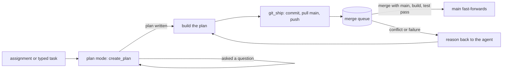

# Software factory

The user gives a channel requirements. The channel's members plan the
work, build it and ship it, and a merge queue lands every push on `main`
one at a time. Nobody has to approve a plan or press merge. Agents ask a
question only when a wrong guess could cause harm, lose data or leave
major inconsistencies.



## 1. Plan, then build, with no stop between

Code: `crates/surface/aura-app/src/event_loop/factory/flow.rs` (the stages,
pure and unit-tested) and `factory/hooks.rs` (where the event loop applies
them).

- When a channel member that isn't the coordinator gets an inbox
  **assignment**, it enters the flow at `Assigned`. This happens both when
  the member is new and when an existing member is given more work. It
  moves to `Planning` when the assignment's work starts, not when the
  message arrives, so a turn still running for an earlier task is not
  taken for the new one.
- **`/plan`'s planner** enters the flow at `Assigned` as it joins the
  channel (`channels::start_planner`). The request it is given, with
  `/plan` or typed into its chat after a bare `/plan`, is its task.
- A **task typed** straight into a member's chat enters the flow too, as
  its turn starts (`hooks::typed_task`). These messages are not tasks and
  run as before:
  - "implement" or `/build`, which build the plan;
  - anything sent to a member the user put in plan mode, which waits for
    "implement" or `/build`;
  - an @mention from the coordinator's chat, which is conversation;
  - a message to a local member with a plan still open, which carries on
    with that plan (`continue_open_plan`).
- A turn at `Planning` runs in **plan mode**. For a local agent the kernel
  switches its policy, as `/plan` does. For a cloud agent the hub sets the
  mode, so the machine gets the plan-mode prompt. Either way the chat
  shows plan mode, and says "Planning first: …" (`hooks::PLANNING_FIRST`)
  instead of `/plan`'s note about "implement". The channel's MEMBERS
  shows `(P)` after the member's name, as PROJECTS does.
- Nobody is asked to start the build. While the agent is at `Planning`,
  its `<plan_mode>` section is the one for a plan built right after the
  turn (`plan_mode::Build::RightAway`, from `AgentHub::plan_build`). It
  tells the model to ask only when a wrong guess is harmful, and to end
  its turn once the plan is written instead of telling the user to say
  "implement". A local agent's "Plan ready" note says the plan is built
  next, without waiting for approval.
- When the turn ends having run `create_plan` itself, the hub queues the
  build at the front of the agent's work. The plan is read from the turn's
  own tool calls (`factory::turn`), so an older plan is never taken for
  the new one, and rewriting the same plan file counts:
  - a local agent gets `Work::Build`, the same path as `/build`, and its
    chat says "Building <plan>";
  - a cloud agent gets the build-plan prompt after leaving plan mode, and
    its chat says "Plan written: building it now."
    (`hooks::BUILDING_PLAN`).

  The inbox answer to the coordinator waits for the build turn, so the
  report says what was built rather than "plan written".
- When the turn ends **without** a plan, the agent asked a question. The
  question goes back as its answer, and the agent stays at `Planning`. The
  reply comes back to a turn that still plans, and once that turn writes a
  plan, the build starts. Switching the agent out of plan mode first takes
  the task over: it leaves the flow, and the next turn runs as asked.
- A turn that fails or is stopped leaves the flow. Its work is given up,
  as before. One that was planning also takes the agent out of plan mode,
  where it couldn't edit or ship.
- If the build can't start (`start_build` finds no plan to build), the
  flow ends and the planning turn's inbox answer is sent then.
- **Resume:** a plan that is open but unfinished, for example after a
  restart, carries on through the existing `continue_open_plan`. A new
  assignment always starts with a new plan, even if an old one is still
  open.
- Members are told the rules in a `<software_factory>` block after their
  `<channel>` block (`factory::FACTORY_RULES`). The block covers two
  things:
  - Plan first, and don't ask for approval.
  - Ask only when a wrong guess is harmful. Otherwise pick the safe
    default and say which one.

### Across restarts

Each member's stage is saved with the reports members owe, in one atomic
write of `<data dir>/inbox-owed.json` (field `flows`). That write runs on
a blocking thread after every event the loop handles, and once more as
the app quits. The file is bounded (1,000 members, 2 MiB of saved
prompts) and is read as empty, with a warning, when it is corrupt. On
start, each member continues where it was (`factory/saved.rs`):

| Saved stage | What happens on reopen |
|---|---|
| assigned | Nothing extra: the task is the inbox's queued or undelivered message. |
| planning, turn under way | Plan mode, and the prompt that turn started with runs again. |
| planning, waiting for a reply | Plan mode; the reply comes back to a planning turn. |
| building | The build of its plan runs again. |
| shipping | It is asked to ship again. |

The report its build held back is still owed, and goes out when the flow
ends. A cloud member whose turn was under way gets nothing re-queued,
since its turn goes on on its machine and is reattached. Members that
settled or failed (`Flows::leave`) are not saved, and archived ones are
dropped. `Flows::resumes_after_restart` tells a turn resumed on reopen
that the factory has queued that member's work already.

## 2. Ship: commit, pull main, push

When a task is done, the agent ships it with the `git_ship` tool
(`crates/exec/aura-exec-tools/src/git_tool/ship.rs`). Each step has a
timeout. The steps are:

1. **Commit** every change (`add -A`, `commit`). If nothing changed, this
   step does nothing.
2. **Pull its own branch:** `fetch origin refs/heads/<branch>` and merge
   it, so a merge the queue put on the PR's branch comes in first and the
   push stays a fast-forward. A branch origin doesn't have yet is skipped.
3. **Pull main:**
   - `fetch origin refs/heads/<target>`, then `merge --no-edit FETCH_HEAD`.
   - A conflict runs `merge --abort`, names the conflicted files and stops
     without pushing.
   - If origin has no `<target>` branch, the pull is skipped.
4. **Push** the current branch with `git_push_impl`. That respects the
   cloud node's branch pin.
5. **Return** the merge queue marker
   (`"merge_queue": {branch, head, remote}`).
6. A repo without `origin` skips steps 2 to 4, and its local branch is
   queued with `remote: null`.

How shipping is started:

- The factory rules (and, on a machine, the `<cloud_git>` note) tell the
  agent to call `git_ship` at the end.
- If a build turn ends without a push, the hub queues one more turn that
  asks the agent to ship (`hooks::SHIP_PROMPT`). The hub never runs git
  for an agent: every ship goes through the agent's own kernel and tool
  policy, like any other tool call.
- A local agent whose folder another channel member also works in is not
  asked: `add -A` there would commit the other member's work too. Its chat
  says so. `git_ship` calls of one folder also run one at a time, so two
  members never race on its index.

### One branch per task

Code: `crates/exec/aura-exec-tools/src/git_tool/branches.rs` and
`tools_start.rs`.

- `git_start_task { task }` fetches the target and checks out a new
  branch `aura/<task slug>-<agent code>` at `origin/<target>`. A name
  that exists here or on origin gets `-2`, `-3`, ... before the code, so
  no branch is ever reused. It refuses, naming them, while uncommitted
  changes or commits origin doesn't have would be left behind.
- The agent code comes from the machine's pinned branch, else from the
  current `aura/...-<code>` branch.
- A cloud machine is still placed on one branch, but may push that one
  and any other `aura/<slug>-<same code>` (`allowed_by_pin`). Another
  agent's branch, the protected branches and the queue's target stay
  refused.
- **Follow-up work.** When `git_ship` finds the branch's last push is
  already on the target and new commits sit on top, it moves them to a
  fresh branch first (named after its optional `task`, else the old
  name with a number) and ships that. A merged branch is never pushed
  again.
- The factory rules and the `<cloud_git>` note tell agents to start each
  task with `git_start_task` and never to merge a PR themselves.

## 3. No push skips the queue

Pushes from `run_command` are blocked, not detected: a push that already
reached the remote can't be taken back, and one to the target branch must
never land at all. There are two layers (`fs_tools/cmd/push_guard.rs`):

- **Typed pushes are refused.** A command whose words run `git push`,
  however it's typed (after git's global options, in a script, through
  `sh -c`, `env`, `xargs` or `eval`), `gh pr merge`, or `gh api` on a
  PR's merge (`pulls/<n>/merge`), is refused
  before it runs, pointing the agent at `git_ship`. A command that only
  names a push (`git commit -m "git push later"`) is refused too, which
  is the safe side to err on.
- **Scripted pushes fail.** Every command `run_command` starts gets
  `url.aura-blocked-push://….pushInsteadOf` for `https://`, `http://`,
  `ssh://` and `git@` through `GIT_CONFIG_COUNT`. So a push that a
  script or a build makes goes to a URL no git transport serves, and
  never reaches the remote. Fetch, clone and every other git command
  are unaffected. The push tools run git themselves, without it.

A deliberate evasion is still possible: a script file that clears
`GIT_CONFIG_COUNT` and then pushes. That needs an agent working against
its own instructions, so the guard isn't built for it.

- Every successful push carries the marker. That includes `git_push`,
  `git_commit_push` and `git_ship`. Implemented in `Pushed::to_json` and
  `Shipped::to_json`.
- Every tool call of every agent, local or cloud, reaches the UI through
  `AgentUi`, which hands each command to `factory::observe::record`. A
  result counts as a push only when its call started as `git_push`,
  `git_commit_push` or `git_ship`, so another tool's output that happens
  to hold a marker (a `run_command` echoing one) queues nothing.
- A cloud turn's conversation is read again when the turn ends, and its
  pushes are queued again; a stream cut off mid-turn can't lose one. The
  queue drops the repeat.
- Pushes to `main` or `master` (`PROTECTED_BRANCHES`) are refused with
  `GitToolError::ProtectedBranch`, and so are pushes to the target a
  workspace's `.aura/merge-queue.toml` names. The target only moves
  through the queue.
- **Known gap:** a raw `git push` typed into `run_command` doesn't go
  through the git tools, so it skips the queue. The prompts steer agents
  to `git_ship`.

## 4. The merge queue

Crate: `crates/exec/aura-exec-merge-queue`.

| Module | Role |
|---|---|
| `entry` | `MergeEntry`, `MergeStatus` (queued, running, merged, failed), the `QueuedPush` marker |
| `state` | `QueueState`: enqueue, claim, finish, recover, expire and prune, all pure |
| `store` | Atomic JSON file, changed only under its file lock, and the one-processor lock |
| `lock` | The operating system's file locks (`flock`; no-sharing opens on Windows) |
| `checks` | Running a check in its own process group, its output in a log file |
| `config` | Target branch and checks |
| `integrate` | `GitIntegrator`, which lands one entry |
| `processor` | `MergeQueue` (queue, read, announce) and `Processor`, the lock holder that recovers and lands |

- **Ordering:** entries run in first-in, first-out order, and at most one
  runs at a time.
  - A new push of a branch that is still queued updates that entry's head
    and keeps its place.
  - The same push again, while it is queued, running or merged, is a
    duplicate.
- **One queue per repo:**
  - A repo's queue is keyed by its common git dir. Every worktree and
    clone path of the repo inside the hub therefore shares one queue and
    one processor.
  - Only a `Processor` lands entries, and one exists per repo: it holds an
    OS lock on `merge-queue.lock` for as long as it lives. The lock goes
    with its process however that ends, so nothing refreshes it and no
    other process can take it from a live processor, however long a merge
    runs.
  - Every change to the file is a read, modify and write under the lock
    on `merge-queue.state.lock`. Processes sharing a queue (two hubs on one
    repo) see each other's pushes, and a processor picks up pushes queued
    elsewhere within 15 seconds.
- **Persistence:** the queue lives at
  `<git-common-dir>/aura/merge-queue.json`.
  - The file is rewritten atomically (temp file, fsync, rename) before
    any change is announced.
  - An unreadable file is moved aside, never deleted.
- **Crash recovery:** once a processor holds the lock (never before), an
  entry left `running` goes back to `queued` in its old place. After 3
  interrupted attempts it fails.
  At startup the hub opens the queue of every channel project that has a
  queue file, so processing resumes.
- **Timeouts:**
  - each git call: 5 minutes;
  - each check: 60 minutes by default;
  - each entry in total: 3 hours. An entry cut off by that limit is checked
    first: if the target already holds its commit (the push landed just
    before the cut), it counts as merged;
  - an entry may wait for up to 24 hours after its last change (queued,
    pushed again, or put back after a crash) before it expires.
- **History:** every finished entry is kept. The queue file keeps the 100
  newest; older ones move, under the queue file's lock, to
  `<git-common-dir>/aura/merge-history.jsonl`, one JSON line each. The
  queue file records how much of that file is committed, so a crash
  between the two writes never duplicates or loses an entry. The QUEUE
  tab gets the newest 100 and `N older merges` under them; scrolling to
  that line asks for the next 100 (`UiEvent::LoadOlderMerges`), read
  backwards from the end of the history file.
- **Landing an entry** (`integrate`):
  1. Fetch the target and the entry's branch into private
     `refs/aura-queue/*` refs.
  2. Check out the entry's exact head in the queue's own worktree, which
     lives outside `.git` in a per-repo work folder under the user's cache
     folder (`~/.cache/aura/merge-queue/<repo>-<hash>/worktree` on Linux),
     with the check log beside it. The worktree is reset and cleaned each
     time; ignored build caches are kept. The worktree queues used to keep
     in `<git-common-dir>/aura/merge-worktree` is removed with `git
     worktree remove` (or deleted and pruned) the first time the new one
     is made.
  3. Fast-forward if the head is already based on the target. Otherwise
     merge it with the target: one merge commit, the target first. The
     queue merges rather than rebases, because `git_ship` already merged
     main into the branch and the agent resolved the conflicts; a rebase
     would drop that merge and replay the same conflict. A conflict fails
     the entry and names the files.
  4. Run the build, then the test, on exactly that commit. The commands
     are those of `.aura/merge-queue.toml` as the target's commit has it
     (`git show <target>:.aura/merge-queue.toml`), read per entry, so a
     push can't change the checks that gate it. Each check runs in a
     process group of its own, which a timeout kills whole; its output
     goes to `<git-common-dir>/aura/check.log`, and the failure reason
     keeps the end of it.
  5. Move the target. A pushed entry of a repo on github.com lands
     through its PR (see "Landing through the PR" below). Otherwise:
     - With a remote: a non-forced `push <sha>:refs/heads/<target>`. If
       the target moved in the meantime, the push is rejected and the
       entry is retried from step 1, up to 3 times. A push cut off by its
       timeout counts when the remote's target holds the commit.
     - A local target: a compare-and-swap `update-ref`. If the target is
       checked out, it is moved with `merge --ff-only`, but only in a clean
       checkout; a dirty checkout fails the entry.
- **Landing through the PR** (`integrate/pull_request.rs`, the default
  for a pushed entry when the hub's queue has a GitHub repo for it;
  `land = "push"` in the config file turns it off, `land =
  "pull_request"` makes it required):
  1. The branch's tip as fetched is the head that is tested: a push made
     since the entry was queued is tested too. A tip that no longer holds
     the queued commit (a force-push) fails the entry.
  2. The queue finds the branch's open PR, or opens one titled by the
     branch's first commit, and sets the `aura/merge-queue` commit status
     to pending.
  3. It merges the latest target in its worktree and runs the checks, as
     above, generated files resolved the same way.
  4. A merge commit it made is pushed onto the PR's branch as a
     fast-forward, so the PR's head is exactly the tested commit. A
     rejected push means the branch moved: the entry is tried again from
     the fetch.
  5. With the remote target unchanged (`ls-remote`), it sets the status
     to success and runs `gh pr merge <n> --merge --match-head-commit
     <tested sha>`: a normal merge commit, only at that head. A head that
     moved is tested again, up to 3 times.
  6. After a confirmed merge, the branch is deleted on origin with
     `--force-with-lease` on the merged commit, so newer work on it stays.
  - On a conflict, a failed check or a refusal nothing merges: the PR
    stays open, the queue comments on it with the reason, the conflicting
    files or the output, and sets the status to failure. The entry fails
    with the same details (`MergeEntry::failure`, `MergeEntry::pr`).
  - A PR closed by hand while it is tested is abandoned: the entry fails
    and the branch is deleted.
  - GitHub unreachable, or `gh` not signed in, holds the queue
    (`QueueState::hold`): the entry goes back to its place without an
    attempt counted, nothing starts for 5 minutes, and its agent is told
    it waits through no fault of its own.
  - The forge is `GhForge` (`forge/gh.rs`): `gh` with `--repo
    owner/name`, a 60-second limit per call, and its own sign-in (or
    `GH_TOKEN`). Tests use a fake GitHub over a bare repo
    (`tests/support/forge.rs`).
  - **Branch protection.** A status alone doesn't stop someone merging
    by hand. Protect the target and require the `aura/merge-queue`
    status; see `docs/software-factory-review.md` for the command.
- **A failing test is diagnosed before anyone is blamed**
  (`integrate/diagnose.rs`, `failure.rs`). When the test check fails, the
  failing tests are read from its log (libtest's `test x ... FAILED` and
  `---- x stdout ----` blocks) and, for a `cargo test` command:
  1. they run once more on the same merge (`-- --exact <names>`); if
     they pass, the entry merges and its note names them as flaky;
  2. else they run on the plain target. If they fail there too, the
     target is broken: the entry goes back to its place uncharged and is
     parked until the target moves (or 2 hours pass), and the queue
     reports it (`QueueEvent::Held`, `HoldKind::TargetBroken`) with the
     tests, their output on the target, and the target's first-parent
     commits since the queue last merged (its last 5 after a restart) as
     suspects. Other entries still run, so the fix can land;
  3. else the entry broke them, and fails naming them, with their output.
  The hub sends the report once per broken tip to the coordinator of
  each channel on the repo and to the agents whose queue entries merged
  a suspect commit; a commit merged outside the queue is named as such
  with its author (`notes::broken_target_prompt`).
  Output that names no tests fails the entry as before.
- **Results:**
  - A failed entry goes back to the agent that pushed it as a notice. The
    notice starts a turn that names the PR, the conflicting files or the
    failing output, and tells the agent to fix it on the same branch and
    ship again (`factory/notes.rs`).
  - A merged entry adds a line to the agent's chat.
  - Every change is sent to the QUEUE tab of each channel whose project is
    in that repo (`UiCommand::SetMergeQueue`).

### Config: `.aura/merge-queue.toml` (optional, committed on the target)

```toml
target = "main"                    # branch merges land on
build = "cargo build --workspace"  # "" turns the build check off
test = "cargo test --workspace"    # "" turns the test check off
check_timeout_secs = 3600
```

`target` is read from the file as committed on `main` (the local branch,
else `origin/main`; `aura_exec_merge_queue::resolve_target`), so an
uncommitted edit in a checkout can't move it and every worktree agrees.
A repo with no `main` reads its working tree's file. The queue, `git_ship`
(when the call names no target), the push guard, new cloud machines and
the QUEUE tab all use that one answer. The push guard refuses both it and
the target a workspace's own uncommitted file names. The other keys are
read from the target branch's commit, per entry. Without the
file, the checks are inferred from the merged tree's files:

- `Cargo.toml`: `cargo build --workspace --all-targets` and
  `cargo test --workspace`
- `package.json`: `npm run build --if-present` and `npm test --if-present`
- `go.mod`: `go build ./...` and `go test ./...`

A repo with none of these merges unchecked, and the entry's detail says so.

## 5. The QUEUE tab

The QUEUE tab sits right after INFO in the right side panel of an open
channel (`SidePanelTab::ChannelQueue`), in the terminal UI and the desktop
app, which draws the same tabs.

- The header shows the target branch and the repo.
- Then comes one block per entry, newest first:
  - the state, coloured: merged, failed, running or queued;
  - the branch and short head;
  - the agent;
  - the queued and finished times;
  - the number of attempts, when it is more than one;
  - the merged sha;
  - the detail, which for a failed entry is the reason.
- A broken target comes first, above every block, in the error colour.
- A failed merge shows its failing tests and their output (the
  assertion or snapshot diff, up to 24 lines), or the files that
  conflicted, right under its state line, before its other facts. Its
  PR's address comes after the merged sha.
- The tab is reached by clicking it, by Shift+Left/Right, or with the
  mouse wheel and keys for scrolling.

Code: `crates/ui/aura-ui-terminal/src/renderer/channel_queue.rs`, with
views in `aura_ui::events::{MergeQueueView, MergeEntryView}`.

## 6. A new cloud machine starts on the latest code

A machine starts from its project's snapshot plus the hub's HEAD, or, for
a fork, from its parent's disk. It never gets the hub's uncommitted
changes (see "Machines and the hub's uncommitted work" below). Either can be
behind GitHub, because the merge queue lands other agents' work on
`origin`'s target branch and not in the hub's checkout. So every new
agent's machine pulls the latest target (main unless the committed
config names another; the hub resolves it when it places the agent)
from GitHub on top of what it has, before the agent's first turn:

1. The agent's branch is checked out at the hub's HEAD and `origin` is set
   to the project's GitHub repository (`workspace::start_branch`). A fork instead moves its parent's
   disk to its own branch (`workspace::fork_branch`).
2. `git fetch origin <target>` runs with the machine's credentials (from
   its claim), bounded by 120 seconds. Then `origin/<target>` is merged into the
   agent's branch. That is a fast-forward when the branch has nothing of
   its own (`workspace::pull::pull_latest`).
3. Only then is the working tree marked as the base the hub takes
   patches against, so later pulls back to the hub see only the agent's
   own changes.

The pull never fails a placement and never loses work:

- **Skipped:** without `origin`, without a `main` on it, or without
  access, nothing changes.
- **Refused:** a merge that would touch uncommitted changes in the
  workspace is refused by git before it changes anything.
- **Aborted:** a merge that conflicts is aborted, so the branch is left
  as it was. The agent then merges main itself when it ships
  (`git_ship`), and the queue merges it with main anyway.

The outcome shows as the `github` fact of the machine's boot ("merged
origin/main at 1a2b3c4d", "up to date with origin/main" or "skipped: …").

### Machines and the hub's uncommitted work

Machines used to start with the hub's uncommitted changes unpacked in
their workspace. A ship commits every change it finds, so it pushed that
unfinished work too. Two things stop that now:

- **New machines start from commits only.** The hub no longer seeds a
  machine with its uncommitted files (`hub/seed.rs`), and says how many
  stayed home in the `changes` boot fact: commit them to share them.
  This is the safer of the two options, because nothing uncommitted from
  the hub ever reaches a machine, so nothing has to be told apart later.
- **Machines seeded before that never commit the seed.** Their starting
  point is the commit at `refs/aura/base`, and its diff against its
  parent is exactly the seeded files. After staging, `git_commit`,
  `git_commit_push` and `git_ship` unstage the seeded files the agent
  left as they were. A seeded file the agent changed too fails the
  commit (`SeededHubChanges`), since its edits can't be told apart from
  the hub's (`git_tool/seed.rs`).

### Restarting while cloud turns run

A turn under way means its machine is awake, so a restarted app
reconnects to it rather than waking it (`hub/reconnect.rs`):

- **Reconnect, not wake.** For each turn mark, the hub claims the node
  again, since node tokens aren't kept across restarts, and attaches to
  the turn's run. There's no wake call and no update check (#76). The
  chat and the member's row say "Reconnecting…" until it's reached.
- **Fast and in the background.** The agent on screen is reconnected
  first, then the rest, at most `RECONNECTS_AT_ONCE` (8) at a time. The
  streams that follow have no limit, and startup doesn't wait on any of
  them.
- **Retries.** A node that can't be reached is tried again after 2, 5, 15
  and 30 seconds. Then the turn is reported failed and its mark kept, as
  before, so a later pickup can still find it. A turn is still picked up
  only once (#102).
- **Sleeping machines.** A machine with a turn mark that sleeps has
  finished that turn, so it is woken to copy the reply, and its chat says
  "Waking cloud machine". One with no mark is left asleep: catch-up no
  longer wakes it. What it made is copied when it next wakes for work.

### Machines from before the merge queue

Machines made before the merge queue run an older aura. It has no
`git_ship`, its pushes carry no queue marker, and its prompt still says
to open a pull request. Three things keep them in the queue:

1. **They are updated.** A node now reports its git tools when it is
   claimed (`NodeClaimed::tools`). When a turn or session is about to
   start on a node without `git_ship`, and the machine does no work, the
   hub uploads its own cloud build, installs it once it starts on the
   machine, restarts the node and claims it again
   (`fleet/update.rs`, `hub/node_update.rs`). The node's store stays on
   disk, so the conversation survives. If the update fails, the old node
   keeps running. A turn is never cut off by it:
   - **One update at a time.** A per-agent lock serializes updates, and
     the busy check and the update's own busy count are taken under one
     lock, so no turn this hub starts can begin during the update.
   - **The node is asked.** A turn the node started itself (for mail, or
     a spawned agent) isn't counted by the hub. So before restarting,
     the hub asks the node (`GET /v1/cloud/processes`). A node too old
     to answer counts as idle only once its hub socket has reported that
     nothing runs. If the node can't be reached, there's no update.
   - **Marks outlive lost watches.** A turn's mark goes only when its run
     is known to have ended: its end was seen, the node says the run is
     gone, or the hub stopped it. When the hub stops watching for another
     reason (the machine couldn't be woken, the node stopped answering,
     the 6-hour limit passed and the stop didn't take), the turn is
     reported failed but its mark stays (`CloudHub::unsettled_run`). The
     node isn't restarted under it, and a later turn's mark replaces it.
2. **The ship prompt fits the node.** Before asking a cloud agent to
   ship, the hub checks whether its node offered `git_ship`. If not, it
   asks for `git_commit_push` and says not to open a pull request
   (`FALLBACK_SHIP_PROMPT`).
3. **Their pushes are queued anyway.** A push tool's result from an old
   node (`{"pushed": true, "branch", "commits": [...]}`) is read as a
   push of its newest commit to `origin` (`QueuedPush::from_legacy_output`),
   both live and when the turn ends, so it lands in the queue like any
   other. A push made by hand (`run_command git push`) is still not seen.

## 7. Isolation of parallel agents

- **Cloud channels:** each member has its own machine, its own clone and
  its own branch (`aura/<slug>-<code>`). Members never share a checkout,
  and the branch pin keeps each one to its own branch.
- **The queue:** it works only in its own worktree and private refs. It
  never touches an agent's workspace or the user's checkout, except the
  clean fast-forward of a local target described above.
- **Local channels:** each member works in a git worktree of its own,
  `<data dir>/worktrees/<agent id>`, on its own branch
  `aura/<definition>-<id8>` started at the repository's HEAD
  (`isolation/member.rs`, set when it joins in `channels/join.rs`). Its
  subagents work in its worktree. A project folder below the
  repository's top maps to the same folder inside the worktree. So a
  member's ship commits and pushes only its own work.
  - Archiving a member removes its worktree if it holds no uncommitted
    work, and keeps it otherwise. The branch and its commits always
    stay. Restoring the member adds the worktree back on its branch.
  - A project folder outside git, or a repository with no commit yet,
    keeps the old shared folder. There the hub still doesn't ask an
    agent to ship in a folder another member shares.

## 8. Fewer conflicts between parallel agents

Parallel branches used to conflict in the same few places. Nearly every
merge conflicted in `CHANGELOG.md`, because each branch added its entry
at the top of `[Unreleased]`. Three things now keep that churn down.

### Changelog fragments

- A change adds its entry as its own file,
  `changelog.d/<last segment of its branch>.md`, and never edits
  `CHANGELOG.md`. No other branch writes that file, so entries can't
  conflict. The format is in [`changelog.d/README.md`](../changelog.d/README.md).
- The fragments are put into `CHANGELOG.md` at release time, not by the
  queue: `aura changelog` shows the entries they make, newest first by
  when git added them, and `aura changelog --write` writes them under
  `## [Unreleased]` and deletes them. So what lands is always exactly
  the agent's merge, checked. Code:
  `aura-exec-merge-queue::changelog` (pure) and
  `aura-cli/src/changelog_commands.rs`.
- `git_ship` enforces it (`git_tool/fragments.rs`). After the pull it
  diffs the fetched target against `HEAD`. If the repo has
  `changelog.d/` and the branch edits `CHANGELOG.md` without deleting a
  fragment (a release), it stops before pushing with
  `ChangelogEdited`, naming the fragment to write. A repo without
  `changelog.d/` ships as before.
- `FACTORY_RULES` and the cloud agent's `<cloud_git>` note tell agents
  the same.

### The queue resolves generated files itself

When merging the target into an entry conflicts (`integrate.rs`,
`merge_commit`), `resolve::settle` looks at the conflicted files.
Generated files are matched by name at any depth:

| File | Resolution |
|---|---|
| `CHANGELOG.md` | Union of both sides (`git merge-file --union` on the three stages), so both new entries stay |
| `Cargo.lock` | The target's side, then `cargo metadata --format-version 1` in its folder brings it up to date with the merged manifests |
| `package-lock.json` | The target's side, then `npm install --package-lock-only --ignore-scripts` |

- If every conflict is in one of them, they are resolved, added and
  committed with the queue's merge message, and the entry goes on to the
  checks as usual. The build and tests still run on exactly the commit
  that lands. The entry's detail says "resolved CHANGELOG.md mechanically".
- If any other file conflicts, the merge is aborted and the entry fails.
  The reason lists the real files first and says the generated ones would
  have been resolved. It goes back to the agent as before, which pulls
  main, resolves and ships again.
- A generated file that can't be resolved mechanically (deleted on one
  side, or its regenerate command fails) counts as a real conflict, and
  the reason says why.

### Overlap warnings

- When a push is queued, the hub records which files the entry changes
  (`MergeEntry::files`, from `git diff --name-only <target>...<head>`,
  `overlap::changed_files`). Generated files don't count.
- The work in flight is every queued or running entry, and every branch
  whose last entry failed and hasn't merged since: its agent is fixing
  it (`overlap::open_work`). Each local channel member's worktree on a
  branch other than the target counts too, with its committed and
  uncommitted changes. A cloud member's work counts once it is pushed.
- When the new entry shares files with any of them, both owning agents
  get a notice naming the other agent, its branch and the shared files,
  and asking them to agree who lands first (`send_to_agent`). A pair is
  told once per process, so re-pushing the same overlap stays quiet.
  Code: `aura-app/src/event_loop/factory/overlap.rs`.
- The QUEUE tab lists an entry's overlaps under it ("Overlaps", one line
  per other piece of work: its entry or branch, its agent and the
  shared files).
- Nothing is blocked. Overlap is a reason to talk, not to wait.

## Defaults chosen

| Question | Default |
|---|---|
| Straight into main, or GitHub PRs and GitHub's merge queue? | Straight into the target branch through aura's own queue: a non-forced push after a merge with main and green checks. This needs no GitHub settings, and it works without a remote too. |
| Is each entry gated on build and tests? | Yes. Configured or inferred build and test must pass on the exact commit that lands. A repo with nothing to check merges unchecked, and says so. |
| How many processors? | One per repo, enforced in the process and across processes. |
| What happens on failure? | The entry is marked failed with its reason, and the reason goes to the owning agent, which is prompted to fix and re-ship. It also shows in the channel's QUEUE tab. |
| Which branches are protected? | `main` and `master`. Agents can never push them. |
| What does a new cloud machine start on? | The hub's HEAD, never its uncommitted changes, with GitHub's latest merge queue target (`main` by default) merged on top. If the merge isn't clean, it starts on the hub's commits alone and says why. |
