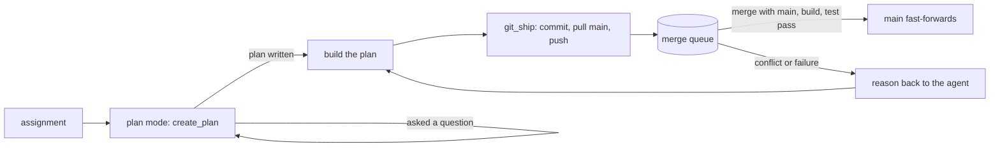

# Software factory

The user gives a channel requirements. The channel's members plan the
work, build it and ship it, and a merge queue lands every push on `main`
one at a time. Nobody has to approve a plan or press merge. Agents ask a
question only when a wrong guess could cause harm, lose data or leave
major inconsistencies.



## 1. Plan, then build, with no stop between

Code: `crates/surface/aura-app/src/event_loop/factory/flow.rs` (the stages,
pure and unit-tested) and `factory/hooks.rs` (where the event loop applies
them).

- When a channel member that isn't the coordinator gets an inbox
  **assignment**, it enters the flow at `Assigned`. This happens both when
  the member is new and when an existing member is given more work. It
  moves to `Planning` when the assignment's work starts, not when the
  message arrives, so a turn still running for an earlier task is not
  taken for the new one.
- A turn at `Planning` runs in **plan mode**. For a local agent the kernel
  switches its policy, as `/plan` does. For a cloud agent the hub sets the
  mode, so the machine gets the plan-mode prompt.
- When the turn ends having run `create_plan` itself, the hub queues the
  build at the front of the agent's work. The plan is read from the turn's
  own tool calls (`factory::turn`), so an older plan is never taken for
  the new one, and rewriting the same plan file counts:
  - a local agent gets `Work::Build`, the same path as `/build`;
  - a cloud agent gets the build-plan prompt after leaving plan mode.

  The inbox answer to the coordinator waits for the build turn, so the
  report says what was built rather than "plan written".
- When the turn ends **without** a plan, the agent asked a question. The
  question goes back as its answer, and the agent stays at `Planning`. The
  reply comes back to a turn that still plans, and once that turn writes a
  plan, the build starts.
- A turn that fails or is stopped leaves the flow. Its work is given up,
  as before. One that was planning also takes the agent out of plan mode,
  where it couldn't edit or ship.
- If the build can't start (`start_build` finds no plan to build), the
  flow ends and the planning turn's inbox answer is sent then.
- **Resume:** a plan that is open but unfinished, for example after a
  restart, carries on through the existing `continue_open_plan`. A new
  assignment always starts with a new plan, even if an old one is still
  open.
- Members are told the rules in a `<software_factory>` block after their
  `<channel>` block (`factory::FACTORY_RULES`). The block covers two
  things:
  - Plan first, and don't ask for approval.
  - Ask only when a wrong guess is harmful. Otherwise pick the safe
    default and say which one.

## 2. Ship: commit, pull main, push

When a task is done, the agent ships it with the `git_ship` tool
(`crates/exec/aura-exec-tools/src/git_tool/ship.rs`). Each step has a
timeout. The steps are:

1. **Commit** every change (`add -A`, `commit`). If nothing changed, this
   step does nothing.
2. **Pull main:**
   - `fetch origin refs/heads/<target>`, then `merge --no-edit FETCH_HEAD`.
   - A conflict runs `merge --abort`, names the conflicted files and stops
     without pushing.
   - If origin has no `<target>` branch, the pull is skipped.
3. **Push** the current branch with `git_push_impl`. That respects the
   cloud node's branch pin.
4. **Return** the merge queue marker
   (`"merge_queue": {branch, head, remote}`).
5. A repo without `origin` skips steps 2 and 3, and its local branch is
   queued with `remote: null`.

How shipping is started:

- The factory rules (and, on a machine, the `<cloud_git>` note) tell the
  agent to call `git_ship` at the end.
- If a build turn ends without a push, the hub queues one more turn that
  asks the agent to ship (`hooks::SHIP_PROMPT`). The hub never runs git
  for an agent: every ship goes through the agent's own kernel and tool
  policy, like any other tool call.
- A local agent whose folder another channel member also works in is not
  asked: `add -A` there would commit the other member's work too. Its chat
  says so. `git_ship` calls of one folder also run one at a time, so two
  members never race on its index.

## 3. No push skips the queue

- Every successful push carries the marker. That includes `git_push`,
  `git_commit_push` and `git_ship`. Implemented in `Pushed::to_json` and
  `Shipped::to_json`.
- Every tool call of every agent, local or cloud, reaches the UI through
  `AgentUi`, which hands each command to `factory::observe::record`. A
  result counts as a push only when its call started as `git_push`,
  `git_commit_push` or `git_ship`, so another tool's output that happens
  to hold a marker (a `run_command` echoing one) queues nothing.
- A cloud turn's conversation is read again when the turn ends, and its
  pushes are queued again; a stream cut off mid-turn can't lose one. The
  queue drops the repeat.
- Pushes to `main` or `master` (`PROTECTED_BRANCHES`) are refused with
  `GitToolError::ProtectedBranch`, and so are pushes to the target a
  workspace's `.aura/merge-queue.toml` names. The target only moves
  through the queue.
- **Known gap:** a raw `git push` typed into `run_command` doesn't go
  through the git tools, so it skips the queue. The prompts steer agents
  to `git_ship`.

## 4. The merge queue

Crate: `crates/exec/aura-exec-merge-queue`.

| Module | Role |
|---|---|
| `entry` | `MergeEntry`, `MergeStatus` (queued, running, merged, failed), the `QueuedPush` marker |
| `state` | `QueueState`: enqueue, claim, finish, recover, expire and prune, all pure |
| `store` | Atomic JSON file, changed only under its file lock, and the one-processor lock |
| `lock` | The operating system's file locks (`flock`; no-sharing opens on Windows) |
| `checks` | Running a check in its own process group, its output in a log file |
| `config` | Target branch and checks |
| `integrate` | `GitIntegrator`, which lands one entry |
| `processor` | `MergeQueue` (queue, read, announce) and `Processor`, the lock holder that recovers and lands |

- **Ordering:** entries run in first-in, first-out order, and at most one
  runs at a time.
  - A new push of a branch that is still queued updates that entry's head
    and keeps its place.
  - The same push again, while it is queued, running or merged, is a
    duplicate.
- **One queue per repo:**
  - A repo's queue is keyed by its common git dir. Every worktree and
    clone path of the repo inside the hub therefore shares one queue and
    one processor.
  - Only a `Processor` lands entries, and one exists per repo: it holds an
    OS lock on `merge-queue.lock` for as long as it lives. The lock goes
    with its process however that ends, so nothing refreshes it and no
    other process can take it from a live processor, however long a merge
    runs.
  - Every change to the file is a read, modify and write under the lock
    on `merge-queue.state.lock`. Processes sharing a queue (two hubs on one
    repo) see each other's pushes, and a processor picks up pushes queued
    elsewhere within 15 seconds.
- **Persistence:** the queue lives at
  `<git-common-dir>/aura/merge-queue.json`.
  - The file is rewritten atomically (temp file, fsync, rename) before
    any change is announced.
  - An unreadable file is moved aside, never deleted.
- **Crash recovery:** once a processor holds the lock (never before), an
  entry left `running` goes back to `queued` in its old place. After 3
  interrupted attempts it fails.
  At startup the hub opens the queue of every channel project that has a
  queue file, so processing resumes.
- **Timeouts:**
  - each git call: 5 minutes;
  - each check: 60 minutes by default;
  - each entry in total: 3 hours. An entry cut off by that limit is checked
    first: if the target already holds its commit (the push landed just
    before the cut), it counts as merged;
  - an entry may wait for up to 24 hours after its branch's last push
    before it expires;
  - the 1,000 newest finished entries are kept.
- **Landing an entry** (`integrate`):
  1. Fetch the target and the entry's branch into private
     `refs/aura-queue/*` refs.
  2. Check out the entry's exact head in the queue's own worktree
     (`<git-common-dir>/aura/merge-worktree`). The worktree is reset and
     cleaned each time; ignored build caches are kept.
  3. Fast-forward if the head is already based on the target. Otherwise
     merge it with the target: one merge commit, the target first. The
     queue merges rather than rebases, because `git_ship` already merged
     main into the branch and the agent resolved the conflicts; a rebase
     would drop that merge and replay the same conflict. A conflict fails
     the entry and names the files.
  4. Run the build, then the test, on exactly that commit. The commands
     are those of `.aura/merge-queue.toml` as the target's commit has it
     (`git show <target>:.aura/merge-queue.toml`), read per entry, so a
     push can't change the checks that gate it. Each check runs in a
     process group of its own, which a timeout kills whole; its output
     goes to `<git-common-dir>/aura/check.log`, and the failure reason
     keeps the end of it.
  5. Move the target:
     - With a remote: a non-forced `push <sha>:refs/heads/<target>`. If
       the target moved in the meantime, the push is rejected and the
       entry is retried from step 1, up to 3 times. A push cut off by its
       timeout counts when the remote's target holds the commit.
     - A local target: a compare-and-swap `update-ref`. If the target is
       checked out, it is moved with `merge --ff-only`, but only in a clean
       checkout; a dirty checkout fails the entry.
- **Results:**
  - A failed entry goes back to the agent that pushed it as a notice. The
    notice starts a turn that tells the agent to pull main, fix the
    problem and ship again.
  - A merged entry adds a line to the agent's chat.
  - Every change is sent to the QUEUE tab of each channel whose project is
    in that repo (`UiCommand::SetMergeQueue`).

### Config: `.aura/merge-queue.toml` (optional, committed on the target)

```toml
target = "main"                    # branch merges land on
build = "cargo build --workspace"  # "" turns the build check off
test = "cargo test --workspace"    # "" turns the test check off
check_timeout_secs = 3600
```

`target` is read from the hub's checkout when the queue opens. The other
keys are read from the target branch's commit, per entry. Without the
file, the checks are inferred from the merged tree's files:

- `Cargo.toml`: `cargo build --workspace --all-targets` and
  `cargo test --workspace`
- `package.json`: `npm run build --if-present` and `npm test --if-present`
- `go.mod`: `go build ./...` and `go test ./...`

A repo with none of these merges unchecked, and the entry's detail says so.

## 5. The QUEUE tab

The QUEUE tab sits right after INFO in the right side panel of an open
channel (`SidePanelTab::ChannelQueue`), in the terminal UI and the desktop
app, which draws the same tabs.

- The header shows the target branch and the repo.
- Then comes one block per entry, newest first:
  - the state, coloured: merged, failed, running or queued;
  - the branch and short head;
  - the agent;
  - the queued and finished times;
  - the number of attempts, when it is more than one;
  - the merged sha;
  - the detail, which for a failed entry is the reason.
- The tab is reached by clicking it, by Shift+Left/Right, or with the
  mouse wheel and keys for scrolling.

Code: `crates/ui/aura-ui-terminal/src/renderer/channel_queue.rs`, with
views in `aura_ui::events::{MergeQueueView, MergeEntryView}`.

## 6. A new cloud machine starts on the latest code

A machine starts from its project's snapshot plus the hub's HEAD, or, for
a fork, from its parent's disk. It never gets the hub's uncommitted
changes (see "Machines and the hub's uncommitted work" below). Either can be
behind GitHub, because the merge queue lands other agents' work on
`origin`'s main and not in the hub's checkout. So every new agent's
machine pulls the latest main from GitHub on top of what it has, before
the agent's first turn:

1. The agent's branch is checked out at the hub's HEAD and `origin` is set
   to the project's GitHub repository (`workspace::start_branch`). A fork instead moves its parent's
   disk to its own branch (`workspace::fork_branch`).
2. `git fetch origin main` runs with the machine's credentials (from its
   claim), bounded by 120 seconds. Then `origin/main` is merged into the
   agent's branch. That is a fast-forward when the branch has nothing of
   its own (`workspace::pull::pull_latest`).
3. Only then is the working tree marked as the base the hub takes
   patches against, so later pulls back to the hub see only the agent's
   own changes.

The pull never fails a placement and never loses work:

- **Skipped:** without `origin`, without a `main` on it, or without
  access, nothing changes.
- **Refused:** a merge that would touch uncommitted changes in the
  workspace is refused by git before it changes anything.
- **Aborted:** a merge that conflicts is aborted, so the branch is left
  as it was. The agent then merges main itself when it ships
  (`git_ship`), and the queue merges it with main anyway.

The outcome shows as the `github` fact of the machine's boot ("merged
origin/main at 1a2b3c4d", "up to date with origin/main" or "skipped: …").

### Machines and the hub's uncommitted work

Machines used to start with the hub's uncommitted changes unpacked in
their workspace. A ship commits every change it finds, so it pushed that
unfinished work too. Two things stop that now:

- **New machines start from commits only.** The hub no longer seeds a
  machine with its uncommitted files (`hub/seed.rs`), and says how many
  stayed home in the `changes` boot fact: commit them to share them.
  This is the safer of the two options, because nothing uncommitted from
  the hub ever reaches a machine, so nothing has to be told apart later.
- **Machines seeded before that never commit the seed.** Their starting
  point is the commit at `refs/aura/base`, and its diff against its
  parent is exactly the seeded files. After staging, `git_commit`,
  `git_commit_push` and `git_ship` unstage the seeded files the agent
  left as they were. A seeded file the agent changed too fails the
  commit (`SeededHubChanges`), since its edits can't be told apart from
  the hub's (`git_tool/seed.rs`).

### Machines from before the merge queue

Machines made before the merge queue run an older aura. It has no
`git_ship`, its pushes carry no queue marker, and its prompt still says
to open a pull request. Three things keep them in the queue:

1. **They are updated.** A node now reports its git tools when it is
   claimed (`NodeClaimed::tools`). When a turn or session is about to
   start on a node without `git_ship`, and the machine does no work, the
   hub uploads its own cloud build, installs it once it starts on the
   machine, restarts the node and claims it again
   (`fleet/update.rs`, `CloudHub::current_node`). A running turn is
   never cut off: a busy machine waits for its next turn. The node's
   store stays on disk, so the conversation survives. If the update
   fails, the old node keeps running.
2. **The ship prompt fits the node.** Before asking a cloud agent to
   ship, the hub checks whether its node offered `git_ship`. If not, it
   asks for `git_commit_push` and says not to open a pull request
   (`FALLBACK_SHIP_PROMPT`).
3. **Their pushes are queued anyway.** A push tool's result from an old
   node (`{"pushed": true, "branch", "commits": [...]}`) is read as a
   push of its newest commit to `origin` (`QueuedPush::from_legacy_output`),
   both live and when the turn ends, so it lands in the queue like any
   other. A push made by hand (`run_command git push`) is still not seen.

## 7. Isolation of parallel agents

- **Cloud channels:** each member has its own machine, its own clone and
  its own branch (`aura/<slug>-<code>`). Members never share a checkout,
  and the branch pin keeps each one to its own branch.
- **The queue:** it works only in its own worktree and private refs. It
  never touches an agent's workspace or the user's checkout, except the
  clean fast-forward of a local target described above.
- **Local channels:** members still work in the channel project's folder,
  as before. The hub doesn't ask an agent to ship in a folder another
  member shares, and `git_ship` calls of one folder run one at a time. Hundreds of
  parallel agents should run in a cloud channel.
  - Giving each local member its own git worktree is left for later.
    `isolation::WorktreeIsolation` already provides the mechanics.

## Defaults chosen

| Question | Default |
|---|---|
| Straight into main, or GitHub PRs and GitHub's merge queue? | Straight into the target branch through aura's own queue: a non-forced push after a merge with main and green checks. This needs no GitHub settings, and it works without a remote too. |
| Is each entry gated on build and tests? | Yes. Configured or inferred build and test must pass on the exact commit that lands. A repo with nothing to check merges unchecked, and says so. |
| How many processors? | One per repo, enforced in the process and across processes. |
| What happens on failure? | The entry is marked failed with its reason, and the reason goes to the owning agent, which is prompted to fix and re-ship. It also shows in the channel's QUEUE tab. |
| Which branches are protected? | `main` and `master`. Agents can never push them. |
| What does a new cloud machine start on? | The hub's HEAD, never its uncommitted changes, with GitHub's latest `main` merged on top. If the merge isn't clean, it starts on the hub's commits alone and says why. |
