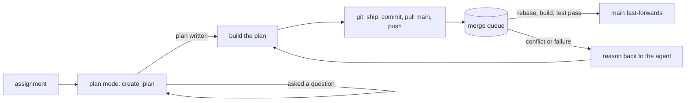

# Software factory

The user gives a channel requirements. The channel's members plan the
work, build it and ship it, and a merge queue lands every push on `main`
one at a time. Nobody has to approve a plan or press merge. Agents ask a
question only when a wrong guess could cause harm, lose data or leave
major inconsistencies.



## 1. Plan, then build, with no stop between

Code: `crates/surface/aura-app/src/event_loop/factory/flow.rs` (the stages,
pure and unit-tested) and `factory/hooks.rs` (where the event loop applies
them).

- When a channel member that isn't the coordinator gets an inbox
  **assignment**, it enters the flow at `Planning`. This happens both when
  the member is new and when an existing member is given more work.
- A turn at `Planning` runs in **plan mode**. For a local agent the kernel
  switches its policy, as `/plan` does. For a cloud agent the hub sets the
  mode, so the machine gets the plan-mode prompt.
- When the turn ends with a new plan written by `create_plan`, the hub
  queues the build at the front of the agent's work:
  - a local agent gets `Work::Build`, the same path as `/build`;
  - a cloud agent gets the build-plan prompt after leaving plan mode.

  The inbox answer to the coordinator waits for the build turn, so the
  report says what was built rather than "plan written".
- When the turn ends **without** a plan, the agent asked a question. The
  question goes back as its answer, and the agent stays at `Planning`. The
  reply comes back to a turn that still plans, and once that turn writes a
  plan, the build starts.
- A turn that fails or is stopped leaves the flow. Its work is given up,
  as before.
- **Resume:** a plan that is open but unfinished, for example after a
  restart, carries on through the existing `continue_open_plan`. A new
  assignment always starts with a new plan, even if an old one is still
  open.
- Members are told the rules in a `<software_factory>` block after their
  `<channel>` block (`factory::FACTORY_RULES`). The block covers two
  things:
  - Plan first, and don't ask for approval.
  - Ask only when a wrong guess is harmful. Otherwise pick the safe
    default and say which one.

## 2. Ship: commit, pull main, push

When a task is done, the agent ships it with the `git_ship` tool
(`crates/exec/aura-exec-tools/src/git_tool/ship.rs`). Each step has a
timeout. The steps are:

1. **Commit** every change (`add -A`, `commit`). If nothing changed, this
   step does nothing.
2. **Pull main:**
   - `fetch origin refs/heads/<target>`, then `merge --no-edit FETCH_HEAD`.
   - A conflict runs `merge --abort`, names the conflicted files and stops
     without pushing.
   - If origin has no `<target>` branch, the pull is skipped.
3. **Push** the current branch with `git_push_impl`. That respects the
   cloud node's branch pin.
4. **Return** the merge queue marker
   (`"merge_queue": {branch, head, remote}`).
5. A repo without `origin` skips steps 2 and 3, and its local branch is
   queued with `remote: null`.

How shipping is started:

- **Local agents:** when the build turn ends, the hub runs `git_ship`
  itself in the agent's folder. It only does this when the folder is on an
  agent's own `aura/*` branch; a folder on any other branch is left alone,
  with a line in the chat. If the ship fails, the agent gets a notice,
  which starts a turn to fix it.
- **Cloud agents:** the hub can't run git on the machine.
  - The `<cloud_git>` note and the factory rules tell the agent to call
    `git_ship` at the end.
  - If a build turn ends with no push marker in its results, the hub
    queues one more turn that asks the agent to ship.

## 3. No push skips the queue

- Every successful push carries the marker. That includes `git_push`,
  `git_commit_push` and `git_ship`. Implemented in `Pushed::to_json` and
  `Shipped::to_json`.
- Every tool result of every agent, local or cloud, reaches the UI through
  `AgentUi`. `AgentUi` hands each result to `factory::observe::record`,
  which forwards markers to the queue service. The marker is written by
  the push tools themselves and read at the one place every result passes,
  so an aura push can't avoid the queue.
- Pushes to `main` or `master` (`PROTECTED_BRANCHES`) are refused with
  `GitToolError::ProtectedBranch`. The target only moves through the
  queue.
- **Known gap:** a raw `git push` typed into `run_command` doesn't go
  through the git tools, so it skips the queue. The prompts steer agents
  to `git_ship`.

## 4. The merge queue

Crate: `crates/exec/aura-exec-merge-queue`.

| Module | Role |
|---|---|
| `entry` | `MergeEntry`, `MergeStatus` (queued, running, merged, failed), the `QueuedPush` marker |
| `state` | `QueueState`: enqueue, claim, finish, recover, expire and prune, all pure |
| `store` | Atomic JSON file and the one-processor lock |
| `config` | Target branch and checks |
| `integrate` | `GitIntegrator`, which lands one entry |
| `processor` | `MergeQueue`, which runs the loop, persists and announces |

- **Ordering:** entries run in first-in, first-out order, and at most one
  runs at a time.
  - A new push of a branch that is still queued updates that entry's head
    and keeps its place.
  - The same push again, while it is running or after it merged, is a
    duplicate.
- **One queue per repo:**
  - A repo's queue is keyed by its common git dir. Every worktree and
    clone path of the repo inside the hub therefore shares one queue and
    one processor.
  - `merge-queue.lock` keeps other processes out. A lock untouched for
    10 minutes counts as abandoned and is taken over.
- **Persistence:** the queue lives at
  `<git-common-dir>/aura/merge-queue.json`.
  - The file is rewritten atomically (temp file, fsync, rename) before
    any change is announced.
  - An unreadable file is moved aside, never deleted.
- **Crash recovery:** when a queue opens, an entry left `running` goes
  back to `queued` in its old place. After 3 interrupted attempts it fails.
  At startup the hub opens the queue of every channel project that has a
  queue file, so processing resumes.
- **Timeouts:**
  - each git call: 5 minutes;
  - each check: 60 minutes by default;
  - each entry in total: 3 hours;
  - an entry may wait in the queue for up to 24 hours before it expires.
- **Landing an entry** (`integrate`):
  1. Fetch the target and the entry's branch into private
     `refs/aura-queue/*` refs.
  2. Check out the entry's exact head in the queue's own worktree
     (`<git-common-dir>/aura/merge-worktree`). The worktree is reset and
     cleaned each time; ignored build caches are kept.
  3. Fast-forward if the head is already based on the target, else rebase
     onto the target. A conflict fails the entry and names the files.
  4. Run the build, then the test, on exactly that commit.
  5. Move the target:
     - With a remote: a non-forced `push <sha>:refs/heads/<target>`. If
       the target moved in the meantime, the push is rejected and the
       entry is retried from step 1, up to 3 times.
     - A local target: a compare-and-swap `update-ref`. If the target is
       checked out, it is moved with `merge --ff-only`, but only in a clean
       checkout; a dirty checkout fails the entry.
- **Results:**
  - A failed entry goes back to the agent that pushed it as a notice. The
    notice starts a turn that tells the agent to pull main, fix the
    problem and ship again.
  - A merged entry adds a line to the agent's chat.
  - Every change is sent to the QUEUE tab of each channel whose project is
    in that repo (`UiCommand::SetMergeQueue`).

### Config: `.aura/merge-queue.toml` (optional, in the repo)

```toml
target = "main"                    # branch merges land on
build = "cargo build --workspace"  # "" turns the build check off
test = "cargo test --workspace"    # "" turns the test check off
check_timeout_secs = 3600
```

Without the file, the checks are inferred from the repo's files:

- `Cargo.toml`: `cargo build --workspace --all-targets` and
  `cargo test --workspace`
- `package.json`: `npm run build --if-present` and `npm test --if-present`
- `go.mod`: `go build ./...` and `go test ./...`

A repo with none of these merges unchecked, and the entry's detail says so.

## 5. The QUEUE tab

The QUEUE tab sits right after INFO in the right side panel of an open
channel (`SidePanelTab::ChannelQueue`), in the terminal UI and the desktop
app, which draws the same tabs.

- The header shows the target branch and the repo.
- Then comes one block per entry, newest first:
  - the state, coloured: merged, failed, running or queued;
  - the branch and short head;
  - the agent;
  - the queued and finished times;
  - the number of attempts, when it is more than one;
  - the merged sha;
  - the detail, which for a failed entry is the reason.
- The tab is reached by clicking it, by Shift+Left/Right, or with the
  mouse wheel and keys for scrolling.

Code: `crates/ui/aura-ui-terminal/src/renderer/channel_queue.rs`, with
views in `aura_ui::events::{MergeQueueView, MergeEntryView}`.

## 6. A new cloud machine starts on the latest code

A machine starts from its project's snapshot plus the hub's HEAD and
uncommitted changes, or, for a fork, from its parent's disk. Either can be
behind GitHub, because the merge queue lands other agents' work on
`origin`'s main and not in the hub's checkout. So every new agent's
machine pulls the latest main from GitHub on top of what it has, before
the agent's first turn:

1. The agent's branch is checked out at the hub's HEAD, `origin` is set to
   the project's GitHub repository, and the hub's uncommitted changes are
   unpacked (`workspace::start_branch`). A fork instead moves its parent's
   disk to its own branch (`workspace::fork_branch`).
2. `git fetch origin main` runs with the machine's credentials (from its
   claim), bounded by 120 seconds. Then `origin/main` is merged into the
   agent's branch. That is a fast-forward when the branch has nothing of
   its own (`workspace::pull::pull_latest`).
3. Only then is the working tree marked as the base the hub takes
   patches against, so later pulls back to the hub see only the agent's
   own changes.

The pull never fails a placement and never loses work:

- **Skipped:** without `origin`, without a `main` on it, or without
  access, nothing changes.
- **Refused:** a merge that would touch the hub's uncommitted changes is
  refused by git before it changes anything.
- **Aborted:** a merge that conflicts is aborted, so the branch is left
  as it was. The agent then merges main itself when it ships
  (`git_ship`), and the queue rebases it anyway.

The outcome shows as the `github` fact of the machine's boot ("merged
origin/main at 1a2b3c4d", "up to date with origin/main" or "skipped: …").

## 7. Isolation of parallel agents

- **Cloud channels:** each member has its own machine, its own clone and
  its own branch (`aura/<slug>-<code>`). Members never share a checkout,
  and the branch pin keeps each one to its own branch.
- **The queue:** it works only in its own worktree and private refs. It
  never touches an agent's workspace or the user's checkout, except the
  clean fast-forward of a local target described above.
- **Local channels:** members still work in the channel project's folder,
  as before. The hub auto-ships only from `aura/*` branches. Hundreds of
  parallel agents should run in a cloud channel.
  - Giving each local member its own git worktree is left for later.
    `isolation::WorktreeIsolation` already provides the mechanics.

## Defaults chosen

| Question | Default |
|---|---|
| Straight into main, or GitHub PRs and GitHub's merge queue? | Straight into the target branch through aura's own queue: a non-forced push after a rebase and green checks. This needs no GitHub settings, and it works without a remote too. |
| Is each entry gated on build and tests? | Yes. Configured or inferred build and test must pass on the exact commit that lands. A repo with nothing to check merges unchecked, and says so. |
| How many processors? | One per repo, enforced in the process and across processes. |
| What happens on failure? | The entry is marked failed with its reason, and the reason goes to the owning agent, which is prompted to fix and re-ship. It also shows in the channel's QUEUE tab. |
| Which branches are protected? | `main` and `master`. Agents can never push them. |
| What does a new cloud machine start on? | The hub's HEAD and uncommitted changes, with GitHub's latest `main` merged on top. If the merge isn't clean, it starts on the hub's code alone and says why. |
